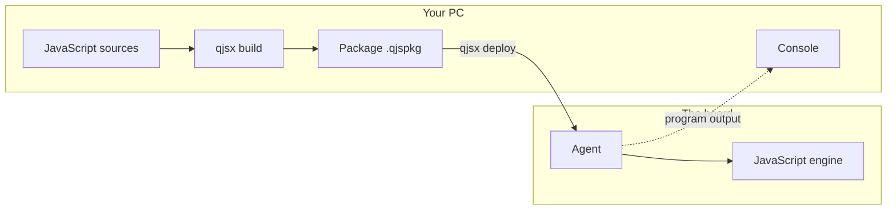

# qjsx

**Modern JavaScript on a microcontroller, written and debugged from your PC.**

qjsx runs JavaScript programs on small boards such as the ESP32-S3. You write the program on
your computer, one command prepares it, another sends it to the board, and it starts.

The JavaScript engine is [QuickJS](https://bellard.org/quickjs/) by Fabrice Bellard: classes,
`async` / `await`, modules, promises… the whole language of today, in a few hundred kilobytes.

> **Work in progress.** The foundations run on a real board, but important pieces are still
> missing. See [Where the project stands](#where-the-project-stands).

## The idea



- **The PC does the heavy work.** It compiles the program and keeps everything that debugging
  needs (sources, variable names, positions).
- **The board stays light.** It receives a program that is already compiled, and runs it.
  There is no compiler on the board: the firmware is about 700 KB.
- **One firmware per board.** You flash it once; after that you only send programs, in a
  second or two.

## An example

A project is a folder with a `qjsx.json` file and some sources:

```json
{
    "name": "hello",
    "main": "src/main.js"
}
```

```js
// src/main.js
import { join } from "stdlib/path";

const log = join("data", "log.txt");
let turns = 0;

setInterval(() => {
    turns++;
    console.log(`turn ${turns}, the log would go to ${log}`);
}, 1000);
```

Build it, then send it to the board and watch what it prints:

```bash
qjsx build
```

```bash
qjsx deploy --target serial:COM3@921600 --monitor
```

The same program also runs on the PC, without a board:

```bash
qjsx run src/main.js
```

To debug it in VS Code, start the debugger server of the project:

```bash
qjsx debug --target serial:COM3@921600
```

then attach VS Code to it, with this configuration in `.vscode/launch.json`:

```json
{
  "type": "node",
  "request": "attach",
  "name": "qjsx: attach",
  "address": "127.0.0.1",
  "port": 9339,
  "autoAttachChildProcesses": false,
  "attachExistingChildren": false,
  "skipFiles": [],
  "sourceMaps": false,
  "enableContentValidation": false
}
```

## What is inside

- **`qjsx`, a command-line tool**: a single executable to build, send, start, stop and watch a
  program.
- **A firmware for the ESP32-S3**, which receives programs over the serial port and runs them.
- **Libraries**: the standard library (`stdlib`) comes with the tool, and you can make your
  own with `qjsx mklib`. Only the modules a program really imports go to the board.
- **What it takes to write native modules**: a small C++ library that exposes C++ code to
  JavaScript without the usual pain.
- **The foundations of a debugger**: breakpoints, stepping, pause, reading and changing
  variables already work on the board.

A few safety nets are already there: the tool warns when a program uses `eval()`, which does
not exist on the board, and the board refuses a program prepared for another version of the
engine instead of crashing.

## Where the project stands

| | Status |
|---|---|
| `qjsx` tool on Windows | works |
| `qjsx` tool on Linux and macOS | written, not tried yet |
| ESP32-S3 firmware (YD-ESP32-S3 board, 16 MB flash, 8 MB PSRAM) | works |
| Sending and running a program over the serial port | works |
| Libraries (`.qjslib`) | works |
| Debugger on the board | works |
| Debugger in VS Code (`qjsx debug`) | works (conditional breakpoints and logpoints to do) |
| Hardware modules (GPIO, I2C, SPI, WiFi…) | to do |
| Files on the board | to do |
| Native USB link, WiFi link | to do |
| RP2350 board (Olimex PICO2-XXL) | planned |

In short: today you can run JavaScript on the board and watch it, but you cannot yet blink an
LED from that JavaScript.

## Building

You need `gcc`, `make` and [premake5](https://premake.github.io/). On Windows the project is
built with MinGW-w64.

```bash
premake5 gmake --cc=gcc --shell=posix
```

```bash
make -C build config=release
```

The tool is then in `bin/Release/`. To run the tests:

```bash
bash tests/run-tests.sh Release
```

The firmware is built with [ESP-IDF](https://docs.espressif.com/projects/esp-idf/) 6.1, from
the `ports/esp32` folder.

## Going further

The detailed documentation is in the [`doc/`](doc/) folder:

- [architecture.md](doc/architecture.md): how it is all designed, and the status of each part;
- [engine-changes.md](doc/engine-changes.md): what was changed in QuickJS, and why;
- [new-device.md](doc/new-device.md): how to run qjsx on a new board or a new chip;
- [coding-rules.md](doc/coding-rules.md): the rules the code is written by;
- [known-bugs.md](doc/known-bugs.md) and [history.md](doc/history.md): the known defects, and
  those that were fixed.

[TODO.md](TODO.md) (in French) lists what comes next.

## Credits and license

qjsx is built on [QuickJS](https://bellard.org/quickjs/), by Fabrice Bellard and Charlie
Gordon, distributed under the MIT license. Its original version, unmodified, is kept in
`engine/qjs-bellard/`.

The project is distributed under the MIT license: see [LICENSE](LICENSE).
