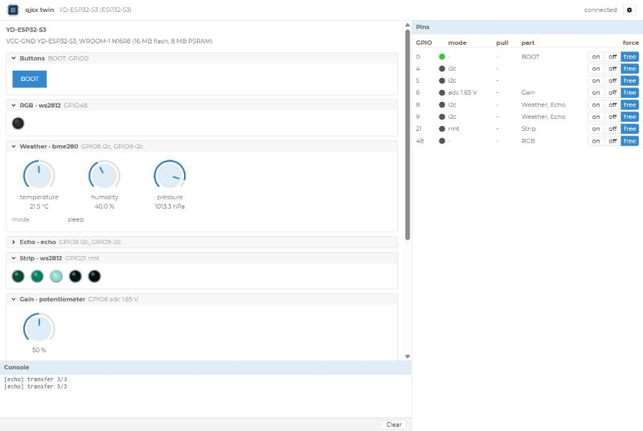

# qjsx

**Modern JavaScript on a microcontroller, written and debugged from your PC.**

*Think CircuitPython or MicroPython, but in modern JavaScript — with a real debugger in VS Code.*

qjsx runs JavaScript programs on small boards such as the ESP32-S3 or the Teensy 4.0. You write the program on
your computer, one command prepares it, another sends it to the board, and it starts.

The JavaScript engine is [QuickJS](https://bellard.org/quickjs/) by Fabrice Bellard: classes,
`async` / `await`, modules, promises… the whole language of today, in a few hundred kilobytes.

📖 **[The manual of the JS developer](https://rlibre.github.io/qjsx/)** — getting started,
guides, and the reference of every module.

> **Work in progress.** The foundations run on a real board, but important pieces are still
> missing. See [Where the project stands](#where-the-project-stands).

## The idea


- **The PC does the heavy work.** It compiles the program and keeps everything that debugging
  needs (sources, variable names, positions).
- **The board stays light.** It receives a program that is already compiled, and runs it.
  There is no compiler on the board: the firmware is about 700 KB.
- **One firmware per board.** You flash it once; after that you only send programs, in a
  second or two.

## An example

A project is a folder with a `qjsx.json` file and some sources:

```json
{
    "name": "hello",
    "main": "src/main.js"
}
```

```js
// src/main.js
import { join } from "stdlib/path";

const log = join("data", "log.txt");
let turns = 0;

setInterval(() => {
    turns++;
    console.log(`turn ${turns}, the log would go to ${log}`);
}, 1000);
```

Build it, then send it to the board and watch what it prints:

```bash
qjsx build
```

```bash
qjsx deploy --target serial:COM3@921600 --monitor
```

The same program also runs on the PC, without a board:

```bash
qjsx run src/main.js
```

To debug it in VS Code, start the debugger server of the project (`--restart` starts the
program again each time VS Code attaches, so that its startup code can be debugged):

```bash
qjsx debug --target serial:COM3@921600 --restart
```

then attach VS Code to it, with this configuration in `.vscode/launch.json`:

```json
{
  "type": "node",
  "request": "attach",
  "name": "qjsx: attach",
  "address": "127.0.0.1",
  "port": 9339,
  "autoAttachChildProcesses": false,
  "attachExistingChildren": false,
  "skipFiles": [],
  "sourceMaps": false,
  "enableContentValidation": false
}
```

VS Code does not talk to the board itself: `qjsx debug` stands in between, with everything
the board does not have.


## What is inside

- **`qjsx`, a command-line tool**: a single executable to flash the firmware of a board, build,
  send, start, stop and watch a program, read and write the files of the board, and see which
  functions take its time (`qjsx profile`).
- **Firmwares for the boards**: the ESP32 family — the original ESP32 and the ESP32-S3 over
  their serial port, the ESP32-P4 over the chip's own USB — then the Teensy 4.0 and the RP2350,
  over their own USB port. Each one receives programs and runs them. A board that runs Linux
  needs no firmware: the cross-built tool runs there and plays the device.
- **Color displays**: `stdlib/display` draws rectangles, lines, arcs, rounded rectangles,
  smoothed text and PNG images, on an SPI display (the ST7796 of the WT32-SC01: about 15 images
  a second for two animated gauges) or on the panel built into the board (720 x 1280 on the two
  ESP32-P4 boards: about 185 images a second, drawn by a task of its own); `stdlib/touch` reads
  the touch panel in front of it. On an SPI display nothing keeps a copy of the screen — the
  image is rendered a few rows at a time while it goes out — and the fonts and the images stay
  in flash.
- **Libraries**: the standard library (`stdlib`) comes with the tool, and you can make your
  own with `qjsx mklib`. Only the modules a program really imports go to the board (see
  below), and inside them only what it uses: `qjsx build` leaves out the functions, classes
  and constants that nothing calls (each one would cost about 200 to 300 bytes of RAM on the
  board), and says which.
- **What it takes to write native modules**: a small C++ library that exposes C++ code to
  JavaScript without the usual pain.
- **The foundations of a debugger**: breakpoints, stepping, pause, reading and changing
  variables already work on the board.

What `qjsx build` produces, and what of it reaches the board:


A few safety nets are already there: the tool warns when a program uses `eval()`, which does
not exist on the board, refuses an import of a name that the module does not export (with
its line and column, instead of an error on the board), and the board refuses a program
prepared for another version of the engine instead of crashing.

Programs of a board are tasks that wait (`await`): the engine waits without allocating
memory, so an `await` of an async function costs a few microseconds on an ESP32-S3 or a
Teensy 4.0.

## A digital twin of the board

No board at hand? The tool can play one. `qjsx agent` becomes the **digital twin** of a
board: your program runs on the PC exactly as it would on the board, with the same modules
(`device/gpio`, `device/i2c`, `device/adc`...), and you deploy and debug it the same way.


A web page shows the board and lets you act on it:



- **the parts of the board**: its BOOT button (hold it down), its RGB LED (it lights as the
  program drives it); its screen (it shows what the program draws, at the speed
  of the real board's SPI bus); the needle meters of its analog outputs;
- **the parts you wire on it**, declared in the `qjsx.json` of your project: a BME280
  sensor whose temperature, humidity and pressure you turn with knobs, a potentiometer, a
  strip of LEDs... Your program reads the BME280 over I2C with the same driver as on the
  real board;
- **your own parts**: a few lines of JavaScript that answer at an I2C address or drive a pin
  (the API is `qjsx:twin`), with a view of their own if you want one;
- **the pins**: what the program does with each one (input, output, I2C, analog input with
  its voltage), and buttons to force a pin to 0 or 1;
- **the buses and ports**: the transfers of an I2C bus, the traffic of each UART, and TCP
  ports so that a program of your PC can play the other end of a UART or of a USB port;
- a console for the parts, light and dark themes, panels you can move around.

```json
"target": "twin",
"twin": {
    "board": "yd-esp32-s3",
    "parts": [
        { "id": "meteo", "model": "bme280", "label": "Weather", "i2c": { "sda": 8, "scl": 9 }, "address": "0x76" },
        { "id": "gain", "model": "potentiometer", "label": "Gain", "pin": 6 }
    ]
}
```

```bash
qjsx agent          # in the folder of the project: the twin, its page on http://127.0.0.1:8090/
qjsx deploy         # "target": "twin" sends the program to it
```

The twin runs at the speed of the PC, not of the board.

## Where the project stands

What a program, and the tool, can do on each chip:

| | PC | Twin | ESP32 ¹ | RP2350 | RT1062 | Linux |
|---|:--:|:--:|:--:|:--:|:--:|:--:|
| **The link and the tool** | | | | | | |
| Link over the board's UART ² | — | — | ✓ | — | — | — |
| Link over the chip's own USB ² | — | — | ✓ | ✓ | ✓ | — |
| Link over TCP | ✓ | ✓ | — ³ | — | — | ✓ |
| Send and run a program (`qjsx deploy`) | ✓ | ✓ | ✓ | ✓ | ✓ | ✓ |
| Debugger from VS Code (`qjsx debug`) ⁴ | ✓ | ✓ | ✓ | ✓ | ✓ | ✓ |
| Flash the firmware (`qjsx flash`) ⁵ | — | — | ✓ | — | — | — |
| Sampling profiler (`qjsx profile`) ⁶ | ✓ | ✓ | ~ | ~ | ~ | ✓ |
| **The program** | | | | | | |
| Package kept in flash, run from it ⁷ | — | — | ✓ | ✓ | ✓ | — |
| Package loaded in RAM (`deploy --ram`) | ✓ | ✓ | ✓ | ~ | ~ | ✓ |
| Libraries (`.qjslib`), `stdlib` written in JS | ✓ | ✓ | ✓ | ✓ | ✓ | ✓ |
| Fonts and PNG images kept in flash (`with { type: "bytes" }`) | ✓ | ✓ | ✓ | ~ | ~ | ✓ |
| Files of the program (`sys/fs`) ⁸ | ✓ | ✓ | ✓ `/data` | — | — | ✓ |
| Permissions of a program of the PC ⁹ | ✓ | — | — | — | — | — |
| TCP sockets (`sys/net`) | ✓ | — | — ³ | — | — | ✓ |
| **The hardware** | | | | | | |
| `device/gpio` | — | ✓ | ✓ | ✓ | ✓ | — ¹⁰ |
| `device/pwm` | — | ✓ | ✓ | — | ✓ | — ¹⁰ |
| `device/i2c` | — | ✓ | ✓ | — | — | — ¹⁰ |
| `device/spi` | — | ✓ | ✓ | — | — | — ¹⁰ |
| `device/adc` | — | ✓ | ~ | — | — | — |
| `device/dac` ¹¹ | — | ✓ | ✓ | — | — | — |
| `device/rmt`, `stdlib/rgbled` | — | ✓ | ✓ | — | — | — |
| `device/serial` ¹⁴ | ✓ | ✓ | ~ | — | — | ~ |
| `device/usb`, the board as a USB device ¹² | — | ✓ | ✓ | — | — | — |
| `device/board` (id, MAC, memory, load, restart) | — | ✓ | ✓ | — | ✓ | ✓ |
| `device/wifi` ³ | — | — | — | — | — | — |
| **The screen** | | | | | | |
| `sys/draw`, `stdlib/display` ¹³ | — | ✓ | ✓ | — | — | ✓ |
| `stdlib/touch` ¹³ | — | ✓ | ✓ | — | — | ✓ |

**✓** works, and was tried on the real hardware (for the PC and the twin: by the test suite).
**~** it is in the build and compiles, but has not been seen working on that hardware, often
because nothing was wired to the board at hand. **—** not there.

The columns: **PC** a program of the PC (`qjsx run`); **Twin** the digital twin of a board;
**ESP32** the original ESP32 (WT32-SC01), the ESP32-S3 (YD-ESP32-S3, ESP32-S3-DevKitC-1 N8R8)
and the ESP32-P4 (M5Stack Tab5, Waveshare ESP32-P4-Module-DEV-KIT); **RP2350** Olimex
PICO2-XXL; **RT1062** Teensy 4.0; **Linux** a board running Linux, where the tool itself is
the agent (STM32MP157-DK2).

¹ One firmware serves every ESP32 chip, so a mark in that column holds for the whole family
unless a footnote says otherwise. There is one original ESP32 board here, two ESP32-S3 and two
ESP32-P4, and not every module could be tried on each: `device/i2c`, `qjsx flash` and the fonts
and images read in flash were seen on the original ESP32 and on an ESP32-P4, not on an S3;
`device/spi` only on the original ESP32 (its display); `device/rmt` with `stdlib/rgbled`,
`device/usb`, `device/board` and a package loaded in RAM only on an S3; the files of `/data` on
the original ESP32 and an S3, not on a P4; `device/pwm` on an S3 (with an oscilloscope) and on a
P4, whose timer clock is taken as 80 MHz from the PLL without having been measured;
`device/adc` on none of them.

² The link of the agent is the console of the board: UART0 where the board has a USB-serial
bridge (the original ESP32 and the ESP32-S3 boards here), the chip's own USB Serial/JTAG where
the board has nothing else (both ESP32-P4 boards; the original ESP32 has no USB at all, and no
S3 board here puts its console there). The RP2350 and the Teensy 4.0 have only their own USB.
The PC sees either one as a serial port.

³ A board reaches the network through WiFi, which is designed but not written; `sys/net` and a
link over TCP to a board wait for it.

⁴ Breakpoints, stepping, pause, call stack, reading and changing variables, `console` output.
Conditional breakpoints, logpoints and hit counts are still to do.

⁵ `qjsx flash` speaks to the ROM loader of the ESP32 chips. The RP2350 and the Teensy 4.0 are
flashed by their own tools (`tools/pico.ps1`, `tools/teensy.ps1`).

⁶ The tool always has it; a firmware only when it is built with `-DQJSX_PROFILER=ON`.

⁷ The PC, the twin and a Linux board keep the packages as files of a folder, not in flash.

⁸ On an ESP32 the files of the program live on LittleFS in the `data` partition, mounted on
`/data`, and the program reaches nothing outside it. `sys/fs` is in the firmware of the RP2350
and the Teensy 4.0 too, but they have no file system yet: every call fails with `ENOSYS`.

⁹ The Deno-like permissions (files, network, environment, serial ports) are for a program of
the PC. A program of a board, of the twin or of a Linux board is confined to its data folder.

¹⁰ On a Linux board these modules are registered so that the static imports of
`stdlib/display` and `stdlib/touch` resolve; they drive nothing.

¹¹ Only the chips that have a DAC: the original ESP32 (GPIO25, GPIO26) and the ESP32-S2 — not
the S3, not the P4. Flashed on the original ESP32; its output has not been measured yet.

¹² Only the chips with USB OTG: the ESP32-S2, S3 and P4; tried on an S3. This is the board's
own USB port offered to a host as a device, not the link of the agent.

¹³ A screen needs a firmware built for a board that has one: the WT32-SC01 (an ST7796 on SPI)
and the two ESP32-P4 boards (a MIPI-DSI panel built into the board), each with its touch
controller on I2C. No ESP32-S3 board here has a display. On a Linux board the display is the
kernel's (DRM) and the touch panel is read as an input device.

¹⁴ On a board, `device/serial` opens the UARTs of the chip (never the one that carries the
link of the agent). On the PC and on a Linux board it opens the serial ports of the system
(`COM3`, `/dev/ttyUSB0`); its POSIX side is built but was not tried.

The tool is built for Windows, and cross-built for 32-bit Arm Linux (that is what runs on the
Linux board); a Linux x64 build and a macOS build have not been made yet.

In short: programs run and are debugged from VS Code on the original ESP32, the ESP32-S3, the
ESP32-P4, the RP2350, the Teensy 4.0 and a Linux board. Pins, PWM, I2C, SPI, a color display
with its touch panel, the files of the board and USB are there; WiFi, and with it the network
and a link over TCP to a board, is the main piece missing. Several modules compile but have
never been wired to a board: the table says which.

## Building

You need `gcc`, `make` and [premake5](https://premake.github.io/). On Windows the project is
built with MinGW-w64.

```bash
premake5 gmake --cc=gcc --shell=posix
```

```bash
make -C build config=release
```

The tool is then in `bin/Release/` (`config=debug`: `bin/Debug/`, with debug info and
asserts; `config=profile`: the code of Release with its debug info, for
`tools/profile/profile.sh`). To run the tests:

```bash
bash tests/run-tests.sh Release
```

The firmwares, one per board:

| Boards | Folder | Built with |
|---|---|---|
| ESP32-S3: YD-ESP32-S3, ESP32-S3-DevKitC-1 N8R8 | `ports/esp32` | [ESP-IDF](https://docs.espressif.com/projects/esp-idf/) 6.1 (`tools/idf.ps1`) |
| Original ESP32: WT32-SC01 (display and touch) | `ports/esp32` | the same |
| ESP32-P4: M5Stack Tab5, Waveshare ESP32-P4-Module-DEV-KIT (display and touch) | `ports/esp32` | the same |
| Teensy 4.0 (i.MX RT1062) | `ports/imxrt1062` | NXP's [MCUXpresso SDK](https://github.com/nxp-mcuxpresso) 26.06 LTS, FreeRTOS, the Arm GNU toolchain; flashed with `teensy_loader_cli` (`tools/teensy.ps1`) |
| RP2350: Olimex PICO2-XXL | `ports/rp2350` | the pico-sdk, FreeRTOS, the Arm GNU toolchain (`tools/pico.ps1`) |

One firmware serves every board of the same chip family; the board is chosen at build time.
An ESP32 board is flashed by the tool itself (`qjsx flash --board <name> --port COM3`). A
Teensy running qjsx is flashed again without its button: the tool asks it for its loader
through its USB serial port.

A board running Linux needs no firmware: the tool itself, cross-built for the board
(`premake5 gmake --cc=gcc --shell=posix --cross=linux-arm`), runs there as `qjsx agent`.

## Going further

The detailed documentation is in the [`doc/`](doc/) folder:

- the manual of the JS developer, published at **<https://rlibre.github.io/qjsx/>**: the
  guides, and the reference of every module, generated from its typings. Its sources are
  in [jsmanual/](doc/jsmanual/), to read it as it is being written: `npm install` then
  `npm run dev` in that folder;
- [architecture.md](doc/architecture.md): how it is all designed, and the status of each part;
- [engine-changes.md](doc/engine-changes.md): what was changed in QuickJS, and why;
- [new-device.md](doc/new-device.md): how to run qjsx on a new board or a new chip;
- [coding-rules.md](doc/coding-rules.md): the rules the code is written by;
- [known-bugs.md](doc/known-bugs.md) and [history.md](doc/history.md): the known defects, and
  those that were fixed.

[TODO.md](TODO.md) (in French) lists what comes next.

## Credits and license

qjsx is built on [QuickJS](https://bellard.org/quickjs/), by Fabrice Bellard and Charlie
Gordon, distributed under the MIT license. Its original version, unmodified, is kept in
`engine/qjs-bellard/`.

The page of the digital twin (`host/twin/ui/`) is built with [x4js](https://x4js.org), by
R-libre ingénierie, distributed under the MIT license.

The project is distributed under the MIT license: see [LICENSE](LICENSE).
