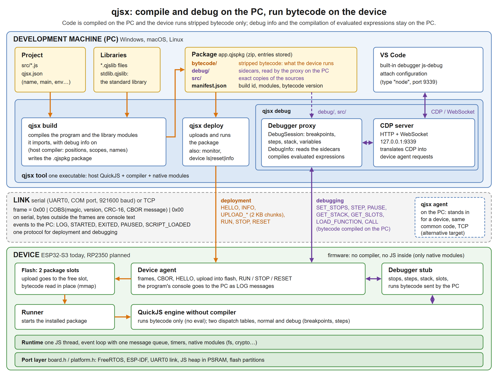
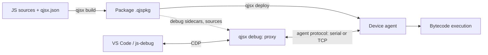
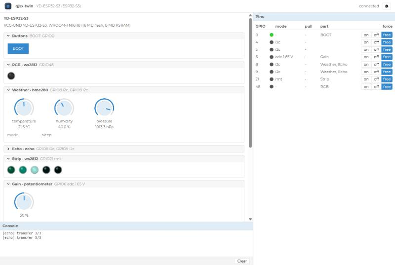

# qjsx: design and reference

This document describes the architecture of qjsx: a JavaScript runtime based on QuickJS, for the
development machine (Windows, macOS, Linux) and for devices (see below), together with a
debugger usable from VS Code.

It gathers the decisions taken (recorded in [`CLAUDE.md`](../CLAUDE.md)), the description
of the split engine ([quickjs-map.md](quickjs-map.md)), the measurements
([quickjs-split-perf.md](quickjs-split-perf.md)), the generator
([tools/quickjs-split](../tools/quickjs-split/README.md)) and the task list
([`TODO.md`](../TODO.md)). If this document and `CLAUDE.md` disagree, `CLAUDE.md`
prevails.

**Device.** In this document, a *device* is a target board that runs the programs
(precompiled bytecode, debug and deployment agent, no compiler):

- the **ESP32** (ESP32-S3, YD board with a WROOM-1 module, PSRAM): ported, runs on the board;
- the **RP2350** (Olimex PICO2-XXL, RP2350B, 8 MB of PSRAM): ported (pico-sdk + FreeRTOS
  SMP, USB link, JS heap in PSRAM), runs on the board.

This list will grow: what is said of a device holds for any new target
(one more port in `ports/`, one implementation of `board.h`). A chip is named only
for what is specific to it (ESP-IDF, `esp_partition_mmap`, RP2350 boot ROM…).



The source of this image is [architecture.svg](architecture.svg) (edit the SVG, then
render it again as `architecture.png`).

## How to read this document

Each section carries an explicit status:

| Status | Meaning |
|---|---|
| **done** | the code exists in the repository and has been tested or measured |
| **in progress** | part of the code exists; the status block says what is done and what is not |
| **designed, not implemented** | the decision is taken, no code exists |
| **to verify** | a point that the sources explicitly mark as still to be confirmed |

The decisions marked as taken in `CLAUDE.md` are not reopened without the author of the
project.

## Contents

1. [Overview](#1-overview)
2. [The QuickJS engine](#2-the-quickjs-engine)
3. [The debugger](#3-the-debugger)
4. [Formats and protocol](#4-formats-and-protocol)
5. [The runtime](#5-the-runtime)
6. [The host tool `qjsx`](#6-the-host-tool-qjsx)
7. [Open points and points to verify](#7-open-points-and-points-to-verify)
8. [Appendices](#8-appendices)

---

## 1. Overview

> **Status: in progress** (2026-11-11). What runs today, on the PC and on an ESP32-S3 board:
> the engine (section 2), the packages and the libraries (4.1, 4.5), the device agent and its
> protocol (4.3), the runtime (5), the host tool (6) and the ESP32-S3 firmware (5.5). For the
> debugger, the part that lives on the device is done and tested (4.3); the host part (proxy,
> CDP server, VS Code) is not written (section 3). Not started: hardware modules (GPIO,
> I2C…), files on a device, WiFi links. The RP2350 port is written and builds (5.5), not tried
> on the board yet.

### 1.1 Goals

- Run modern JavaScript (promises, `async`/`await`, classes, modules) with QuickJS,
  on the development machine and on the devices.
- Debug from VS Code the code that runs on a device: breakpoints, stepping,
  variable inspection, expression evaluation, pause on exceptions.
- Deploy the compiled code to the device through the same channel as debugging.
- Write native modules (C++) visible from JavaScript easily.

"Development machine only" debugging is not a goal: the architecture aims at a remote
target.

### 1.2 Targets

| Target | Role |
|---|---|
| Development machine (Windows, macOS, Linux) | runs the host tool `qjsx` (compilation, package, deployment, debug proxy); can also run scripts |
| Device (ESP32, RP2350…) | runs the precompiled bytecode, the device agent (debug and deployment); no compiler, no `eval` |

### 1.3 Components

| Component | Where it runs | Role |
|---|---|---|
| QuickJS engine | host and device | interpreter; the compiler exists only on the host |
| Host tool `qjsx` | host | one executable: host QuickJS + C modules (event loop, sockets, serial port, SHA-256, compile API); its commands are written in JS, embedded as source and compiled when the tool starts. The standard library is delivered next to it (`stdlib.qjslib`) |
| Firmware + device agent | device | runs the scripts; the agent ("device agent") contains the debug stub and receives the deployments |
| Debug proxy (not written) | host, in `qjsx debug` | CDP adapter written in JS; translates CDP into agent messages; compiles the expressions to evaluate |
| VS Code + js-debug | host | debugger client, built into VS Code, speaks CDP |

### 1.4 The end-to-end flow

1. The developer writes JavaScript sources in a project described by `qjsx.json`.
2. `qjsx build` compiles the sources with the host compiler ("debug info" option), and
   produces a `.qjspkg` package: bytecode, debug sidecars, copy of the sources, manifest, with
   the library modules the program imports (4.5). Planned, not done: it also writes the
   `.d.ts` typings of the native modules for VS Code.
3. `qjsx deploy` sends the package to the device, through the agent, which writes it to
   flash. It sends a reduced package (2026-11-11): the manifest (`"reduced": true`) and
   `bytecode/` only; the debug sidecars and the sources stay in the full package on the PC.
   Before sending, it checks that the firmware has every native module the program
   imports (the agent lists them in its answer to `HELLO`). With `--ram` (2026-11-12) the
   package goes to the RAM of the device instead: nothing is written to the flash, the
   package runs instead of the installed one until the next restart of the device
   (`common/agent/ram_storage.*`: the exact size, from the C heap; refused when it does not
   fit). `qjsx debug` loads the project's latest package that way by default
   (`--no-upload`: debug what the device has). With `--reset` (flash only), the tool
   restarts the device after installing and waits for it to come back (`Device.reopen`:
   a native USB port goes away meanwhile); the program starts at boot, as after a power on.
4. The device runs the bytecode, with no compilation on the target.
5. Planned, not written: `qjsx debug` starts the proxy. It opens a CDP server for VS Code
   (through js-debug) and talks to the device agent over a serial or TCP link. It finds the
   debug sidecars thanks to the build ids that the agent reports to it.



### 1.5 Links between the host and the device

Three links are planned: serial (UART, COM/USB), WiFi and wired network (TCP). The debug
protocol is independent of the transport: the same framing applies everywhere (section 4.3).
Done today: the serial link of the ESP32-S3 (UART0), and TCP for the desktop agent that stands
in for a board.

---

## 2. The QuickJS engine

### 2.1 Version and choices

> **Status: done.**

- Engine: QuickJS by Fabrice Bellard, version **2026-06-04** (`engine/qjs-bellard/VERSION`). It is
  not quickjs-ng.
- mquickjs was evaluated and rejected: it is an ES5 subset (no `Promise`/`async`, no
  classes, no modules…).
- `engine/qjs-bellard/` contains the upstream engine, unmodified. The local patches of 2021 were
  dropped.

`quickjs.c` is 61,197 lines long: 1,562 functions, 142 types, 97 data tables. The map of the
modules of this file (line ranges, dependencies) is in [quickjs-map.md](quickjs-map.md),
and the list of every item in [quickjs-items.csv](quickjs-items.csv).

### 2.2 The split engine (`engine/qjsx/`)

> **Status: done.** Generated automatically, tested and measured (section 2.4), then modified
> by hand since 2026-11-10 (section 2.3 and [engine-changes.md](engine-changes.md)).

`engine/qjsx/` contains the same engine split into **55 source files** by the generator. The
hand changes added three files: `quickjs-debug.h`, `core/debug.c` and
`compiler/debug-info.c`. Each generated file
states at its top the lines of `quickjs.c` it comes from (for example `builtins/json.c`:
"Lines of quickjs.c: 23156-23360, 49092-50177").

#### Folders

| Folder | Role | Files |
|---|---|---|
| `core/` | always compiled | 18 files: atoms, bigint-arith, cfunc, closures, conversions, errors, gc, generators, interpreter, intrinsics, iteration, modules, objects, operators, print, properties, runtime, strings |
| `bytecode/` | loading and saving bytecode | opcodes, reader, writer |
| `builtins/` | standard objects, one file per object | 22 files: array, arraybuffer, atomics, base64, bigint, dataview, date, function, global, iterator, json, mapset, math, number, object, promise, proxy, regexp, string, symbol, typedarray, weakref |
| `compiler/` | the compiler, absent from a build without `eval` | 12 files: emitter, eval, finalize, funcdef, parser-class, parser-expr, parser-func, parser-module, parser-stmt, resolve-labels, resolve-vars, tokenizer |

The other files of the engine (`cutils`, `dtoa`, `libregexp`, `libunicode`, `list.h`,
`quickjs.h`, `quickjs-atom.h`, `quickjs-opcode.h`, `LICENSE`, `VERSION`) are copied as they are to
the root of `engine/qjsx/`.

The interpreter (`JS_CallInternal`, "computed goto" dispatch, `DIRECT_DISPATCH`) is in
`core/interpreter.c`. The frames (`JSStackFrame`) are chained from
`rt->current_stack_frame`.

#### Headers

- **`quickjs-internal.h`**, included by every file. Its parts, in order, are
  separated by marker comments:
  1. the prelude of `quickjs.c` (lines 1 to 1415: options, `JSRuntime`, `JSContext`, `JSObject`,
     `JSFunctionBytecode`, `JSStackFrame`…) without its prototypes;
  2. `/* ---- macros and types shared between files ---- */`;
  3. `/* ---- prototypes and shared data ---- */`: inclusion of `core/core.h`,
     `bytecode/bytecode.h`, `builtins/builtins.h`;
  4. `/* ---- inline functions shared between files ---- */`.
- **`core/core.h`, `bytecode/bytecode.h`, `builtins/builtins.h`**: prototypes of the functions and
  `extern` declarations of the tables shared between files.
- **`compiler/compiler.h`**: types (`JSFunctionDef`, `JSToken`, `JSParseState`, `BlockEnv`,
  `JSVarDef`…, `TOK_*` enumeration), macros and prototypes private to the compiler. Only the
  files of `compiler/` include it. Nothing outside `compiler/` calls the compiler
  directly, except `JS_NewContext` (in `core/runtime.c`) which calls `JS_AddIntrinsicEval`
  (in `compiler/eval.c`) through the public API.

#### Rules of the split

- Only the functions and tables used in several files lost `static`
  (688 functions, 48 tables); the others stay `static` in their file.
- The size of the shared tables is written in their `extern` declaration, so that `countof()`
  works elsewhere. If a table changes size without the header being updated, the compilation
  fails.
- A macro defined inside a function and used elsewhere (for example `JS_THROW_VAR_RO` in
  `JS_CallInternal`) is copied identically into a header.
- A few items are placed outside their original line range:

| Item | Destination | Reason |
|---|---|---|
| `free_function_bytecode`, `free_bytecode_atoms` | `core/gc.c` | free bytecode at run time, called by the GC |
| `JSOpCode`, `opcode_info` | `bytecode/opcodes.c` | used by the bytecode reader and writer (and later the debugger) |
| `JS_EvalFunction` and the eval dispatch | `core/interpreter.c` | run bytecode that is already compiled |
| `__JS_EvalInternal` | `compiler/eval.c` | single entry point to the compiler |
| `JS_ResolveModule` | `core/modules.c` | |
| `ident_realloc` | `core/strings.c` | |
| `get_line_col` | `core/errors.c` | |
| `js_get_prototype_from_ctor` | `core/objects.c` | |
| `add_export_entry` | `compiler/parser-module.c` | see change 2 below |

#### The generator

The split is produced by `tools/quickjs-split/split.js` (Node), driven by
`tools/quickjs-split/split-config.js`, and started by `tools/quickjs-split/regen.sh`.

Steps of `split.js`:

1. cut `quickjs.c` into top-level units (functions, data, types, macros,
   prototypes), each one remembering the `#if/#elif/#else` context it is in;
2. apply the agreed patches (JSON parser state, module exports);
3. assign each unit to an output file (line ranges + exceptions by name);
4. compute what is shared between files: the shared functions and data lose
   `static` and get a declaration in a header; the shared types, macros and inline functions
   go into a header;
5. write the files and print a report (number of files, shared functions and data,
   compiler functions used outside `compiler/`, unassigned units).

`split-config.js` contains:

- `version` (`2026-06-04`) and `preludeEnd` (1416: the lines before it become
  `quickjs-internal.h`);
- `fileRanges`: a list of `[first line, file]`, each range running up to the next
  entry;
- `overrides`: the items placed outside their range (table above);
- `patches`: the two patches described in 2.3.

`regen.sh` empties the content of `engine/qjsx/{core,bytecode,builtins,compiler}`, runs
`split.js` on `engine/qjs-bellard/quickjs.c`, then copies the other files of the engine.

**Rules of use:**

- `engine/qjsx/` was generated, and now carries changes made by hand: a regeneration would
  erase them, so `regen.sh` refuses to overwrite the folder without `--force`. To move to a
  new version of QuickJS, regenerate in another folder, then reapply
  [engine-changes.patch](engine-changes.patch). The author of the project must be asked
  before the engine is regenerated, or changed outside the work already agreed.
- The line ranges of `split-config.js` refer to the `quickjs.c` of version
  2026-06-04. For another version, they must be checked again.

### 2.3 Changes from the original

> **Status: done.** These are the only two changes made by the generator. The
> changes made by hand for the debugger (since 2026-11-10) are described in
> [engine-changes.md](engine-changes.md); their exact diff is in
> [engine-changes.patch](engine-changes.patch).

1. **JSON.parse has its own state.** In the original, `JS_ParseJSON3` and the JSON tokenizer
   reuse the state of the JavaScript parser (`JSParseState`, `js_parse_init`, `free_token`,
   `js_parse_error`, `js_parse_error_pos`). The patch adds to `builtins/json.c` a state
   of its own (`JSONParseState`, `JSONToken`, `JSON_TOK_*`, `json_parse_init`, `json_free_token`,
   `json_parse_error`, `json_parse_error_pos`) and renames the uses in the JSON ranges. JSON
   therefore no longer depends on the compiler.
2. **Module exports are separated from the parser.**
   - `add_export_entry2` (`core/modules.c`) no longer receives a `JSParseState` and throws an
     ordinary `SyntaxError` ("duplicate exported name");
   - `add_export_entry` (`compiler/parser-module.c`) reports the duplicate with its position in the
     source, then calls `add_export_entry2`;
   - the call in `JS_AddModuleExport` is adapted to the new signature.

The error messages and positions of `JSON.parse` and the duplicate export error are
identical in both versions (section 2.4).

### 2.4 Validation and performance of the split

> **Status: done** (measurements of 2026-11-10, details in
> [quickjs-split-perf.md](quickjs-split-perf.md)).

Conditions: Windows, gcc 13.1.0 mingw64, `-O2 -fwrapv`, no LTO, 20 threads; both
`qjs.exe` are built with the same `qjs.c`, `quickjs-libc.c` and `repl.c` by Bellard.

- **Tests**: Bellard's tests pass with both versions (`test_closure`,
  `test_language`, `test_builtin` with `--std`, `test_loop`, `test_bigint`,
  `test_cyclic_import`, `test_worker`).
- **Compilation**: 47.4 s for the original whatever the number of threads; 7.4 s for the
  split version on 20 threads. A change to `json.c` recompiles in 1.6 s (against
  42.7 s), a change to `quickjs-internal.h` in 6.7 s.
- **Size**: machine code 1,000 KB against 1,112 KB; `qjs.exe` without symbols 1,143 KB against
  1,256 KB.
- **Speed** (`tests/microbench.js`): −3.8% on the total, with per-test differences from −48.4%
  (`array_read`) to +27.5% (`prop_clone`). The explanation put forward (gcc no longer inlines
  across files the `static` functions called once) is an **unverified hypothesis**.

The tests need an extracted release of QuickJS 2026-06-04
(https://bellard.org/quickjs/quickjs-2026-06-04.tar.xz) for `qjs.c`, `qjsc.c`,
`quickjs-libc.c`, `repl.js` and `tests/`. The procedure is in
[tools/quickjs-split/README.md](../tools/quickjs-split/README.md).

### 2.5 Removing the compiler on the device

> **Status: engine without compiler done and validated on the PC on 2026-11-11** (change H of
> [engine-changes.md](engine-changes.md): `qjsx-engine-target`, `qjsx-target`, fixture
> `nocompiler`), then built for the ESP32-S3. The firmware no longer embeds any JS: the
> library modules written in JS (`stdlib/path`) travel as bytecode in the program's
> package (`.qjslib` libraries, section 4.5).

Decision: **no `eval` on the device, debug builds included.** The `compiler/` folder is not
compiled for the device. The JS code arrives on the target already compiled by the development
machine. Everything the debugger evaluates (`Runtime.evaluate`, `evaluateOnCallFrame`,
`callFunctionOn`) is compiled on the host and sent as bytecode.

What the split already allows:

- the compiler (about 13,300 lines, 22% of `quickjs.c`) is isolated in `compiler/` with
  its private header;
- it is already behind an indirection: `ctx->eval_internal`, filled only by
  `JS_AddIntrinsicEval` with `__JS_EvalInternal`. If the pointer is NULL, `JS_EvalInternal` throws
  a `TypeError` "eval is not supported"; this is the path of `JS_Eval`, `JS_EvalThis`,
  `JS_EvalObject`, of the global eval, of the `Function` constructor and of the direct eval;
- `JS_NewContext` called `JS_AddIntrinsicEval`, the only dependency of the rest of the engine
  on the compiler: with `QJSX_NO_COMPILER` defined it no longer does (change H);
- the couplings identified in [quickjs-map.md](quickjs-map.md) (JSON, `free_function_bytecode`,
  `opcode_info`, `js_parse_error` in the exports, mixed roles of the `eval-api`, compiler
  types) are handled by the split (sections 2.2 and 2.3).

The ESP32-S3 firmware is such a build (section 5.5); on the PC, the executable `qjsx-target`
is the tool linked with the engine without compiler, used by the tests to run packages like
a device does.

### 2.6 Compiler changes

> **Status: done on 2026-11-10, with three deviations.** Up-to-date description, files touched and
> tests in [engine-changes.md](engine-changes.md). The text below is the original
> design. Deviations:
> - the positions go through the operand of `OP_line_num` (two bits for the kind), not through a
>   new opcode;
> - the scopes are **source** ranges, not pc ranges;
> - no build id in the bytecode and no per-script table in the reader: a script is
>   identified by the build id of the package and the module name, which is now always present.

- **Statement start positions.** Today, a `pc2line` entry is recorded only
  when `resolve_labels` emits instructions (`add_pc2line_info`). A temporary opcode
  `OP_stmt_pos <offset>` will be emitted:
  - at the start of each statement;
  - at each `catch` clause;
  - at the entry of the function body;
  - at each `return` and at the implicit return;
  - at each loop condition.

  `resolve_labels` attaches it unconditionally to the next emitted instruction. Each
  position carries a kind: statement, return or expression.
- **Variable scopes.** Scope entry and exit markers (without code) are
  passed down to `resolve_labels`, to get the final pcs and therefore the visibility range of
  each variable. Internal variables are flagged; slots in the temporal dead zone
  (TDZ) are reported as such.
- **Function number.** Each `JSFunctionBytecode` gets a 16-bit number (creation
  order), serialized: the version number of the bytecode format changes.
- **Build id.** The top-level function carries a build id, computed by the
  packer on the serialized bytecode with this field set to zero.
- **Function table at read time.** The bytecode reader builds, per script, a
  record (build id + number → function table, entry cleared when the function is
  freed) used by the stub.
- **`debugger;`** compiles to a new opcode `OP_debugger` (no effect without a debugger
  attached). Today, the keyword is ignored by the parser ("currently no debugger").
- **Tail calls always disabled**, in debug as in production: same bytecode in
  both cases, complete call stacks.
- **Collection of the debug sidecar** in `js_create_function`, before the information is
  stripped; the host compiler returns `{ bytecode, debug }` to the host JS, which writes the JSON,
  the manifest and the zip (CRC32 computed in JS).

### 2.7 Interpreter changes

> **Status: done on 2026-11-10, except `sf->call_sp`** (prediction of uncaught
> exceptions, not done). Public API in `engine/qjsx/quickjs-debug.h`, details in
> [engine-changes.md](engine-changes.md), section F. The debugger stub of the device agent
> uses it (section 4.3).

- **Two dispatch tables** (option C): a normal table and a debug table. The debug
  table checks a per-function bitmap of the stop positions. When "computed goto" is
  not available, a per-opcode test is the fallback. Details in 3.2.
- **`sf->call_sp`**: a new field of `JSStackFrame`, saved before each call, for
  the prediction of uncaught exceptions (3.4). The existing field `cur_sp` does not fit:
  it already has a meaning for generators.
- **`OP_debugger`** to execute (see 2.6).

Existing entry points useful to the debugger (lines of the original `quickjs.c`, see
[quickjs-map.md](quickjs-map.md)): `JS_CallInternal` (hooks), `JSStackFrame`, `find_line_num`
(`pc2line` decoding), `build_backtrace`, `compute_pc2line_info`, `js_poll_interrupts` and
`JS_SetInterruptHandler`.

### 2.8 Build

> **Status: done.**

- Toolchain: Windows, gcc 13.1 mingw64, premake5 5.0.0. The makefiles are
  generated with `premake5 gmake --cc=gcc --shell=posix`, then `make -C build config=release`
  (or `config=debug`, `config=profile`). Three configurations: Debug (no optimization,
  debug info, asserts), Release (optimized, no debug info, symbols stripped: about 2.5 MB
  for `qjsx` instead of 10.9 MB with its debug info), Profile (the code of Release with its
  debug info, for `tools/profile/profile.sh`, whose addr2line needs it).
- `premake5.lua` builds the engine as two static libraries, `qjsx-engine` and
  `qjsx-engine-target` (the same without `compiler/`, with `QJSX_NO_COMPILER`), and the tool
  (section 6). `CONFIG_VERSION` comes from `engine/qjsx/VERSION`.
- The devices build the same engine sources through `ports/cmake/qjsx.cmake` (section 5.5).
- The test build that compares the original engine and the split one is apart, in
  `tools/quickjs-split/test/` (it needs node for its benchmark table).

---

## 3. The debugger

> **Status of the whole section: in progress.** This section is the design. What exists
> today (2026-11-11):
> - **done, on the device**: the debugger stub of the agent (`common/agent/debugger.*`):
>   breakpoints and statement stops, pause of a running program, stepping, pause on every
>   exception, stack, slots and properties, changing a variable, loading and calling
>   bytecode compiled on the host. Messages in 4.3; tested through the desktop agent and on the
>   ESP32-S3 (`tests/debugger.test.js`, 52 checks on the board; 72 since the stepping by
>   activation number of 3.3, checked on the desktop agent only);
> - **done, on the host**: the core of the proxy, without CDP (2026-11-11):
>   `host/js/debuginfo.js` (packages indexed by build id, sidecars, byte offsets ↔ lines and
>   UTF-16 columns, where a breakpoint goes, visible variables by scope) and
>   `host/js/debugsession.js` (a session with a device: breakpoints by line kept and set again
>   at each `SCRIPT_LOADED` / `STARTED`, stack with names and lines, variables by name,
>   evaluation as in 3.5, steps). Lines and columns from 0, as in CDP. Tested by
>   `tests/debuginfo.test.js` and `tests/proxy.test.js` (desktop agent);
> - **done, on the host**: the CDP server (2026-11-11): `qjsx debug`, `host/js/websocket.js`
>   (HTTP + WebSocket) and `host/js/cdp.js` (3.9). Tested by `tests/websocket.test.js` and
>   `tests/cdp.test.js` (a client that plays js-debug's part; desktop agent and ESP32-S3).
>   Tried in VS Code itself on 2026-11-11 (desktop agent);
> - **done (2026-11-11, step 4)**: pause on uncaught exceptions (3.4), debugging startup code
>   with `qjsx debug --restart` (3.8), `this` of the frames and object previews in VS Code
>   (3.9). Tested on the desktop agent and on the ESP32-S3;
> - **not done**: conditional breakpoints, logpoints and hit counts (3.6: refused by the CDP
>   server until then, postponed by the user).

### 3.1 Architecture

- **Client**: VS Code, through its built-in debugger js-debug. The protocol on the VS Code
  side is therefore **CDP** (Chrome DevTools Protocol), not DAP.
- **C stub on the target**: minimal, it exposes primitives (frames, variable
  slots, properties, loading and calling bytecode). It is part of the
  device agent, which also handles deployment.
- **Proxy on the host**: the CDP adapter is written in JavaScript and runs in the host
  QuickJS (the `qjsx` executable, not Node). This host QuickJS embeds the compiler: it compiles the
  evaluated expressions and produces the bytecode and the debug sidecars of the scripts.
- **C modules the host needs**: `quickjs-libc` has no sockets and its Windows event
  loop only waits on stdin, timers and workers. The host therefore needs
  C modules for an event loop, TCP sockets and the serial port (section 5).
- **Split debug info**: since the code arrives precompiled,
  the debug info lives on the host, next to the proxy, in a sidecar, and not in the target's
  bytecode. A script is identified by the build id of its package and its module name (3.7).

Division of roles:

| Role | Stub (device) | Proxy (host) |
|---|---|---|
| Stopping on a breakpoint, stepping | detects the stops (dispatch tables, bitmap) | translates lines/columns into positions, computes the bitmaps |
| Variable names, scopes | does not know them | reads them in the debug sidecar |
| Expression evaluation | runs the bytecode it receives | compiles the wrapped expression |
| Conditions, logpoints, counters | evaluates on the spot | compiles |
| Persistent breakpoints | | keeps them and re-applies them |

### 3.2 Breakpoints

**Decision: two dispatch tables (option C).**

- The interpreter has a normal dispatch table and a debug table. The debug
  table checks, for the current function, a **bitmap of the stop positions**.
- Without "computed goto", a per-opcode test is the fallback.
- Opcode patching (replacing an instruction with a stop instruction) was **rejected**:
  the bytecode may be in ROM, and patching complicates stepping.
- The possible stop positions are the statement start positions produced by the
  compiler (2.6).
- The proxy sends the stop positions with the `SET_STOPS` message. It keeps the list of
  breakpoints and re-applies them at each `SCRIPT_LOADED` and after a device restart.

### 3.3 Stepping

All the rules are expressed as "next statement start":

| Command | Stop at the next statement start… |
|---|---|
| over (main step) | in the same frame or in a calling frame |
| into (enter) | anywhere; native functions are stepped over, JS callbacks called from C are entered |
| out (leave) | in a calling frame |

- **Frame comparison** (decided 2026-11-11, replaces the address in the C stack and the stack
  depth): by the **activation number** the engine gives each frame
  ([engine-changes.md](engine-changes.md), L). It is unique and never reused: a frame created
  later at the same place of the C stack never passes for an earlier one. The frame of a
  generator or an `async` function keeps its number across `yield` / `await`.
- **What the stub records when a step starts** (`startStep`, `common/agent/debugger.cpp`):
  - over: the start frame, unless the pause is at its return position (it is ending);
  - over from an `async` function: only that frame. An `await` suspends it and a promise job
    resumes it later, with other callers: the step waits for it, so a step "over" an `await`
    resumes in the same `async` function. A generator suspended by `yield` goes back to its
    caller, which is recorded;
  - otherwise, over and out: every calling frame that runs bytecode.
- **Where the step stops** (`shouldStopStepping`): at a statement start of a recorded frame.
  While a recorded frame is still on the stack below, the code it called runs without
  stopping. When none is left (end of a callback of the event loop, out of an `async`
  function resumed by a promise job, uncaught exception), the step goes on as an "into", as
  V8 does: it stops at the first statement run outside the start frame.
- **Known limit**: an `async` function that ends with an exception after a step "over" from
  inside it is never resumed; stepping stays on (slower program) until the next pause.
- **Additional stops**: at the start of a `catch` clause, and at function end (at each
  `return` and at the implicit return) to show the return value.

### 3.4 Pause on exceptions

Two modes, set by `SET_EXCEPTIONS` (done on 2026-11-11):

- **"all"**: pause at the `throw`, before the stack is unwound.
- **"uncaught"**: the engine predicts at the `throw` whether a handler will catch the value
  ([engine-changes.md](engine-changes.md), M), and the stub pauses only when none will.
  The prediction is computed only when a debugger is attached (no cost otherwise):
  - in the throwing frame, from its real stack: a `catch` offset, except offset 0 (iterator
    close) and a handler that rethrows (`gosub; throw` or `throw`: a `finally`);
  - in each calling frame, statically: is its pc inside the try region of a `catch`
    clause (from an `OP_catch` to its handler)? Native frames let the value through;
  - an `async` function counts as catching (the value becomes a rejection), except the
    top-level function of a module (QuickJS compiles modules as async functions, but their
    rejection is the failure of the module);
  - nothing down to the bottom of the stack: uncaught.

  It replaces the `sf->call_sp` of the first design, which needed a store before every
  call. Approximation: a throw in a promise callback (`then`) is predicted uncaught
  although it becomes a rejection. `PAUSED` carries `UNCAUGHT` (the prediction), passed
  to VS Code as `data.uncaught`.
- **Unhandled promise rejections** (reported through the "promise rejection tracker"): not
  done.
- An uncaught exception of the program is printed on its error output (a `LOG` message
  during a session), and the program goes on. A dedicated event is not done.

### 3.5 Expression evaluation

- The proxy wraps the expression in a function whose parameters are the variables
  visible at the stop position (known from the debug sidecar), compiles it on the host, then the
  stub runs it (`LOAD_FUNCTION` then `CALL`).
- This covers `Runtime.evaluate`, `Debugger.evaluateOnCallFrame` and `Runtime.callFunctionOn`.
- The js-debug helper functions are loaded only once (`LOAD_FUNCTION`).
- Accessors (getters) are never run implicitly during a `GET_PROPERTIES`.
- Changing a variable goes through `SET_SLOT`.

### 3.6 Conditional breakpoints, logpoints, hit counts

Conditions, logpoints and hit counts are compiled by the proxy and
**evaluated on the device itself**, with no round trip to the host at each hit.

### 3.7 Source / bytecode / sidecar consistency

- Each script has a build id: the first 32 hexadecimal digits of the SHA-256 of its
  bytecode. It is recorded in the manifest of the package and in the sidecar, not in the
  bytecode itself.
- The device reports the build id of the package it runs (`STARTED`, `INFO`) and the name of
  each module it loads (`SCRIPT_LOADED`, `LIST_SCRIPTS`): a script is identified by both.
- The proxy indexes the `.qjspkg` packages it finds to find the package, then the sidecar of
  the module.
- The proxy checks the consistency between the source, the bytecode and the sidecar (the manifest
  contains the hash of the source).
- The scripts are announced to VS Code with `file:///` URLs pointing to the local sources.

### 3.8 Debugging startup code (`qjsx debug --restart`)

> **Status: done on 2026-11-11.** Replaces the first design, a `--wait-debugger` flag kept
> by the agent from one boot to the next (persistent storage on every board, a timeout,
> never on production devices): dropped for now, to reconsider only if what follows a real
> chip reset has to be debugged.

- `qjsx debug --restart` (off by default): js-debug sends `Runtime.runIfWaitingForDebugger`
  once its breakpoints are set; the server then sends `RUN`, so the program starts again
  with the debugger attached. Each module waits at `SCRIPT_LOADED` for its stops, so the
  breakpoints of the startup code are hit.
- VS Code's Restart button (which detaches and attaches again) then restarts the program
  too.
- Only the program restarts, not the chip: the hardware state of the previous run stays.

### 3.9 The CDP server (`qjsx debug`)

> **Status: done on 2026-11-11** (`host/js/websocket.js`, `host/js/cdp.js`, command in
> `host/js/cli.js`), tested by a client that plays js-debug's part; not tried in VS Code
> itself yet.

`qjsx debug [--target t] [--port p] [--host a]`, in a project folder, opens the device and
listens (default 127.0.0.1:9339, `debugPort` of `qjsx.json`; not Node's 9229, which a Node
debugging session may use at the same time). VS Code attaches to it as to a Node.js
inspector (configuration in 6.5).

What js-debug does, read in its sources (main branch, 2026-11-11):

- it asks `GET /json/version` and `GET /json/list` and takes `webSocketDebuggerUrl` (or
  `websocketAddress` from the configuration), then opens the WebSocket;
- an error answer to a command is almost never fatal: the commands the server does not
  serve get "not found" (`-32601`);
- scripts are expected as `file:///` URLs; with a `hash`, js-debug would compare the local
  file and show a read-only copy if they differ: no hash is sent;
- breakpoints come as `Debugger.setBreakpointByUrl` with a JS `urlRegex`, matched against the
  URL of every module; the answer gives `breakpointId` and `locations`, and
  `Debugger.breakpointResolved` follows for the modules loaded later;
- destroying the default execution context closes its session.

What the server does:

- **One client at a time**; a new one replaces the previous one. The device is attached
  (`DEBUG_ATTACH`) when the client first needs it, and detached when it leaves (stops
  removed, a paused program resumes).
- **The session survives the end of the program**: the default context is never destroyed.
  A new run (redeploy, device restart) clears and recreates the context, announces its
  scripts again and binds the breakpoints in the new package.
- **Scripts**: a program module is announced with the URL of its file in the project; a
  library module with a copy of its source written in `<output>/debug-src/` (a URL without
  scheme would be taken by js-debug for a Node internal, and skipped).
- **Identifiers**: `scriptId` per module and per run; `callFrameId` and scope `objectId`
  carry the number of the pause, so that those of a pause that is over are refused;
  `objectId` "h:<handle>" for an object of the device.
- **Commands**: `Runtime.enable` (context 1, `isDefault`), `Debugger.enable`,
  `setBreakpointByUrl` / `setBreakpoint` / `removeBreakpoint` / `getPossibleBreakpoints` /
  `getScriptSource`, `pause` / `resume` / `stepInto` / `stepOver` / `stepOut`,
  `setPauseOnExceptions` ("caught" counts as "all"), `evaluateOnCallFrame`,
  `Runtime.evaluate`, `Runtime.callFunctionOn` (compiled on the host, loaded once per source
  text in the persistent group: js-debug's helpers), `Runtime.getProperties` (scopes and
  objects; getters never called), `Runtime.releaseObject`, `Debugger.setVariableValue`.
  `returnByValue` goes through `JSON.stringify` on the device. Accepted and ignored:
  `Profiler.enable`, `NodeWorker.enable`, `setAsyncCallStackDepth`, `setBlackboxPatterns`,
  `setBreakpointsActive`, the `disable` commands; `runIfWaitingForDebugger` restarts the
  program with `--restart` (3.8).
- **A breakpoint with a condition, and a logpoint, are refused** until 3.6 is done (VS Code
  shows them unbound).
- **Program output** goes to the debug console as `Runtime.consoleAPICalled`, one message
  per line; the end of the program as an "info" message.
- **`this` of the frames**: read at the pause for the frames whose function has a `this`
  slot (QuickJS makes one only when the function uses `this`); elsewhere `undefined`.
- **Object previews** (`generatePreview`): built on the host, one `GET_PROPERTIES` per
  object, at most 5 enumerable own properties, nested values by their description; to
  measure on the board over serial (next step if too slow: a small preview added by the
  stub to each object value).
- **`--restart`**: 3.8. **Uncaught exceptions**: `data.uncaught` of `Debugger.paused`
  (3.4).
- **Not done**: async stack traces, the "global" scope.

---

## 4. Formats and protocol

### 4.1 The `.qjspkg` package

> **Status: done** (`qjsx build`, `host/js/build.js` and `zip.js`; reading
> `common/runtime/package.*`). Current content:
> - `manifest.json`: `format` (1), `name`, `buildId`, `created`, `compiler`
>   (`"qjsx 0.1.0 / QuickJS 2026-06-04"`), `main`, `scripts[]` with, for each one, `path`,
>   `module`, `buildId`, `sourceHash`, and the names of its `bytecode`, `debug`, `source` entries;
>   a module that comes from a library also carries `library` (section 4.5);
> - `libraries[]` (name and version of the libraries used) and `natives[]` (native modules
>   imported, which the firmware must provide);
> - `bytecode`: the bytecode version number of the package (see "Package compiled for
>   another engine" below);
> - `bytecode/<path>.qbc`, `debug/<path>.json`, `src/<path>`;
> - ids: build id of a script = first 32 hexadecimal digits of the SHA-256 of its
>   bytecode; `sourceHash` = SHA-256 of the source; build id of the package = SHA-256 of the
>   ids of the scripts and of the main module; file `<name>-<12 digits>.qjspkg`;
> - zip with stored entries, fixed dates (1980-01-01): same content, same archive.
>
> The bytecode is compiled with every debug info stripped (`strip: "all"`, `JS_STRIP_DEBUG`):
> no source text, positions nor variable names. The engine keeps the module name outside the
> debug info (change A of [engine-changes.md](engine-changes.md)), so `import.meta` still
> works. There is no build id inside the bytecode: a script is identified by the build id of
> its package and its module name.

- **One zip per build**, extension `.qjspkg`. `qjsx build` writes the full package;
  `qjsx deploy` sends the device a reduced one, made on the fly (`reducePackage`,
  `host/js/deploy.js`, 2026-11-11): same extension, `manifest.json` marked `"reduced": true`
  (its scripts without their `debug` and `source` entries) and `bytecode/` only. The build
  id does not change: the debugger finds the full package on the PC by it.
- **Entries stored without compression**: no dependency on a compression library, and
  the device reads the package in place. On the ESP32 the slot of the package is mapped with
  `esp_partition_mmap` and the modules are read from there, without copying the package into
  RAM. The engine still copies the bytecode it loads: `JS_READ_OBJ_ROM_DATA`, which would let
  it run the bytecode straight from flash, is not used. **To try.**
- The zip (with its CRC32) is written by the host JS.

Content:

| Entry | Content |
|---|---|
| `manifest.json` | format version, build id, compiler id, bytecode version, main module, `env`, libraries, native modules, list of the scripts (path, script build id, source hash) |
| `bytecode/` | the bytecode, that is, what goes to the device |
| `debug/` | one JSON debug sidecar per script |
| `src/` | exact copy of the compiled sources |

The exact names of the manifest fields are in the status block above; every hash is a
SHA-256.

**Package compiled for another engine** (done on 2026-11-11). An engine only reads the
bytecode of its own version (QuickJS's `BC_VERSION`, `0x45` today, given by
`JS_GetBytecodeVersion()`). `qjsx build` writes this number in the manifest (`bytecode`), and
it is checked in two places:

1. **When sending.** `qjsx deploy` puts it in `UPLOAD_BEGIN`. The agent compares it to its own and
   refuses at once if it differs: nothing is written, the installed package stays in place, and
   the tool prints the device's message ("the package holds bytecode version 70, this device
   reads version 69: rebuild the package, or flash a firmware that matches qjsx").
2. **When starting.** The loader (`startPackage`, `common/runtime/program.cpp`) reads the
   number again in the manifest before loading any module. This check does not depend on
   what the host says, and covers `qjsx run package.qjspkg` on the PC.

A package without a `bytecode` field (built by an older `qjsx`) is refused in the same
way. The number is only worth something if `BC_VERSION` increases at each engine change that
touches the bytecode: this is a rule of `engine-changes.md` (section K).

**`eval` and `Function` warnings** (done on 2026-11-11). On a device, `eval(...)`
and the `Function` constructor throw "eval is not supported"; on the PC they work.
`qjsx build` and `qjsx mklib` therefore warn, without failing:

```
src/main.js:46:29: warning: eval() needs the compiler, which a device does not have: it throws there
```

The detection is done by the compiler (change K) and it is syntactic: the direct
call `eval(...)`, the call `Function(...)` and `new Function`. An indirect use
(`(0, eval)(x)`, `globalThis.eval`, an alias) is not seen; the run-time error remains the
safety net. A module taken as it is from a library is not recompiled: its warnings
were given by `qjsx mklib`.

### 4.2 The debug sidecar

> **Status: done** (format 2, 2026-11-10). Details in
> [engine-changes.md](engine-changes.md), section E.

One JSON sidecar per script, in `debug/`, collected by the compiler before the information is
stripped: `format`, `path`, `buildId`, `sourceHash`, and `functions`. The index of a
function in `functions` is its function number. Each function carries:

- its name, its source range and the size of its bytecode;
- `positions`: triplets `pc, source offset, kind`, sorted by pc. The kind is 0 for
  an expression (the positions of the original pc2line), 1 for a statement start and 2 for
  a return;
- `arguments`, `locals` (with their scope), `closures`: names and flags (lexical, const,
  captured, global). The index of a variable is its slot in the frame;
- `scopes`: parent and **source range** of each scope. Deviation from the original
  design, which planned pc ranges: the proxy goes from the pc of the stop to a source
  position, then to the scopes that contain it. Internal variables are recognized by their
  name (`<ret>`, `this`, …). A variable in the TDZ reads with the tag `JS_TAG_UNINITIALIZED`.

The positions are **byte offsets in the source**. The proxy derives from them the lines and
the UTF-16 columns that CDP expects.

The link with the bytecode goes through the build id of the script (4.1, 3.7). Variable names
never travel to or from the device: they are read in the sidecar.

### 4.3 The device agent protocol

> **Status: done**, for deployment and for the device side of the debugger. Two
> implementations that must stay equivalent: JS on the host side (`host/js/cbor.js`,
> `frames.js`, `protocol.js`, `device.js`, `deploy.js`) and C++ on the device side (`common/agent/`:
> `cbor`, `frames`, `protocol.h`, `agent` — portable code, for the device and for the desktop agent
> `qjsx agent`). Tested end to end between the two (`tests/run-tests.sh`).
>
> Points fixed at implementation time:
> - **frame**: `0x00 | COBS(0xE5 | version 1 | CRC-16/CCITT-FALSE of the message, 2 bytes
>   big-endian | message) | 0x00`; on a serial link, a segment that does not decode as a
>   valid frame is console text;
> - **message**: CBOR array `[type, id, content]`; `id` > 0 for a request and its response,
>   0 for an event; content = integer-keyed map (or `null`);
> - **types**: `RESPONSE` 1, `ERROR` 2 (`{MESSAGE}`), `HELLO` 10 (`{PROTOCOL, TOKEN?}` →
>   `{PROTOCOL, AGENT, ENGINE, VERSION, MAX_MESSAGE, NATIVES}`; VERSION: qjsx version of the
>   firmware, NATIVES: names of its native modules, 2026-11-11), `INFO` 11 (→ `{RUNNING, BUILD_ID, PACKAGE_SIZE, VOLATILE}`: the package RUN starts, VOLATILE when it is in RAM),
>   `UPLOAD_BEGIN` 20 (`{SIZE, SHA256, BUILD_ID, BYTECODE, VOLATILE?}`, refused if the bytecode number
>   is not that of the device's engine; VOLATILE true: to RAM, refused if it does not fit), `UPLOAD_CHUNK` 21 (`{OFFSET, DATA}`, 2,048
>   bytes, in order), `UPLOAD_END` 22 (checks size and SHA-256, installs), `RUN` 23,
>   `STOP` 24, `RESET` 25; events `LOG` 30 (`{STREAM, TEXT}`), `EXITED` 31 (`{CODE}`),
>   `STARTED` 32 (`{BUILD_ID}`). Key values: `common/agent/protocol.h`;
> - **session**: any request other than `HELLO` is refused before `HELLO`; during the
>   session, the program's console (`console.*`, uncaught exceptions) goes out as `LOG`;
> - **retransmission**: the host resends a request without a response after 3 s (3 tries) with the same
>   id; the agent then resends the remembered response without executing again;
> - **token**: if the agent is started with a token, `HELLO` must provide it.
>
> **Debug part: done on the device side on 2026-11-10** (stub, `common/agent/debugger.*`). The
> messages and the encoding of values are described at the top of `host/js/protocol.js`.
> - **requests**: `DEBUG_ATTACH` 40 to `RELEASE` 54. They include pause, resume, the steps,
>   the stops per function, the exceptions mode, the list of modules, the stack, reading and
>   writing the slots, the properties and internal slots, loading a
>   function compiled on the host, calling, and releasing handles;
> - **events**: `PAUSED` 60, `RESUMED` 61, `SCRIPT_LOADED` 62. After `SCRIPT_LOADED`,
>   the device waits for `RESUME`: the host first sets the stops of the module;
> - **values**: primitives in direct CBOR, objects behind grouped handles (group
>   `PAUSE` released on resume, `CONSOLE`, `PERSISTENT`). Objects are described without
>   running JS;
> - **maximum size of a message**: 64 KB (functions compiled by the proxy). The C++ CBOR
>   now reads and writes floats and `undefined`;
> - **threads**: requests arrive on the transport thread and run on the
>   JS thread:
>   - while paused, in the pause loop;
>   - when idle, through a message of the event loop;
>   - while JS is running, from the interrupt handler, and only the
>     requests that run no JS (`PAUSE`, `SET_STOPS`…);
> - **tested** by `tests/debugger.test.js` through the desktop agent (52 checks:
>   breakpoints, step into / over / out, pausing an infinite loop, variables and closures
>   modified, calling functions compiled on the host, exceptions, `debugger;`);
> - **not done yet**: the "uncaught" prediction (the `UNCAUGHT` mode does not
>   pause), `[[Entries]]` of Map/Set, `--wait-debugger`, conditional breakpoints.

The protocol between the stub and the proxy is called "device agent": it serves debug **and**
deployment.

#### Framing

On every link (serial and TCP), a frame has the form:

`0x00 | COBS(magic | version | CRC-16 | message) | 0x00`

- COBS guarantees that there is no `0x00` byte inside the frame; `0x00` delimits the frames.
- A frame whose CRC is wrong is ignored.
- On a serial link, bytes that do not decode as a valid frame are console text.
  During a session, the agent sends the console of the program (`console.*`, uncaught
  exceptions) as `LOG` messages. The logs of ESP-IDF itself are not wrapped: on UART0 they
  stay plain text between the frames. Wrapping them is planned for the links that are not
  the console.

The magic marker is one byte, `0xE5`; the CRC is CRC-16/CCITT-FALSE (status block above).

#### Encoding

A hand-written subset of **CBOR**: integers, floats, strings, bytes, arrays and
integer-keyed maps.

#### Objects, handles and groups

- Objects stay on the target, behind **handles**, grouped like
  CDP object groups:
  - `pause`: released on resume;
  - `console`;
  - `persistent`.
- Primitive values travel inline.
- Names never travel: they come from the debug sidecar.
- `RELEASE` releases handles.

#### Robustness

- Requests are numbered: a duplicate gets the same response again, without being
  executed again.
- The agent gives the maximum size of a message in its answer to `HELLO` (`MAX_MESSAGE`,
  64 KB).
- Big payloads are chunked (`UPLOAD_BEGIN` / `UPLOAD_CHUNK` / `UPLOAD_END`).

#### Messages

| Category | Messages |
|---|---|
| Opening | `HELLO` (protocol version, token; the answer gives the maximum size), `INFO` |
| Deployment | `UPLOAD_BEGIN`, `UPLOAD_CHUNK`, `UPLOAD_END` (write a `.qjspkg` to flash, or load it in RAM), `RUN`, `STOP`, `RESET` |
| Debug session | `DEBUG_ATTACH`, `DEBUG_DETACH` |
| Execution control | `PAUSE`, `RESUME`, `STEP`, `SET_STOPS`, `SET_EXCEPTIONS` |
| Scripts | `LIST_SCRIPTS` |
| Inspection | `GET_STACK`, `GET_SLOTS`, `GET_PROPERTIES` (without running getters; it also gives the internal slots) |
| Modification | `SET_SLOT` |
| Code execution | `LOAD_FUNCTION`, `CALL` |
| Handles | `RELEASE` |
| Events (agent → host) | `LOG`, `STARTED`, `EXITED`, `PAUSED`, `RESUMED`, `SCRIPT_LOADED` |

The numbers and the fields of each message are in `host/js/protocol.js` and
`common/agent/protocol.h`, which must stay identical. Not done: listing the files of a device.

#### Security over TCP

Design: over TCP, the agent is **disabled by default**, and a **token** is required in
`HELLO`. Done today: the token (the desktop agent started with `--token`). No device has a
TCP link yet.

### 4.4 Position kinds

> **Status: done on 2026-11-10** (engine change E; the kinds are the numbers of the
> `positions` of the debug sidecar, section 4.2).

Each position recorded by the compiler carries a kind:

| Kind | Number | Origin |
|---|---|---|
| expression | 0 | the positions QuickJS already recorded (its pc2line table): error positions, stack traces |
| statement | 1 | statement start, `catch` clause, entry of the function body, loop condition and update: where the debugger can stop |
| return | 2 | each `return` and the implicit return (lets the return value be shown) |

### 4.5 The `.qjslib` libraries

> **Status: done on 2026-11-11** (`qjsx mklib`, `host/js/library.js`, `compile.js`,
> `build.js`; engine change J). Tested by `run-tests.sh` (fixtures `testlib`,
> `uselib`, `dynamicimport`, `nolibrary`) and `tests/tools.test.js`. Not done: checking
> the native modules against the firmware, the `.d.ts`.

**The problem.** A device has no compiler: a module written in JS and embedded as
source in the firmware (this was the case of `path`) cannot load there. And a generic
firmware must not grow with JS that most programs do not use.

**The answer.** The firmware contains no JS, only native modules. Reusable JS
modules live in libraries, `.qjslib` files. `qjsx build` copies into
the program's package the library modules it imports; the device finds them there
like any other module, knowing nothing about libraries.

**Names.** Every module of a library is called `<library>/<module>`, and is imported
under that name, on the model of `node:path`:

```js
import { join } from "stdlib/path";
import { read } from "sensors/bme280";
```

- The standard library is called `stdlib` (`stdlib.qjslib`).
- Native modules are named with a reserved prefix (2026-11-11): `sys/` for the system
  (`sys/fs`, `sys/crypto`, `sys/net`, `sys/compiler`) and `device/` for the hardware of the
  machine the program runs on (`device/serial`, then `device/gpio`…). No library may take
  these names (`qjsx mklib` and `qjsx build` refuse them).
- Two libraries cannot have the same name, so their modules never
  collide.
- Inside a library, a module imports its neighbours by their full name or relatively:
  `"./filter"` from `sensors/bme280` means `sensors/filter`.

**The `.qjslib` file.** A zip with stored entries, laid out like a `.qjspkg`:

| Entry | Content |
|---|---|
| `manifest.json` | `format` (1), `kind` (`"library"`), `name`, `version`, `created`, `compiler`, `bytecode`, `natives[]`, `modules[]` |
| `bytecode/<module>.qbc` | bytecode of the module: a cache, used only by a build whose compiler is the one that produced it |
| `debug/<module>.json` | its debug sidecar (same condition) |
| `src/<module>.js` | its source: what a build made with another compiler recompiles, and what the debugger shows |

Each item of `modules[]` gives `name` (`"sensors/bme280"`), `buildId`, `sourceHash`, the
names of its three entries and `imports` (the names of the modules it imports).

**Making a library: `qjsx mklib [directory] [--output <file>]`.** The command serves
`stdlib` as well as a user's libraries. The folder contains a library
`qjsx.json` (section 6.4): `name`, `version` and `modules`, which maps each
module name to its source file. It compiles each module under its full name, checks
that an import to the library itself does name one of its modules, notes the native
modules imported, and writes `<output>/<name>.qjslib`.

**The standard library.** Its sources are in `lib/stdlib/` (today `path`). The
build of `qjsx` makes `stdlib.qjslib` next to the executable, with the tool it has just
linked; this file is what is shipped, not the sources. The tool finds it in the folder of
its executable (`process.argv[0]` is the full path of the executable, as in Node).

The same sources are also embedded in the host executable, under the same names
(`stdlib/path`): the tool needs them for its own commands, `mklib` among them, before
`stdlib.qjslib` exists, and `qjsx run script.js` uses them for a script started without a build.

**What `qjsx build` does.**

1. It compiles the modules of the program (the files of `sources`).
2. It reads the libraries: `stdlib.qjslib`, then those of `libraries` in `qjsx.json`.
3. It follows the imports of each module. A name that is not a module of the program is:
   - a module of a known library: it is added to the package, whole, and its own
     imports are followed in turn;
   - a `sys/...` or `device/...` name: a native module, recorded in `natives` of the
     manifest (checked by `qjsx deploy` against the modules of the firmware);
   - a bare name (`fs`, the old naming): an error that gives the new form (`sys/fs`);
   - otherwise an error, which names the importing module (relative import not found,
     library not declared, module missing from the library).
4. It writes into the package the bytecode, the debug sidecar and the source of each module, those
   of the libraries under `bytecode/<library>/<module>.qbc`. A library module
   that nobody imports is not copied; there is no finer sorting (function by
   function).

The debugger sees library modules like the others: their sidecar and their source
are in the package.

**Library made by another compiler.** The build compares the compiler
id and the bytecode number of the library (`compiler`, `bytecode` of its
manifest) to its own. If they differ, the library is not refused, since it contains
its sources: its modules are recompiled, and the build says so ("library 'testlib' (...) was
made by another compiler (...): its modules were compiled again from their sources").

**`import()` is forbidden** in a program built by `qjsx build`, and in a
library: the name of a module loaded by `import()` is known only at run time, so the
build could not take it along. The compiler refuses it as a syntax error, with
its position (engine change J). The JS of the tool itself is not concerned.

**Limits.**

- `qjsx run script.js` (without a build) only knows the embedded copy of `stdlib`: a script
  that imports another library must be built, then started with
  `qjsx run package.qjspkg`.
- A typo in the name of a native module (`"cryto"`) is not seen by the build, which does
  not know the firmware; `qjsx deploy` refuses it (2026-11-11): the agent lists the native
  modules of its firmware in its answer to `HELLO` (`NATIVES`) and the tool compares them
  to `natives` of the manifest before sending anything. An older firmware that does not
  list them is not checked.
- If only `lib/stdlib/qjsx.json` changes, `make` does not remake `stdlib.qjslib` (it remakes it
  when the executable is relinked, so as soon as a source of `stdlib` changes).

---

## 5. The runtime

### 5.1 Event loop

> **Status: done** (`common/runtime/loop.h`, `loop.cpp`), for the host (`platform_host.cpp`,
> Windows and POSIX) and for the FreeRTOS devices (`ports/freertos/platform_freertos.cpp`);
> tested by `tests/runtime.test.js` and on the ESP32-S3. On the host, an uncaught exception
> stops the loop with code 1 (`setExitOnUncaught`), like Node; on a device it is printed and
> the program goes on. Not done: posting a message from an interrupt handler.

Same model on every platform (host and device):

- **a single JS thread**;
- **event producers** (drivers, I/O threads, later ISRs on the device) post messages
  into **a single bounded queue**, guarded by `platform::Signal`: a mutex and a condition on
  the host, a mutex and a binary semaphore on FreeRTOS (not a FreeRTOS queue, as first
  planned);
- the loop drains the promise jobs, waits for the next message or timer, then handles it on
  the JS thread;
- messages carry a **source id + a generation**, never a raw pointer
  to an object;
- the event loop of `quickjs-libc` is not used;
- the transport of the debug stub is one more producer; during a pause, a mini-loop
  only handles the debugger's messages.

An uncaught JS exception in a callback on the device is printed, then execution
continues; restarting remains an option.

### 5.2 Async styles

> **Status: rule applied** by the modules written so far (`sys/net`, `device/serial`: callbacks for
> the data and the close, a promise for `connect`). The `uart` example below is the design:
> that module does not exist yet.

- **Callbacks** for spontaneous events: `uart.onData(fn)`.
- **Promises** for operations started by the script:
  `await uart.readLine({ timeout })`.
- A module may offer both.
- Async iteration (`for await`) may come later, built on promises.

### 5.3 C++ ↔ JS binding library

> **Status: done** in `common/jsbind/` (headers only) and tested by `tests/jsbind.test.js`
> with the native module `tests/native/test_module.cpp` (42 checks, no leak in a Debug
> build). It replaces the `uart`/`console` code of `legacy/devices/` (which had bugs,
> `console.cpp` did not compile). It answers the task "make it easier to write C objects
> visible in JS" of `TODO.md`. Not done: the generation of the `.d.ts`.
>
> Deviations from the design:
> - in a `void` function, C++ forbids `return <value>`: one writes
>   `return (void)js::fail(...);` (or `js::fail(...); return;`);
> - a module is declared by a function body: `JS_MODULE(fs, m) { JS_FUNCTION(m, readFileSync); JS_ADD_CLASS(m, Stats); }`,
>   the globals by `JS_GLOBALS(name, g) { ... }`; `JS_FUNCTION_AS(m, cppFunction, "jsName")`
>   when the C++ name clashes (for example `log` of `<math.h>`);
> - additional types: `js::Optional<T>`, `js::Args` (remaining arguments), `js::Created<T>` /
>   `js::create<T>()` to create from C++ an object of a bound class;
> - a pointer to a bound class (`Device *`) is accepted as an argument and returned as it is
>   (same JS object);
> - error names include the owner: `UART.open: argument 1, field 'speed': ...`,
>   `fs.readFileSync: ...`.

#### Constraints

C++17, header-only, **no `std::` at all**, no C++ exceptions, no RTTI.

#### Errors: "first error wins"

- Each call has an error slot; the first error recorded wins.
- `return js::fail(...)` is convertible to any return type.
- Variants: `js::fail<js::RangeError>()`, `js::failSystem()`.
- JS exceptions thrown in callbacks are captured automatically.
- It is the boundary between C++ and JS that throws the JS exception.
- System errors carry a Node-like `code` (`"ENOENT"`).

#### Constraints carried by types

- `js::Range<int, a, b>`: bounded integer.
- `JS_ENUM(Name, a, b)`: enumeration, passed as a string from JS.
- `JS_STRUCT(Options, fields...)`: options object, with C++ default values; unknown
  fields are rejected.

#### Own types

`js::Str`, `js::Bytes`, `js::Buffer`, `js::Function`, `js::Value`.

#### Classes and modules

- `JS_CLASS(Name)` inside the class, and a `JS_EXPORT(member)` marker before each exposed method or
  field. The mechanism relies on `__COUNTER__` and overloaded static registrars;
  slots 0 to 63 are scanned at compile time.
- The JS constructor corresponds to an optional `init(...)` method; the C++ constructor has
  no arguments.
- Fields become properties, read-only if they are `const`.
- `JS_MODULE(name, m) { ... }` declares a module: its body registers the functions
  (`JS_FUNCTION`) and the classes (`JS_ADD_CLASS`).

#### Lifetime and GC

- The destructor is only a **safety net**: it is called by the finalizer, and no
  JS code is allowed in it. Explicit closing goes through `close()`.
- `js::Value` members register automatically for GC marking (registered
  while the object is being constructed).
- `js::keepAlive(bool)` keeps an object alive as long as it has pending I/O (like Node).

#### Typings

`.d.ts` typings for VS Code can be generated from the declarations. Planned, not done:
`qjsx build` would write them (section 6).

### 5.4 Standard library

> **Status: done for what is listed here** (`common/runtime/modules/` for what is shared
> with the devices, `host/modules/` for the host only), tested by `tests/runtime.test.js`:
> - globals: `console` (`log`, `info`, `debug`, `warn`, `error`), `setTimeout`, `setInterval`,
>   `clearTimeout`, `clearInterval`, `TextEncoder` / `TextDecoder` (UTF-8 only), `process`
>   (`argv`, `env`, `platform`, `exit`, `cwd`), global as in Node; on a device (agent),
>   `argv` is `["qjsx", main module]`, `env` comes from the `env` section of qjsx.json (through
>   the manifest), `cwd()` is the data folder of the board (`board::dataDirectory()`,
>   `<storage>/data` for the desktop agent) and `sys/fs` resolves relative paths against it;
>   `process.exit` ends the program, never the process (the agent survives);
> - `sys/fs`: `readFileSync`, `writeFileSync`, `existsSync`, `statSync`, `readdirSync`,
>   `mkdirSync` (`recursive`), `rmSync` (`recursive`, `force`), `renameSync`, `unlinkSync`;
>   UTF-8 paths (wide APIs on Windows);
> - `stdlib/path`: written in JS, in the standard library (`lib/stdlib`, section 4.5);
>   semantics of Node's `path.posix`, plus drive letters and `\` as input on
>   Windows; results always with `/` (Node on Windows produces `\`);
> - `sys/crypto`: `sha256(string or bytes)` and `sha1(...)` → `Uint8Array` (base64: the
>   standard `Uint8Array.prototype.toBase64` / `Uint8Array.fromBase64` of the engine).
>
> - `sys/net`: `connect({host, port})` → promise of a connection, `listen({host, port},
>   onConnection)` → server (`port()`, `close()`); connection: `onData`, `onClose`,
>   `write(text or bytes)`, `close()`, `remoteAddress()`, `remotePort()`. One read
>   thread per connection; `listen` listens on 127.0.0.1 by default (tested, `tests/net.test.js`);
> - `device/serial`: `list()`, `new Serial(port, options)` → `onData`, `onClose`, `write`,
>   `port()`, `isOpen()`, `close()`; the ports of the PC by name, the UARTs of a board by
>   number (section 5.4). Used on Windows with the ESP32-S3 board (deployment, debugger); the POSIX
>   part is written, not tried;
> - `process.stdout.write` / `process.stderr.write`.
>
> On the device, without a compiler, a module written in JS such as `stdlib/path` arrives as bytecode
> in the program's package (section 4.5).
>
> Infrastructure: the I/O threads post into a reference-counted "mailbox"
> (`rt::Mailbox`), which outlives the loop: a thread that posts after a runtime was
> destroyed has its message ignored. The loop is destroyed after `JS_FreeRuntime`
> (`Loop::shutdown()` frees its JS part before), because the finalizers remove their sources.

It replaces `quickjs-libc`, is written with the binding library, and is shared with
the device where it makes sense.

**Globals:**

- `console`;
- `setTimeout`, `setInterval`, `clearTimeout`, `clearInterval`;
- `TextEncoder`, `TextDecoder`;
- `process`;
- `Uint8Array` for bytes (no Node-style `Buffer`).

**Modules:**

| Module | Platform | Description |
|---|---|---|
| `sys/fs` | host; present on a device, where it fails with `ENOSYS` until a board has a file system | files, synchronous |
| `stdlib/path` | all (standard library, in JS) | paths |
| `sys/crypto` | all | `sha256`, `sha1` |
| `sys/net` | host | TCP, asynchronous |
| `device/serial` | host, ESP32, the twin (class `Serial`) | serial ports: the PC's by name, the UARTs of a board by number with their pins |
| `sys/compiler` | host | compile API |
| `device/gpio` | ESP32, RP2350 | class `Gpio`: `read`, `write`, `toggle`, `onChange`, `waitFor`, `close` |
| `device/rmt` | ESP32 | class `Rmt`: pulse trains (`send`, `sendBytes`), promises |
| `stdlib/rgbled` | boards with `device/rmt` (standard library, in JS) | class `RgbLed` (WS2812…): `set`, `fill`, `setHsv`, `fillHsv`, `show`, `close` |
| `device/usb` | ESP32 with USB OTG (S2, S3, P4), the twin | class `Usb`: the board as a composite USB device (`serial()`, `start()`, `close()`); class `UsbCdc`: a serial function (`onData`, `onLineState`, `write`, `lineState`) |
| `stdlib/usb` | boards with `device/usb` (standard library, in JS) | re-exports `Usb`, `UsbCdc`; class `UsbSerial extends Usb`: one serial function, started at once |
| `device/i2c` | ESP32, the twin | class `I2c`: an I2C master bus (`device`, `probe`, `probeSync`, `reset`, `close`); class `I2cDevice`: `write`, `read`, `writeRead` (promises) and their `Sync` versions, `close` |
| `device/adc` | ESP32 (ADC1), the twin | class `Adc`: `read`, `readVoltage`, `bits`, `close` |
| `device/pwm` | ESP32 (LEDC), the twin | class `Pwm`: `setDuty`, `setFrequency`, `setPulseWidth`, `duty`, `frequency`, `bits`, `close` |

`process` is a global, on every platform. `process.versions` (2026-11-12) holds `qjsx` (the
version of the tool or of the firmware), `quickjs` (the engine) and, for a package run,
`build` (its build id: a hash of the bytecode of its modules).

**Hardware modules** (2026-11-11): three layers. An interface of the hardware in
`common/hal/` (`hal_gpio.h`, `hal_rmt.h`, `hal_usb.h`, `hal_i2c.h`, `hal_adc.h`, `hal_pwm.h`: free functions, called on the JS thread; events
reported by an event task of the hal), one implementation per port
(`ports/esp32/main/hal_*_esp32.cpp`, `ports/rp2350/main/hal_gpio_rp2350.cpp`), and the JS
class written once with the binding
library in `common/device/`, which the port compiles and registers in its entry point
(`device_modules.h`). Interrupts never post to the loop themselves: they queue to the
event task of the hal, which posts through a table of targets (mailbox + source) by pin
or channel. The debounce and event task of changing pins is shared by the FreeRTOS ports
(`ports/freertos/gpio_watch.*`): a port keeps its registers and its interrupt. On the
RP2350, `toggle()` is one write to the SIO toggle register, and an open-drain pin is made
with the direction (the chip has no open-drain output). A pin is not reset at the end of a
program (only `close()` resets it).
Measured on the YD-ESP32-S3 (240 MHz, JS heap in PSRAM): a `toggle()` loop gives 247 kHz on
the pin, `write(1)` / `write(0)` 183 kHz; the WS2812 LED on GPIO48 takes about 67 frames
per second from a JS loop with a 10 ms pause. On the PICO2-XXL (RP2350 at 150 MHz, JS heap in
PSRAM), a `toggle()` loop on GPIO15 gives 122 kHz (2026-11-12), 132 kHz once the hot code of
the engine runs from SRAM (known-bugs.md "Speed"): about 570 clocks per turn against 490 on
the ESP32-S3; the rest of the gap is the clock (150 MHz against 240).

**`device/usb`** (2026-11-12; design agreed with the user, tried on the YD-ESP32-S3): the
board as a USB **device** for a host (a PC, a tablet), on the chip's native USB port, not
the USB-serial bridge of the agent. First use: a board whose host is a tablet that only
speaks USB.

```js
import { Usb } from "device/usb";
const usb = new Usb({ manufacturer: "Acme", product: "Gadget", serialNumber: "v2.0.0" });
const port = usb.serial();                  // a UsbCdc, declared before start()
port.onData(bytes => { ... });
port.onLineState(({ dtr, rts }) => { ... });
usb.start();                                // the host sees the device
port.write("hello\r\n");                    // string or bytes

import { UsbSerial } from "stdlib/usb";     // the common case: one serial function
const tablet = new UsbSerial({ manufacturer: "Acme", product: "Gadget" });
```

- **Composite**: the functions are declared with `serial()` (at most 2, the limit of
  esp_tinyusb; HID or mass storage could come later) before `start()`, which presents them
  all at once; one `Usb` object at a time ("busy"). `UsbSerial` is written in JS
  (`lib/stdlib/src/usb.js`, `extends Usb`: the jsbind constructor takes the prototype of
  `new.target`).
- **Descriptors**: `manufacturer`, `product`, `serialNumber` (printable ASCII, 31
  characters at most: esp_tinyusb sends ASCII only and cuts at 31), `vendorId` /
  `productId` (0 or absent: the chip vendor's default, 0x303A / 0x4001 on the ESP32).
- **The device outlives the program**: at the end of a program it stays started (the bytes
  received meanwhile are dropped); the next program that starts a device with the same
  descriptors and functions takes it over without the host seeing it go away, other
  descriptors restart it; only `close()` stops it. A started device keeps the program
  running (`js::keepAlive`) until `close()`. The JS objects never reach the hal: the events
  go through one target (mailbox + source), a `UsbCdc` knows its device by a generation
  number.
- **`write()`** (decided after the try on the board): DTR is not a condition (Windows opens
  a port with RTS only, and a host may read without raising DTR); what the host does not
  take within 50 ms is dropped without error, all of it when the device is not enumerated,
  as a UART with nobody at the other end. `onLineState` / `lineState()` only report DTR and
  RTS; on Windows they do not tell whether the port is open (RTS stays at 1 after a close).
- **ESP32** (`ports/esp32/main/hal_usb_esp32.cpp`): TinyUSB through Espressif's
  `esp_tinyusb` (component manager, `ports/esp32/main/idf_component.yml`, fetched only for
  the chips with USB OTG; `CONFIG_TINYUSB_CDC_COUNT=2` in `sdkconfig.defaults`). The
  descriptors are built at run time (configuration of one or two CDC ACM functions, with
  esp_tinyusb's own endpoint numbers) and kept static while the device runs; its task runs
  on core 0; the received bytes are read straight into a block given to the loop.
  `tinyusb_driver_uninstall` makes the restart with other descriptors possible.
  `qjsx.bin` of the YD-ESP32-S3 with it: 0xce3b0 bytes (845 KB).
- **Tried on the YD-ESP32-S3** (2026-11-12, script kept out of the repository): the PC
  plays the host with `device/serial` on the new COM port: errors, echo, 3000 bytes both
  ways, a new program taking the device over with the port open on the PC, `close()`.
- **Twin**: the serial functions are TCP ports (section 6.6), tested by
  `tests/usb.test.js`.

**`device/i2c`** (2026-11-12; API agreed with the user, built for the ESP32 and the twin;
tried on the YD-ESP32-S3 with nothing wired, no I2C component at hand; RP2350 later):

```js
import { I2c } from "device/i2c";
const bus = new I2c(0, { sda: 8, scl: 9, frequency: 400000 });   // pullUp: false, timeout: 100 ms
const sensor = bus.device(0x48, { frequency: 100000 });           // I2cDevice: its own clock
await sensor.write([0x01, 0x60]);                                 // array of numbers or Uint8Array
const word = await sensor.writeRead([0x00], 2);                   // repeated start: a register read
const now = sensor.readSync(2);                                   // blocking the JS thread
const there = await bus.probe(0x70);                              // true / false, never ENXIO
```

- **Buses and devices**: a bus is a controller of the chip (its number, like the UART of
  `Serial`), with the default clock and time limit of its devices; a device is a 7-bit
  address with its own clock (`i2c_master` sets it per device). The transfers are only on
  the devices (no `bus.write(address, ...)`: a second way to do the same, with an
  ambiguous clock). `bus.close()` closes its devices; a bus or device closed is refused.
- **Errors**: a system error with a Node-like `code`: `ENXIO` (nobody answered, NACK),
  `ETIMEDOUT`, `EIO`; a promise is rejected with it, a `Sync` call throws it. `probe`
  answers false instead of ENXIO. On the ESP32 a clock held low too long by a device also
  reads as ENXIO (the driver gives the same error as a NACK).
- **Order and threads**: the transfers of a bus run one at a time, in the order of the
  calls. The promises go through one "i2c" task shared by every bus and every run (a queue
  of jobs: the bytes to write are copied, the result is posted to the loop with the bytes
  read); a `Sync` call first waits until the jobs of its bus are done, then calls the hal on
  the JS thread. At most 16 promises pending per bus; a bus with pending promises keeps the
  program running. A sequence that must not be cut (select a channel of a switch, then
  read) is the program's business. `close()` drops the queued jobs, waits for the running
  one and rejects the pending promises. A device finds its bus by number and generation,
  never by a pointer: the finalizers of a run may come in any order.
- **hal** (`common/hal/hal_i2c.h`): blocking functions, never two at once on a bus (the
  module sees to it). ESP32: `ports/esp32/main/hal_i2c_esp32.cpp`, the `i2c_master` driver
  in its blocking mode (ESP_ERR_INVALID_RESPONSE -> NACK, ESP_ERR_TIMEOUT, probe's
  ESP_ERR_NOT_FOUND; a probe always runs at 100 kHz).
- **Tried on the YD-ESP32-S3** (2026-11-12, bus 0 on GPIO8 / GPIO9, nothing wired):
  without pull-ups the lines stay low: a probe gives ETIMEDOUT and a transfer ENXIO, each
  after the whole time limit (100 ms); with the chip's pull-ups (`pullUp: true`) nobody
  answers at once: probe false in about 1 ms, transfers ENXIO in 1 to 2 ms, a probe of the
  112 addresses 0x08..0x77 in 21 ms. So a bus without pull-ups reads as ETIMEDOUT on a probe.
- **Twin** (`host/twin/sim/twin_i2c.cpp`): the buses open on the board's pins but nothing is
  wired: a probe answers false, a transfer ENXIO. Tested by `tests/i2c.test.js`. Code that
  plays components on the ports of a twin is in TODO.md.

**`device/serial` on the UARTs of a board** (2026-11-12; design agreed with the user, built
for the ESP32 and the twin; not tried on a board, nothing wired; RP2350 later):

```js
import { list, Serial } from "device/serial";
list();                                                    // [1, 2]: the free UARTs
const reader = new Serial(2, { baudRate: 115200, tx: 38, rx: 37 });
reader.onData(bytes => { ... });                           // one block per burst received
reader.write("text or bytes");                             // synchronous
reader.port();                                             // 2 ("COM3" on the PC)
```

- **One class for the PC and the boards**: the port is a system name on the PC, the number
  of a UART on a board. Options: `baudRate` (115200), `dataBits` (8; 5 to 8), `parity`
  (`"none"`, `"even"`, `"odd"`), `stopBits` (1 or 2); on the PC `flowControl` (`"none"`,
  `"rts-cts"`); on a board the pins `tx`, `rx` (one at least) and `rts` with `cts` (the
  flow control). A pin not given is not wired. A pin on the PC, or `flowControl` on a
  board, is a TypeError. `port()` replaced `path()`.
- **Errors**: the UART of the agent's link (UART0 on the ESP32: its driver is installed)
  and a UART open already give EBUSY, a UART the chip does not have ENOENT, settings
  refused EINVAL. A port is freed at the end of the program; a new program can open it at
  once (`open` waits up to 300 ms for a UART still being closed by the reader thread of the
  previous one).
- **One module, three drivers**: `common/device/serial_module.cpp` (the class, a reader
  thread per open port, the state shared with it reference counted) over a driver,
  `common/hal/hal_serial.h`: a table of functions chosen when the process starts
  (`setSerialDriver`), not free functions, because the qjsx executable holds both the
  ports of the PC and, in a twin, the UARTs of the board. Drivers:
  `host/platform/serial_host.cpp` (the PC; the system code of the former host module),
  `ports/esp32/main/hal_serial_esp32.cpp`, `host/twin/sim/twin_uart.cpp` (section 6.6).
- **ESP32**: the `uart` driver of ESP-IDF with its event queue: the driver reports bytes
  when the line has been quiet for 10 characters (0.87 ms at 115200, 10.4 ms at 9600) or
  when 120 bytes are in its FIFO, so a burst usually arrives in one block; an overflow of
  its 2 KB buffer drops the bytes (said on the console). A closed UART gives its pins back
  as plain GPIO (`gpio_reset_pin`). `qjsx.bin` of the YD-ESP32-S3 with it: 0xdf000 bytes.
- **Twin**: each UART is a TCP port and a panel of the page (section 6.6), tested by
  `tests/serial.test.js`.

**`device/pwm`** (2026-11-13; design agreed with the user, built for the ESP32 and the twin;
verified on the YD-ESP32-S3 with an oscilloscope by the user the same day; RP2350 later):

```js
import { Pwm } from "device/pwm";
const led = new Pwm(5, { frequency: 1000, duty: 0, invert: false });
led.setDuty(0.25);          // duty cycle, 0 to 1 (0 and 1: really off, really on)
led.setFrequency(50);       // Hz; the duty cycle is kept
led.setPulseWidth(1500);    // µs active per period (servos), as a duty cycle
led.duty; led.frequency;    // what the hardware does (rounded)
led.bits;                   // resolution of the duty cycle
led.close();
```

- **Values**: the duty cycle is the share of a period the output is active (high, low when
  `invert`), 0 to 1, independent of the resolution and of the chip (user); the
  resolution is the highest the frequency allows, chosen by the hal; `duty` and
  `frequency` give what the hardware really does. Everything is synchronous. A fade
  (`fade(duty, ms)`) and `stdlib/servo` are for later.
- **Errors**: a RangeError for a duty cycle out of 0 to 1 or a pulse longer than the
  period; `EINVAL` for a pin without output or a frequency out of reach; `EBUSY` for a pin
  that is an output already, or no output or timer free for that frequency. Outputs may
  share a timer, hence a frequency (ESP32: 4 timers for 8 outputs; RP2350: the two
  outputs of a slice): a frequency no timer can take is an error, never a change of the
  other outputs (user).
- **End**: `close()`, and the end of the program (the finalizer), stop the output: the pin
  stays driven at its idle level (0, or 1 inverted), the timer is freed (user: a motor
  must not keep running). Different from `device/gpio`, whose outputs keep their state.
- **hal** (`common/hal/hal_pwm.h`): `open(pin, frequency, duty, invert)`, `close`,
  `setFrequency` (the duty cycle kept, on the new resolution), `setDuty`; each says what
  the output does (`Output`: frequency, duty, bits). `common/hal/pwm_timers.h`: the model
  of the LEDC of the ESP32 (a counter of 2^bits steps, a fractional divider of the clock
  with 8 bits of fraction and 10 of integer, timers shared by frequency), shared by its hal
  and by the twin, so that the twin rounds and refuses exactly as the board.
- **ESP32** (`ports/esp32/main/hal_pwm_esp32.cpp`): LEDC, low speed mode, the APB clock (80
  MHz); 8 channels on any output pin through the GPIO matrix, 4 timers, 14 bits at most on
  the S3 (14 bits at 1 kHz, 11 at 20 kHz, 1 at 40 MHz; under about 5 Hz out of reach);
  inverted by the matrix; closed, the channel stops at its idle level, then the pin
  becomes a plain GPIO output at that level.
- **Twin**: the board's `"pwm"` section (section 6.6), tested by `tests/pwm.test.js`
  (rounding, limits of the S3, the pins on the page, the levels once stopped).

**Naming rule:**

- when a function behaves exactly like Node's, it has Node's name
  (`fs.readFileSync`, `path.join`, `process.argv`…);
- otherwise, short names of the project's own, following the async rules of 5.2 (callbacks
  for events, promises for operations).

### 5.5 Device ports

> **Status: ESP32-S3 done on 2026-11-11** (ESP-IDF v6.1, 700 KB firmware, with no
> JS at all), flashed and tried on the YD board: agent over UART0, deployment and execution in place,
> debugger 52/52, program using `.qjslib` libraries.
> RP2350: written on 2026-11-11 (pico-sdk 2.3.1, FreeRTOS SMP V11.3.3, 740 KB firmware), builds,
> flashed and tried on the board on 2026-11-12: deploy and run in place, 4 MB buffer in PSRAM, debugger 72/72, proxy 30/30, cdp 53/53. JS is slow there for now (a loop of 10^6 simple turns: 4 s; 20,000 small
> objects: 3 s), to measure against the ESP32-S3 and to understand (see below).

One firmware per board, generic: everything the chip can do, flashed once; the
programs then arrive as packages. Each port provides three things around the common code,
identical on every board (`agent::runDevice()`):

| Part | Role | ESP32 | RP2350 |
|---|---|---|---|
| `ports/cmake/qjsx.cmake` | common sources (engine without compiler, runtime, agent), engine options | shared | shared |
| `platform.h` | clock, fatal stop, tasks, locks, signal, periodic pause of the JS thread | `ports/freertos/` (locks, signal, `sleepMs`, `yieldIfDue`) + `platform_esp32.cpp` (`esp_timer`, `esp_system_abort`, pinned tasks) | `ports/freertos/` + `platform_rp2350.cpp` (`time_us_64`, watchdog reboot, `xTaskCreateAffinitySet`) |
| `board.h` | identity, JS heap, JS stack, package storage, links, console | `board_esp32.cpp` | `board_rp2350.cpp`, `psram_rp2350.cpp` |
| entry point | creates the JS task, which calls `agent::runDevice()` | `main.cpp` (48 KB task on core 1) |

**One description per board.** `ports/esp32` serves every ESP32 board; what changes from one
board to another is in `boards/<board>/`: `sdkconfig.board` (chip, flash size, table from
`partitions/`, PSRAM mode) and `board_config.h` (name, later links and pins). The
board is chosen at build time (`QJSX_BOARD`), each one in its `build-<board>` folder. The partition
tables go by flash size (4, 8, 16 MB), not by board.

**The RP2350 port** (`ports/rp2350/`, 2026-11-11; built by `tools/pico.ps1` with the
toolchain installed in `C:\tools\pico`: Arm GNU Toolchain 15.2, pico-sdk 2.3.1, FreeRTOS-Kernel
V11.3.3 and its `RP2350_ARM_NTZ` port, ninja, picotool):

- *Cores and tasks.* FreeRTOS SMP on both Cortex-M33 cores; the JS task (48 KB) is pinned to
  core 1, the USB stack and the reader of the link run on core 0.
- *Link.* The chip's own USB port, as a CDC serial port (the pico-sdk's `stdio_usb`), which
  also carries the console, as UART0 does on the ESP32: frames go out in one
  `stdio_put_string()` call, which holds the stdout lock, so text never cuts a frame. The
  link counts as connected as soon as the PC has enumerated the board, whatever DTR says.
  The port goes away at each chip reset.
- *Packages.* Two slots in the upper 8 MB of the flash (`board_config.h`), read in place
  through the XIP window; the firmware checks at boot that it ends before them. Erasing and
  programming go through `flash_safe_execute()` (the other core held in RAM, interrupts
  masked), one 4 KB sector at a time so the USB is served in between; the upload is
  programmed by 256-byte pages through a buffer in SRAM (the PSRAM cannot be read while the
  flash is written).
- *JS heap.* In the 8 MB QSPI PSRAM on QMI chip select 1 (GPIO8): set up first thing in
  `main()` (direct mode of the QMI, from RAM: leave QPI, read the ID, enter QPI, timings of
  window M1 for the system clock), checked by writing and reading a few words, then managed
  by `memory::RegionHeap` (`common/runtime/region_heap.*`: two-level segregated free lists,
  8-byte headers, merge in constant time). A PSRAM that does not answer leaves the JS heap
  in SRAM, with a message. The same heap runs on the PC with `QJSX_JS_HEAP_MB=<size>` (the
  whole test suite passes on it).
- *What newlib lacks.* `ports/rp2350/compat/`: `pthread` on FreeRTOS semaphores for the
  engine (class id lock, `Atomics.wait`), `clock_gettime` from the boot timer, directory and
  file calls failing with ENOSYS (no file system yet). The engine is a library of its own:
  its `list.h` and FreeRTOS's have the same name.
- *Flashing.* `tools/pico.ps1 flash` (picotool reboots a board running qjsx into BOOTSEL
  through the USB, loads and starts the firmware); the first time, the board is put in
  BOOTSEL by hand (BOOT held, RESET pressed).

**Long computation and watchdog** (decided, coded and verified on the YD board on 2026-11-11:
during the endless loop of `tests/fixtures/debuggee`, no "task_wdt" message in 17 s
of listening to the console, against one every 5 s before).

- *The problem.* On an RTOS, the JS task has a higher priority than the idle task.
  A program that computes without yielding to the event loop therefore starves the idle task of
  its core. Under ESP-IDF, the task watchdog reports it ("task_wdt ... IDLE1"
  every 5 s, without a restart), and the idle task no longer does its housekeeping (freeing
  deleted tasks).
- *The answer.* `platform::yieldIfDue()`, called by the interrupt handler of the runtime
  (`Runner::interrupt`, `common/agent/runner.cpp`), so regularly as long as JS
  is running. Every 100 ms (`YIELD_PERIOD_MS`, `ports/freertos/platform_freertos.cpp`),
  it blocks the JS task until the next tick (`vTaskDelay(1)`); the rest of the time it
  returns at once. Cost: 1% of the computing time at most with a 1 ms tick
  (`CONFIG_FREERTOS_HZ=1000`). On the PC, the function is empty.
- *What the watchdog still detects.* Its criterion becomes: "the JS thread has not
  gone through the engine's interrupt point for 5 s".
  - A script that loops (`while (true) {}`) goes through this point: the watchdog says
    nothing. This is intended: one cannot decide whether a long computation is intended or stuck, and the
    device stays controllable from the PC through this same point (debugger pause, stop,
    redeployment).
  - Native code that spins (busy wait in a driver, loop in a C module)
    no longer goes through it: the message appears, and neither pause nor stop is possible. This is
    a defect of the firmware, not of the script.
  - A deadlock (JS thread asleep on a lock) does not starve the idle task: it is not seen.
- *Rejected options.* No longer watching the idle task of core 1
  (`CONFIG_ESP_TASK_WDT_CHECK_IDLE_TASK_CPU1=n`): the detection of native code that
  spins is lost. JS task at priority 0: it would be preempted by every other task.
- *Not handled.* A standalone device that recovers by itself from a stuck script: this would be a
  time budget chosen by the author of the program ("the event loop must get control
  back every N seconds"), suspended during a debugger pause. To be discussed.

**ESP32-S3** (YD board, WROOM-1 N16R8: 16 MB of flash, 8 MB of octal PSRAM):

- **Memory**: the JS heap is in PSRAM (`heap_caps_malloc`), the JS stack in internal RAM;
  `board::jsStackSize()` gives QuickJS a limit below the stack of the task (an overflow
  becomes a `RangeError`).
- **Partitions** (16 MB): two 3 MB firmware slots reserved for OTA (still to be
  decided), packages 2 MB, data 7.9 MB for a future `fs`. On 4 MB: no OTA.
- **Packages**: two slots, each one half of the partition. An upload goes into the one that is
  not installed; its header (size, sequence, build id) is written last. An interrupted upload
  therefore leaves the installed package intact, and the running program, mapped from its slot by
  `esp_partition_mmap`, is never erased under it.
- **Links**: the board starts all those it can handle; the host chooses its own, and
  the link that receives the `HELLO` carries the session. Today UART0 (COM port, CH343): the
  UART driver also serves the console (`uart_vfs`), one write per call, so a frame is
  never cut by text. To come: native USB, TCP over WiFi.
- **Console**: during a session, the program's output goes out as `LOG` messages on the link
  of the session; otherwise it goes to the ESP-IDF console (UART0, 921600 baud).
- **Engine**: two changes for newlib (`engine-changes.md`, I); compile options
  for GCC 14 and later on 32 bits (`int32_t` is a `long`).
- **Libraries**: a program that imports `stdlib/path` and a test library
  (`tests/fixtures/uselib`) gives on the board the same output as on the PC (2026-11-11);
  the modules come from its package (section 4.5).
- **Limits**: no file system yet (`fs` fails with `ENOSYS`, `cwd()` is `"/"`), no `net`,
  no hardware module.

How to add a board, or a new chip, is described step by step in
[new-device.md](new-device.md).

---

## 6. The host tool `qjsx`

> **Status: in progress.** Done (`host/`):
> - `qjsx run <file.js | package.qjspkg> [arguments]`: a script is run as an ES
>   module; a package is run from its bytecode, as the device does (package reader
>   `common/runtime/package.*`, without copying, shared with the device). Module loader: native,
>   bytecode of the package, embedded JS, files;
> - `qjsx build [directory]`: compiles the project (`qjsx.json`) into a `.qjspkg` (see 4.1), with
>   the library modules it imports (4.5); `--executable` (2026-11-12) also makes an executable
>   of the PC that runs it, `<output>/<name>[.exe]`: a copy of `qjsx-runtime` (built next to
>   `qjsx`: engine without compiler, runtime, native modules of the PC, no tool command, 1.25 MB
>   in Release without symbols) with the package appended and a 16-byte trailer
>   (`QJSXPKG1` + 64-bit size, little endian; `host/runtime/runtime_main.cpp`,
>   `host/js/executable.js`); `process.argv` = [executable, executable, arguments], as a
>   standalone Node executable; on Linux / macOS the file must be `chmod +x`ed (no chmod in
>   `sys/fs` yet);
> - `qjsx mklib [directory] [--output <file>]`: compiles a library project into a `.qjslib`
>   (4.5);
> - `qjsx deploy [package] --target T [--token X] [--no-run] [--ram | --reset] [--monitor [--until-exit]]`,
>   `qjsx monitor`, `qjsx device info|run|stop|reset`, `qjsx targets`; the status messages
>   go to stderr, stdout only carries the program's output;
> - `qjsx agent [--host] [--port 5555] [--storage build/agent] [--token]`: the
>   device agent on the desktop (`host/agent_command.cpp`), which stands in for a board to
>   develop and test; same agent code as the firmware; installed program started at
>   startup; stopping a program even when it is stuck in a loop (interrupt handler);
>   an uncaught exception is printed and the program continues, as on the device;
>   with `--board <name>` (2026-11-12) it is the digital twin of a board, with a web page
>   (6.6);
> - `qjsx help`, `qjsx --version`.
>
> The commands other than `run` and `--version` are written in JS (`host/js/`), embedded
> in the executable as modules `qjsx:<name>` by a premake rule
> (`tools/embed-js.lua`). Native module `sys/compiler` (host): `compile(source, name, { module,
> strip: "none" | "source" | "all", debug, dynamicImport })` → `{ bytecode, debug, imports,
> warnings }`, plus `quickjsVersion`, `qjsxVersion` and `bytecodeVersion`.
> Tests: `tests/run-tests.sh [Release|Debug]` (binding, runtime, tool modules, package
> run exactly like the sources, zip readable by an external tool, reproducible build,
> syntax error with its location). Build: `premake5 gmake --cc=gcc --shell=posix` then
> `make -C build config=release`; in `bin/Release/`: `qjsx`, `stdlib.qjslib`, `qjsx-tests`
> (which adds the test modules) and `qjsx-target` (the tool linked with the engine without
> compiler). Not implemented: `qjsx debug` and `qjsx trace`. The old program (`legacy/`) is
> no longer built; it stays on the author's disk and is not in the repository.

### 6.1 Composition

A single executable:

- host QuickJS, with the compiler;
- C modules: event loop, sockets, serial port, SHA-256, compile API;
- commands written in JS, embedded as source and compiled when the tool starts;
- next to the executable, the standard library `stdlib.qjslib` (section 4.5).

### 6.2 Commands

| Command | Role |
|---|---|
| `run` | runs a script on the PC, or a package from its bytecode like a device does; it reaches only what is granted (6.7) |
| `build` | compiles the project and produces the `.qjspkg` (planned: the `.d.ts` of the native modules) |
| `mklib` | compiles a library project, produces the `.qjslib` (section 4.5) |
| `deploy` | sends a package to the device through the agent and starts it; `--monitor` then shows the program's output |
| `monitor` | shows the output of the program running on a device |
| `device info` / `run` / `stop` / `reset` | installed package and state, start, stop, restart of the device |
| `targets` | lists the serial ports of the PC |
| `agent` | the device agent on the desktop, which stands in for a board; `--board`: the digital twin of a board (6.6) |
| `debug` | planned: starts the proxy, a CDP server for VS Code |
| `trace` | planned; its behaviour is not designed yet |

Planned too, not done: `device ls`, to list the files of a device.

### 6.3 Targets

A target names the link to a device:

| Example | Link |
|---|---|
| `serial:COM3` | Windows serial port |
| `serial:/dev/ttyUSB0@921600` | Unix serial port, with baud rate |
| `tcp:esp.local:5555` | TCP (WiFi or wired) |

### 6.4 Project file `qjsx.json`

At the root of the project (done, `host/js/project.js`). Keys, all optional; an unknown
key or one of the wrong type is an error:

| Key | Default | Role |
|---|---|---|
| `name` | name of the folder | name of the package (letters, digits, `.`, `_`, `-`) |
| `main` | `"src/main.js"` | module run at startup |
| `sources` | `["src/**/*.js"]` | modules compiled into the package (globs `*`, `?`, `**/`) |
| `exclude` | `[]` | patterns removed from `sources` |
| `output` | `"build/packages"` | folder of the packages |
| `keep` | `10` | number of packages kept for the project |
| `target` | — | default device of `deploy`, `monitor` and `device` when `--target` is not given |
| `env` | — | `process.env` of the program on a device (strings only) |
| `libraries` | `[]` | paths of the `.qjslib` files the program may import, in addition to `stdlib` |

A library project (`qjsx mklib`, section 4.5) replaces `main` and `sources` with:

| Key | Role |
|---|---|
| `name` | name of the library: its modules are imported under `<name>/<module>` |
| `version` | version of the library, mandatory |
| `modules` | object "module name → source file"; a name may contain `/` (`"drivers/bme280"`) |
| `output` | folder where `<name>.qjslib` is written |

### 6.5 VS Code integration

> **Status: the attach works through `qjsx debug` (3.9), tried in VS Code by the user on
> 2026-11-11. Typings done 2026-11-13 (below). `--wait-debugger` replaced by `qjsx debug
> --restart`.**

- "attach" configuration of type **`node`** (not `chrome`: js-debug answers the `Target.*`
  commands itself for a Node target), in the `.vscode/launch.json` of the project, with
  `qjsx debug` running in a terminal:

  ```json
  {
    "type": "node",
    "request": "attach",
    "name": "qjsx: attach",
    "address": "127.0.0.1",
    "port": 9339,
    "autoAttachChildProcesses": false,
    "attachExistingChildren": false,
    "skipFiles": [],
    "sourceMaps": false,
    "enableContentValidation": false
  }
  ```

- The scripts are announced with `file:///` URLs to the local sources.
- **Typings** (2026-11-13): every JS module has a `.d.ts` written by hand next to its
  source (`common/device/gpio_module.d.ts`, `lib/stdlib/src/path.d.ts`; the globals and
  `process` in `common/runtime/modules/globals.d.ts`), embedded in `qjsx` as `qjsx:types`
  (`tools/embed-types.lua`). `qjsx build` writes them first, even when the build then
  fails, to `<project>/.qjsx/types/index.d.ts` (not `node_modules/@types`: npm's name
  space, emptied by `npm install`), and a `jsconfig.json` with
  `"types": ["./.qjsx/types"]` and `lib: ["esnext"]` (no DOM names) when the project has
  no configuration. TypeScript 6 and later load no types package by themselves: an
  existing configuration must name the folder in its `types`; it is never changed, a
  framed warning gives the line to add. `tests/types.test.js` compares the names of every
  module, class, method and global with the runtime (types and comments are not checked).
- **Manual of the JS developer**: `doc/jsmanual/`, an Astro + Starlight site; guides by
  hand, the API reference generated from the same typings by TypeDoc (starlight-typedoc).
- The proxy keeps the breakpoints and re-applies them on `SCRIPT_LOADED` and after a device
  restart.

### 6.6 The digital twin of a board (`qjsx agent --board`, `qjsx agent -p`)

> **Status: done 2026-11-12 for the YD-ESP32-S3: pins, parts with models (button, WS2812,
> BME280, potentiometer, and the project's own), I2C buses with a trace, analog inputs,
> UARTs and USB device over TCP, an analyzer of the pins, a page in x4js. Tested in Debug by `tests/twin.test.js`,
> `tests/twinparts.test.js`, `tests/usb.test.js`, `tests/i2c.test.js`,
> `tests/serial.test.js`, `tests/twintcp.test.js`, and tried in the browser pane.**



A twin makes the desktop agent a board: a program written for the board runs on the PC, at
the PC's speed, deployed and debugged exactly as on the board (`qjsx deploy`, `qjsx debug`,
`qjsx monitor`). No executable is involved: the tool itself plays the board (the standalone
executable of `qjsx build --executable` is a different thing, a program delivered as a PC
application).

- **Starting it**:
  - `qjsx agent --board <name | file.json> [--ui-port 8090] [--usb-port <port>]
    [--uart-port <port>] [--uart-serial <uart>=<PC port>]...`: the bare board;
  - `qjsx agent` in the folder of a project whose `qjsx.json` has a `"twin"` section, or
    `qjsx agent -p <folder>` / `--project <folder>` from elsewhere (qjsx installed
    globally): the board it names, with the parts it wires and its ports. `--board` wins
    over the project's board (its parts come with `-p` only then). With `-p`, the storage
    goes in `<folder>/build/agent`.

  ```json
  "target": "twin",
  "twin": {
      "board": "yd-esp32-s3",
      "ports": { "agent": 5555, "ui": 8090, "usb": 8091, "uart": 8093 },
      "uarts": { "1": "COM5", "2": { "port": "COM6", "realSpeed": false } },
      "parts": [
          { "id": "meteo", "model": "bme280", "label": "Weather", "i2c": { "sda": 8, "scl": 9 },
            "address": "0x76", "initial": { "temperature": 21.5 } },
          { "id": "relay", "model": "./twin/relay", "label": "Relay", "pin": 5 }
      ]
  }
  ```

  `ports` is optional: each port comes from the command line, else `twin.ports`, else its
  default. `uarts` (optional) wires UARTs to serial ports of the PC from the start (below,
  `twin_uart_serial.cpp`); `--uart-serial` wins over it, UART by UART. `"target": "twin"` sends `deploy`, `debug`, `monitor`, `device` to the twin of
  the project on this PC (`tcp:127.0.0.1:<twin.ports.agent, 5555>`). `qjsx build` checks
  the shape of the section only; the agent checks the rest when it starts (below).
- **Board description**: `boards/<name>.json` (copied next to the executable by the build,
  in `bin/<config>/boards/`): `name`, `chip`, `description`, `platform`
  (`process.platform` of the program), `pins` (GPIO count), `uarts`, `linkUart`, `adc` (`{
  pins, bits, spans (the ranges its converter reads, in mV), vref (volts) }`), `pwm` (`{
  outputs, timers, clock (Hz), maxBits }`: 8, 4, 80000000, 14 for the S3), `natives`
  (the native modules of the board's firmware), `parts` (the parts soldered on the board,
  as the project's: `{ id, model, label, ... }`; the YD-ESP32-S3: BOOT, a `button` on
  GPIO0, and RGB, a `ws2812` on GPIO48).
- **What the program sees**: only the board's native modules (`rt::setDeviceNativeModules`:
  the loader refuses the others in a device run, the agent lists only them in HELLO, so
  `qjsx deploy` refuses a program importing `sys/net` or `sys/compiler`); the board's
  `process.platform`; the agent calls itself "qjsx twin" and gives the board's chip and
  name as identity.
- **Simulated hardware** (`host/twin/sim/`), behind the interfaces of `common/hal`, so that
  the modules of `common/device/` run unchanged:
  - `twin.cpp`, `hal::gpio`: the level of a pin comes from what drives it, in this order:
    a push-pull output of the program, or a PWM output of the program (its square signal,
    the level computed at the instant it is asked); an open drain of the program at 0; what the page
    forces; what a part drives (a button pressed); the pulls (the program's, else a
    part's); a floating line reads 0. A program's output and a part driving the other
    level is a short on a real board: the pin is marked `conflict` (shown on the page). A
    watched pin calls the change handler at once, on the thread that changed the level:
    no debounce, the twin's lines do not bounce;
  - `twin_bridge.cpp`, the bridge to the models of the parts: the hardware posts events
    to the twin's runtime (a pin a part watches changed; bytes and pulses of the RMT;
    an I2C transfer). An I2C transfer is synchronous for the program: its thread posts the
    request, then waits for the answer of the model at most the timeout of the transfer
    (`ETIMEDOUT` after); the twin's thread never waits for the program's;
  - `twin_rmt.cpp`, `hal::rmt`: 8 channels; a send lasts the time the hardware would take
    (its ticks over the resolution, at least 1 ms), then the done handler is called on a
    thread "twin rmt"; what is sent goes to the parts (a WS2812 decodes its colors) and to
    the analyzer, as sent (pulses, or bytes and the timing of their bits);
  - `twin_pwm.cpp`, `hal::pwm`: the board's `"pwm"` section, rounded and refused as the
    LEDC of the ESP32 (`common/hal/pwm_timers.h`, shared with its hal); any pin can be an
    output. A pin knows its frequency, duty cycle and the time they were set: at the
    same frequency a new duty cycle starts with the next period, the phase kept, as LEDC
    (user, 2026-11-13); started, or at another frequency, the period starts at once.
    Closed: the pin stays a program's output at its idle level;
  - `twin_i2c.cpp`, `hal::i2c`: two buses on the board's pins; a transfer goes to the part
    attached at that address on the bus of those pins (by its pins, not by the port
    number the program chose), a NACK (`ENXIO`) when none; a probe is a transfer of
    nothing. Every transfer is kept in a trace (the last 256, every bus together: time,
    bus, address, frequency of the device, the first 32 bytes written and read, status);
  - `twin_adc.cpp`, `hal::adc`: the analog inputs the description lists; a read converts
    the voltage on the pin (what a part sets, else its level times vref) over the span
    chosen for the range, saturating above it, as the ESP32-S3 does;
  - `twin_choices.cpp`, the choices of the page kept in `<storage>/twin.json`: one JSON
    object per key (`"uart1"`, `"usb0"`, `"serial1"`); each link writes only its own key,
    the others keep what the file held (a link fixed by the command line is never
    written);
  - `twin_tcp.cpp`, the TCP links of the twin: a program of the PC plays the other end of
    a UART or of a USB serial function through a TCP port, one client at a time. The page
    chooses each port and turns its listening on or off (`twin.tcp.listen`); the twin
    keeps the choices in `twin.json`; `--uart-port` / `--usb-port` make a group listen
    from the start on consecutive ports instead (tests, scripts);
  - `twin_usb.cpp`, `hal::usb`: each serial function is a TCP link ("usb0", "usb1"), which
    listens only while the program has the device started. A client that connects plays
    the host opening the port (DTR and RTS at 1). A real tablet cannot reach the twin this
    way: a USB relay board is in TODO.md;
  - `twin_uart.cpp`, the driver of `device/serial` (`hal_serial.h`): the UARTs of the
    board (`"linkUart"`, the agent's link of the real board, is refused with EBUSY). Each
    UART is a TCP link, a panel of the page and, when wired, a serial port of the PC;
    nothing is timed (but the PC port at real speed). The traffic is kept as numbered
    records (the last 16 KB per UART) for the page;
  - `twin_uart_serial.cpp` (user, 2026-11-13), a UART wired to a real serial port of the
    PC (a USB serial adapter), through the PC's serial driver (`host::serialDriver()`):
    the port is open while the program has the UART open, with its settings (flow control
    when it wired RTS and CTS); what the program writes goes to it, besides TCP and the
    page; what it receives goes to the program (source `"serial"` in the traffic). Real
    speed (the default): the program's write waits the time the bytes take on the line
    (start, data, parity, stop bits over the baud rate); else it returns at once and a
    thread sends them (64 KB waiting at most, the rest lost and said once on stderr). A
    port that cannot open (`no such port`, `port busy`, `settings refused`) turns the
    wiring off with the error. Chosen on the page (`twin.uart.serial`, kept in `twin.json`
    under `"serial<n>"`), or fixed from the start, at real speed and not saved, by
    `--uart-serial 1=COM5` or `"twin.uarts"`. TCP and a PC port may be wired to one UART
    at the same time. Two threads per UART: "twin serial n" owns the port (opens, reads,
    closes), "twin serial n out" sends the queue. Tested by `tests/twinwire.test.js` with
    ports that do not exist (states, errors, `twin.json`); the bytes through a real port
    are to try by hand (an adapter with TX wired to RX);
  - `twin_scope.cpp`, the analyzer of the pins: each change of a pin (its level, in
    `update()`, or the voltage a component sets) is recorded with its time, in µs of the
    PC since the twin started (performance counter / `CLOCK_MONOTONIC`), with the level
    and the voltage after it. Between two reads of the page's server (every 50 ms) a pin
    keeps its first 256 changes; the others are only counted, with the time of the last
    (a pin toggled faster than that: the page draws a "busy" band). Two sets of changes,
    swapped by the reader: the program never waits for the page. A PWM output is not
    recorded edge by edge: its changes are (started, another setting, stopped: frequency,
    duty cycle, inversion, from the start of its first period), its level is not while it
    runs, and the page computes the signal (user, 2026-11-13). An RMT send neither: it is
    kept as sent, with the time it started (at most 1024 between two reads), and the page
    computes its pulses (those of a WS2812 last 0.4 µs, less than the µs of the records).
    I2C and UARTs are not played bit by bit.
- **Parts and their models**: a part is a component wired on the board: a model (its
  emulation, JS) and a view (its section on the page). The models run in the twin's
  runtime, never in the program's: the program cannot reach them, the debugger does not
  see them, and they outlive the program (a deploy or a restart keeps the temperature set
  on the page).
  - `qjsx:twin` (`host/twin/api/twin.js`), the PUBLIC API of the models: a model is a
    module whose default export is a class derived from `Part`, built as `new
    Model(config, board)` (config: its entry of the wiring, checked by the model: an
    exception stops the twin). `Part`: `id`, `label`, `config`, `publish(state)` (to the
    pages; the last one is given to a page that connects later), `onAction(action, args)`
    (from the page), `log(...)` (the console of the page), `static controls` (below).
    `board.pin(n)`: `level`, `mode`, `voltage` (read and set, volts), `drive(0 | 1 |
    null)`, `pull("up" | "down" | null)`, `onChange(fn)`; a pin taken by two parts is
    refused. `board.i2c({ sda, scl })`: `attach(address, { onTransfer(written,
    readLength) })` (bytes, or null for a NACK; synchronous only: a promise fails the
    transfer), `detach(address)`; an address taken twice is refused. `board.rmt(pin)`:
    `onBytes(fn)`, `onPulses(fn)`. `board.now()`, `board.supply` (vref). Helpers:
    `Registers` (the registers of a chip: a pointer that moves at each byte, writes
    "increment" or "pairs", `set`, `get`, `onWrite`, `onRead`), `parseAddress`,
    `parsePin`. Everything of a model runs on the twin's thread, one call at a time;
  - the parts of qjsx (`host/twin/parts/<model>/model.js`, embedded as
    `qjsx:twin/parts/<model>`): `button` (pin, activeLow; held down on the page),
    `ws2812` (pin, count, order), `bme280` (i2c, address 0x76 / 0x77, initial; the
    registers, calibration and compensation of the datasheet: a driver written for the
    real chip reads it; the raw values found by bisection of the compensation formulas),
    `potentiometer` (pin, position: the voltage on the pin, read by `device/adc`);
  - a part of the project: `"model": "./folder"`, `model.js` (it imports `qjsx:twin`)
    and, if it wants, `view.js` (below);
  - `host/twin/js/parts.js` (`qjsx:twin/parts`) builds them when the twin starts: the
    board's then the project's; ids unique (lower case, digits, `-`, `_`); the first
    error stops the twin: the twin's runtime reports it (`twinboard.ready(error)`) and
    the agent prints it and exits before the program runs.
- **The server of the page**: `host/twin/js/server.js` (`qjsx:twin/server`, `serveTwin`),
  run by the hidden command `qjsx twin-ui` in a JS runtime of its own, on a thread of the
  agent (4 MB stack), through the native module `qjsx:twinboard`
  (`host/twin/sim/twin_module.cpp`), registered only in a twin. It builds the parts,
  then the bridge (`new twinboard.Bridge(event => board._dispatch(event))`), then
  listens and says the twin is ready. HTTP: `/` and the files of the page,
  `/board.json`, `/state`, `/parts/<id>/view.js` (a project's view); WebSocket `/ws`
  with the subprotocol `messaging` (x4js `Application.setupSocketMessaging`): JSON texts
  `{ msg, params }`:
  - to the page: `twin.board`, `twin.parts` (`[{ id, label, model, controls, view, pins
    }]`), `twin.part.state` (`{ id, state }`), `twin.log` (`{ id, text }`, the last 200
    kept for a page that connects), `twin.state` (pins, UARTs, USB device, I2C buses with
    the parts on them; polled every 50 ms, sent when it changed), `twin.uart.data`,
    `twin.i2c.data` (new records of the traces; a page that connects gets those kept),
    `twin.scope.data` (every 50 ms: `{ now, levels, millivolts, pwm, rmt, changes: [{ pin,
    records: [time, level, millivolts, ...], pwm: [time, frequency, duty, invert, ...],
    dropped, droppedUntil }] }`, times in µs; `pwm` the outputs running now, `rmt` the
    sends since the last message);
  - from the page: `twin.part.action` (`{ id, action, args }`), `twin.pin.force` (`{
    pin, level }`: 0, 1, or -1), `twin.uart.send`, `twin.uart.serial` (`{ uart, port,
    connect, realSpeed }`), `twin.tcp.listen`. `twin.state` also gives `serialPorts`, the
    PC's serial ports (looked at once a second).

  The page's runtime prints nothing: the output sink is one per process (the device
  program's output).
- **The page**: `host/twin/ui/`, an x4js application:
  - `main.ts`, `twinview.ts`: the header (`appheader.ts`: a microprocessor logo, title,
    board, state of the link, settings button), then a `DockingView`: the board in the
    middle, the pins on the right, the console of the parts (`consoleview.ts`, Clear in a
    status bar) and the analyzer as tabs at the bottom; a context menu (right click) shows / hides the panels or
    resets the layout; the layout and the settings (`settings.ts`: theme, used pins only;
    a `SettingsView` in a `Dialog`) are kept by the browser;
  - `boardview.ts`: one folding section per device (`controls/section.ts`), all in one
    list the user reorders by dragging a section by its title line (x4js `dragManager`;
    an accent line shows where it drops; the order kept by the browser by the keys of
    the sections, an unknown section at the end; user, 2026-11-13): the push
    buttons together in a section "Buttons"; each other part, titled "label · model",
    its summary showing what the program uses each of its pins for ("GPIO6 adc 1.65 V",
    "GPIO8 i2c"); the USB device (`usbview.ts`); each UART but the agent's link
    (`uartpanel.ts`: its log and the line to send; its links in the menu of a settings
    icon on the title line of its section, a sub menu "TCP" (`tcpcontrol.ts`) and a sub
    menu "PC port" (`serialcontrol.ts`), each titled with what is on, then "Show in
    hexadecimal" (checked) and "Clear the traffic" (user, 2026-11-13); the icon marked
    when a link is on or failed, a refused choice shown by a Notification (`notify.ts`);
    `controls/section.ts` takes such tools at the right of its title line); each I2C bus
    (the same settings icon: "Clear the transfers" in its menu) the program opened with no part on it (`i2cpanel.ts`:
    its pins and frequencies, the trace of its transfers);
  - `partview.ts`, the view of a part, three levels: no view and no controls, its state
    as name / value; controls declared by the model (`static controls = [{ name, type:
    "slider" | "knob" | "switch" | "select" | "button" | "value" | "led", label, min,
    max, step, unit, items }]`: the page builds them; a control sends `"set" { name:
    value }`; consecutive knobs side by side, a fixed width each); a view of its own
    (`export function createView(x4, part)` in the project's `view.js`, loaded with
    `import()`, given x4js and `part = { id, label, model, onState(fn), send(action,
    args) }`);
  - `pintable.ts`: one row per pin built once and updated in place: level, mode ("adc
    1.65 V", "pwm 1 kHz 25 %", "i2c", "rmt", or the gpio mode), pull, parts, force buttons on / off / free
    in one segmented control (a tooltip says what "free" means); a pin a part drives is
    marked, a conflict in red. The columns are resized from an x4js `Header` (user,
    2026-11-13), which sets their widths as CSS variables of the table; the part column
    takes the room left; the panel scrolls horizontally below the fixed columns and 60 px;
  - `controls/logview.ts`: the logs (the I2C trace, the traffic of a UART, the console of
    the parts) scroll by themselves only (`scrollIntoView` scrolled the whole board view
    at each line), following their newest line while the user leaves them at the bottom;
  - `scopeview.ts`, the analyzer (user, 2026-11-12: "simple"): the pins added in its tool
    bar (the button of a pin, marked with the color of its trace, opens a menu: its color
    among eight, remove), one trace each under the other on black, each in its color (the
    first one free when added), the time base (1 µs to 1 s per division, ten divisions;
    the times under it as often as they fit), Run / Stop (Stop freezes the view, Run
    starts a new acquisition), Clear; the tool bar wraps when narrow; the pins chosen,
    their colors and the time base kept by the browser. A pin with an analog input that the program reads, or with a part on it, is
    drawn as its voltage (0 to vref), the others as their level. 20 s of history kept.
    The traces scroll up and down (the wheel) above the axis of the times, a canvas of its
    own that stays; Ctrl + wheel zooms through the time bases, around the pointer in a
    frozen view; Shift + wheel moves a frozen view in time (nothing while running; no
    drag, user); a tooltip on the traces says so. An analog trace has a line at
    vref and one at 0 V, ticked and labelled at its left in the small font of the scales
    (`--scope-scale-font-size`, 10px, the times too; user, 2026-11-13), with a margin
    above and below; its name is on the line of vref. Record (user, 2026-11-13; a toggle) keeps everything from now on,
    the display untouched, without the 20 s limit, up to 1,000,000 changes (then it stops,
    with a Notification); turned off (or Run released), what was recorded is copied apart and
    Run is released too: the view freezes on the recording (user, 2026-11-13; Run
    released later freezes it on the last recording, else on the live history); Save gives the recording, the pins shown, as a VCD file (`vcd.ts`: a wire
    per logic pin, `x` while busy, a real in volts per analog pin, times in µs from the
    start; read by PulseView and GTKWave; the channels merged with a cursor each, the
    text given in parts), offered by `download.ts` (a Blob and a link: x4js has nothing
    for it); Clear forgets the recording too. The states are kept compact
    (`scopetrace.ts`: one typed array per field, 11 bytes a state instead of about 50 as
    objects: about 11 MB for a million). Its tool bar is at the bottom, under the traces and
    the times (as on a scope; user, 2026-11-13), every control 24 px high; Run and Record
    are toggles with a fixed label, filled while on (Run in the accent color, Record in
    the red of the alerts).
    Since 2026-11-13 (user): the tool bar on two lines, its functions then the pins; Save
    and Clear in the menu of a right click on the traces; the menu of the button of a pin
    has sub menus "Color" and "Switch pin" (another pin in its place). A frozen view
    counts its times from the start of its recording (as the VCD), else from when it froze,
    its grid and times moving with it. A PWM output is drawn from its changes, an RMT send
    from its pulses (computed for the window only), at any zoom; too fast for the pixels,
    a band says what it is ("1 kHz · 25 %", "RMT · 3 bytes"). The VCD writes their edges,
    times in ns, at most 1,000,000 changes (a Notification says where it stops). Modes:
    Roll (the view follows the twin), Normal (it stays on the last trigger), Single
    (armed when chosen or when Run is pressed, it freezes on the first trigger); the
    trigger is an edge (rising, falling, both) of a pin shown, any edge the analyzer knows
    (levels, PWM, RMT), at a tenth of the view from its left, marked by a dashed line,
    the times counted from it; the triggers are a window apart at least (the holdoff of a
    scope); mode, pin and edge kept by the browser.
    Drawn in an x4js `Canvas` (whose inner canvas is absolute: its component gets
    `position: relative`); the traces' types in `scopetrace.ts`;
  - `controls/`: our own components (`Led`: a bezel and a lens with a highlight, a glow
    when lit; `HoldButton`; `Section`); `model.ts`: the only `fetch` of the page;
    `texts.ts`: the texts (`addTranslation`, English); `messages.ts`: the messages.

  One font size everywhere, 12px (user: x4's `--font-size` on `:root`); the page paints its
  own background (else the browser's canvas shows through in the light theme). A lost
  link shows "disconnected" and the page reloads once the twin answers again. Types
  checked with `tsc --noEmit -p host/twin/ui`. Its build, `dist/`, is in the repository,
  with `dist/sources.crc32`.
- **Embedding**: `tools/embed-twin-ui.lua`, a build rule of premake5.lua: when the CRC-32 of
  the sources differs from `dist/sources.crc32`, it runs `npm run build` if
  `node_modules/` is there, else warns and keeps the `dist/` of the repository; then the
  files of `dist/` become a zip archive with stored entries, written as a byte array
  (`twin::uiArchive()`). To work on the page without linking qjsx again: `npm run build`
  in `host/twin/ui`, and the hidden option `qjsx agent ... --ui-dir host/twin/ui/dist`.
- **Not done**: other parts (a display: SSD1306), SPI and UART devices played by models,
  in the analyzer the Auto mode, an adjustable holdoff and position of the trigger,
  decoders; `pin.pwm` for the models of the parts; the speed of the board simulated, test
  scenarios, signals (values that change over time, scripted in the page), other boards
  than the YD-ESP32-S3 (TODO.md).

### 6.7 Permissions of a program of the PC

> **Status: done 2026-11-12 (design agreed with the user the same day), tested in Debug
> by `tests/run-tests.sh` (12 checks with `tests/fixtures/permissions`).**

Goal (user): a bug in the JS of a program running on the PC must not be able to wipe a
disk. Model: Deno's — nothing is allowed unless granted.

- **Where it applies**: a program of the PC, i.e. `qjsx run script.js`, `qjsx run
  app.qjspkg`, and an executable made by `qjsx build --executable`. A **device has no
  permissions** (user): its working folder is the board's data folder (`process.cwd()`,
  base of relative `fs` paths) and everything is allowed; but the desktop agent and the
  twin, which run on the PC's own disk, **simulate the partition of a board**: their
  programs reach no file outside `<storage>/data` (`board::confineFiles()`, true only on the
  desktop board; network, serial ports and environment stay free). The tool's own commands
  (`qjsx build`, `deploy`...) have no permissions either.
- **Kinds**: `read` and `write` (folders; `sys/fs`), `net` (`host` or `host:port`;
  `listen` and `connect` of `sys/net`), `env` (variable names; the others are left out of
  `process.env`), `serial` (port names; `new Serial`, and `list()` needs some port). Each is
  nothing, a list, or everything. Code loading is not checked (the modules a script imports
  are read whatever the permissions, as in Deno).
- **`qjsx.json`**, copied into the manifest by `qjsx build` (part of the build id):

  ```json
  "desktop": {
      "rootFolder": "${userAppDataFolder}",
      "permissions": {
          "read":  ["${rootFolder}", "${executableFolder}/config"],
          "write": ["${rootFolder}"],
          "net":   ["api.example.com:443"],
          "env":   ["HOME"],
          "serial": ["COM3"]
      }
  }
  ```

  each kind is `true`, `false` or a list; a path starts with a variable (followed by `/` or
  nothing) or is absolute, else `qjsx build` refuses it. Variables: `${executableFolder}`
  (the executable's folder; the package file's for `qjsx run app.qjspkg`),
  `${userAppDataFolder}` (`%APPDATA%/<name>`, `~/Library/Application Support/<name>`,
  `$XDG_DATA_HOME/<name>` or `~/.local/share/<name>`; not created), `${currentFolder}` (the
  current folder at launch), `${rootFolder}` (needs `rootFolder`). Without `permissions`,
  a root folder may be read, not written; without anything, nothing is allowed.
- **Root folder**: the program's `process.cwd()`, base of its relative `fs` paths. From
  `--qjsx-root-folder=<folder>` (the only option an executable takes for itself; removed
  from `process.argv`), else the environment variable `QJSX_ROOT_FOLDER`, else
  `rootFolder` of the manifest. The root of a file system (`/`, `C:/`, `//server/share`) is
  refused: nothing runs.
- **`qjsx run` options**, before the script (after it, the arguments are the program's):
  `-A` / `--allow-all`, `-R` / `--allow-read[=folders]`, `-W` / `--allow-write[=folders]`,
  `-N` / `--allow-net[=hosts]`, `-E` / `--allow-env[=names]`, `--allow-serial[=ports]`,
  `--qjsx-root-folder=<folder>`; lists separated by commas, no list = everything. With a
  package they add to its `desktop` section.
- **Checks**: one place per kind (`rt::Permissions`, `common/runtime/permissions.*`): the
  permissions of a run are those of its thread (`thread_local`, set by `rt::runProgram` from
  `RunHooks::permissions`), so the twin's page (a tool runtime) and the device program can
  run side by side. A path is compared by its **real path** (`files::realPath`: absolute,
  `.` and `..` resolved, links and junctions of the existing part followed, the missing part
  appended); a granted folder is resolved once, when granted. A path whose first missing
  component is a dangling link is refused (a write would land at the link's target). A
  recursive `rmSync` never follows a link (it removes the link, not its target). On Windows
  paths, hosts and variable names are compared without case. A refusal throws a system
  error `EACCES` whose message names the access and says how to grant it.
- Built by `host/permissions_host.cpp` (manifest read in a short-lived JS context before the
  run, variables, root, options).
- **Limits**: a guard against bugs, not an isolation — another process can still change the
  links between the check and the use; `eval` is not concerned (there is none outside the
  tool); on the devices `files::realPath` only normalizes (no links on their file systems).

---

## 7. Open points and points to verify

### 7.1 To verify (flagged as such in the sources)

- Running the bytecode straight from flash with `JS_READ_OBJ_ROM_DATA`. Reading the package
  in place through `esp_partition_mmap` works; the engine still copies the bytecode it loads
  (section 4.1).
- js-debug target type for the "attach" configuration: node or chrome.
- The explanation of the microbench differences (inlining of `static` functions by gcc) is an
  unverified hypothesis.

### 7.2 Open tasks (`TODO.md`)

| Task | State |
|---|---|
| Analyze the possible optimizations of the engine (later), starting from the microbench differences (−48% to +27%) | open |
| Send JS sources (files, folders) to the target | done differently: `qjsx deploy` sends a `.qjspkg`, written to flash by the agent (4.3, 5.5) |
| Make it easier to write C objects visible in JS | done: binding library (5.3) |
| Decide what to remove from `quickjs-libc` | done: it is not used; the project's modules replace it (5.4) |

### 7.3 Points not designed yet

Most of the points this list held were settled when the code was written (framing, hashes,
keys of `qjsx.json` and of the manifest, commands, position kinds: see sections 4 and 6).
Still open:

- Writing back the variables modified by an evaluated expression (the wrapper function
  receives the variables as parameters; only `SET_SLOT` is described for changing a variable).
- Behaviour of the `trace` command.
- The style of the JS API of the hardware modules.

### 7.4 Inconsistencies between sources

The inconsistencies noticed when this document was written have been fixed in the sources:
- breakpoint detection by two dispatch tables is indeed the decision taken;
- the device's bytecode is stripped of positions, sources and variable names, identical in
  debug and in production: all the debug info is in the host-side sidecar;
- no build for a device contains the compiler, even in debug ([quickjs-map.md](quickjs-map.md)
  has been updated).

---

## 8. Appendices

### 8.1 Related documents and tools

| Document | Content |
|---|---|
| [`CLAUDE.md`](../CLAUDE.md) | reference list of the decisions taken, repository layout, build |
| [`TODO.md`](../TODO.md) | tasks of the author of the project |
| [quickjs-map.md](quickjs-map.md) | map of `quickjs.c` (modules, dependencies, compiler couplings, debugger entry points) and description of the split version |
| [quickjs-items.csv](quickjs-items.csv) | every item of `quickjs.c`: module, kind, name, lines |
| [quickjs-split-perf.md](quickjs-split-perf.md) | original against split: tests, sizes, compile times, microbench |
| [tools/quickjs-split/README.md](../tools/quickjs-split/README.md) | generator of the split, regeneration, tests |
| [`tools/quickjs-split/split-config.js`](../tools/quickjs-split/split-config.js) | line ranges, exceptions, patches |
| [`tools/quickjs-split/split.js`](../tools/quickjs-split/split.js) | the generator |
| [`tools/quickjs-split/regen.sh`](../tools/quickjs-split/regen.sh) | regeneration of `engine/qjsx/` |

### 8.2 Repository layout

| Path | Content |
|---|---|
| `engine/qjs-bellard/` | upstream QuickJS 2026-06-04, unmodified |
| `engine/qjsx/` | the engine actually built: the same engine split into files by the generator, then modified by hand (2.2, 2.3) |
| `common/jsbind/` | the C++ ↔ JS binding library (5.3) |
| `common/runtime/` | event loop, platform interface, memory, files, package reader, SHA-256, modules shared with the devices (5.1, 5.4) |
| `common/board/` | `board.h`: what the common code needs from a board (5.5) |
| `common/agent/` | the device agent: protocol, deployment, debugger stub, runner of the installed package (4.3) |
| `host/` | the `qjsx` tool: C++ entry points, host-only modules, commands written in JS (`host/js/`), desktop platform and board (6) |
| `lib/stdlib/` | sources of the standard library (4.5) |
| `ports/` | device firmwares: `cmake/` (common build), `freertos/` (shared by the FreeRTOS ports), `esp32/` (5.5) |
| `tests/` | `run-tests.sh`, the test scripts and their fixtures |
| `tools/` | `quickjs-split/` (generator of the split engine, its test build and microbench), `embed-js.lua`, `idf.ps1`, style and documentation checks |
| `doc/` | documentation |
| `premake5.lua` | build of the desktop tool (2.8) |

### 8.3 Glossary

| Term | Meaning |
|---|---|
| Device agent | software embedded on the device that contains the debug stub and handles deployment |
| Debug sidecar | one JSON file per script holding the debug info, kept on the host |
| Build id | id of a script (SHA-256 of its bytecode, first 32 hexadecimal digits) or of a package (same, over the ids of its scripts, its main module and its `env`) |
| CDP | Chrome DevTools Protocol, spoken by js-debug |
| COBS | Consistent Overhead Byte Stuffing: an encoding that removes the `0x00` bytes from a frame |
| Proxy | CDP adapter on the host, between VS Code and the agent |
| Stub | minimal part of the debugger on the target, which exposes primitives |
| TDZ | temporal dead zone of a `let`/`const` variable before its initialization |
