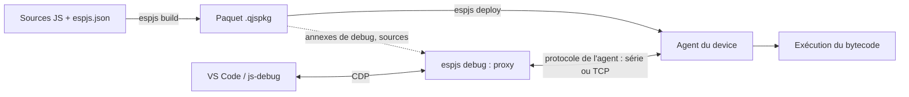

# espjs : conception et référence

Ce document décrit l'architecture d'espjs : un runtime JavaScript fondé sur QuickJS, pour le
poste de développement (Windows, macOS, Linux) et pour des devices (voir ci-dessous), accompagné d'un
debugger utilisable depuis VS Code.

Il rassemble les décisions prises (consignées dans [`CLAUDE.md`](../CLAUDE.md)), la description
du moteur découpé ([quickjs-map.md](quickjs-map.md)), les mesures
([quickjs-split-perf.md](quickjs-split-perf.md)), le générateur
([tools/quickjs-split](../tools/quickjs-split/README.md)) et la liste des tâches
([`TODO.md`](../TODO.md)). En cas de désaccord entre ce document et `CLAUDE.md`, `CLAUDE.md`
fait foi.

**Device.** Dans ce document, un *device* est une carte cible qui exécute les programmes
(bytecode précompilé, agent de debug et de déploiement, pas de compilateur). Aujourd'hui :

- l'**ESP32** (ESP32-S3, carte YD avec module WROOM-1, PSRAM) ;
- le **RP2350** (Olimex PICO2-XXL, RP2350B, 8 Mo de PSRAM).

Cette liste est amenée à grandir : ce qui est dit d'un device vaut pour toute nouvelle cible
(un port de plus dans `ports/`, une implémentation de `board.h`). Une puce n'est nommée que
pour ce qui lui est propre (ESP-IDF, `esp_partition_mmap`, boot ROM du RP2350…).

## Comment lire ce document

Chaque section porte un statut explicite :

| Statut | Signification |
|---|---|
| **réalisé** | le code existe dans le dépôt et a été testé ou mesuré |
| **en cours d'implémentation** | la conception est arrêtée et le code est en train d'être écrit ; au moment de la rédaction, aucun fichier correspondant n'est encore présent dans le dépôt |
| **conçu, non implémenté** | la décision est prise, aucun code n'existe |
| **à vérifier** | point que les sources marquent explicitement comme restant à confirmer |

Les décisions marquées comme prises dans `CLAUDE.md` ne se rediscutent pas sans l'auteur du
projet.

## Sommaire

1. [Vue d'ensemble](#1-vue-densemble)
2. [Le moteur QuickJS](#2-le-moteur-quickjs)
3. [Le debugger](#3-le-debugger)
4. [Formats et protocole](#4-formats-et-protocole)
5. [Le runtime](#5-le-runtime)
6. [L'outil hôte `espjs`](#6-loutil-hôte-espjs)
7. [Points ouverts et à vérifier](#7-points-ouverts-et-à-vérifier)
8. [Annexes](#8-annexes)

---

## 1. Vue d'ensemble

> **Statut : conçu, non implémenté** pour l'ensemble de la chaîne. Seul le moteur (section 2)
> existe aujourd'hui, sous forme d'original intact et de version découpée.

### 1.1 Objectifs

- Exécuter du JavaScript moderne (promesses, `async`/`await`, classes, modules) avec QuickJS,
  sur le poste de développement et sur les devices.
- Déboguer depuis VS Code le code qui tourne sur un device : points d'arrêt, pas-à-pas,
  inspection des variables, évaluation d'expressions, arrêt sur exception.
- Déployer le code compilé sur le device par le même canal que le debug.
- Écrire facilement des modules natifs (C++) visibles depuis JavaScript.

Le debug « poste de développement seul » n'est pas un objectif : l'architecture vise une cible
distante.

### 1.2 Cibles

| Cible | Rôle |
|---|---|
| Poste de développement (Windows, macOS, Linux) | exécute l'outil hôte `espjs` (compilation, paquet, déploiement, proxy de debug) ; peut aussi exécuter des scripts |
| Device (ESP32, RP2350…) | exécute le bytecode précompilé, l'agent du device (debug et déploiement) ; pas de compilateur, pas d'`eval` |

### 1.3 Composants

| Composant | Où il tourne | Rôle |
|---|---|---|
| Moteur QuickJS | hôte et device | interpréteur ; le compilateur n'existe que sur l'hôte |
| Outil hôte `espjs` | hôte | un exécutable unique : QuickJS hôte + modules C (boucle d'événements, sockets, port série, SHA-256, API de compilation) ; ses commandes sont écrites en JS, précompilées et embarquées |
| Firmware + agent du device | device | exécute les scripts ; l'agent (« device agent ») contient le stub de debug et reçoit les déploiements |
| Proxy de debug | hôte, dans `espjs debug` | adaptateur CDP écrit en JS ; traduit CDP en messages de l'agent ; compile les expressions à évaluer |
| VS Code + js-debug | hôte | client du debugger, intégré à VS Code, parle CDP |

### 1.4 Le flux de bout en bout

1. Le développeur écrit ses sources JavaScript dans un projet décrit par `espjs.json`.
2. `espjs build` compile les sources avec le compilateur hôte (option « debug info »), et
   produit un paquet `.qjspkg` : bytecode, annexes de debug, copie des sources, manifeste. Il
   écrit aussi les typages `.d.ts` des modules natifs pour VS Code.
3. `espjs deploy` envoie au device, par l'agent, un paquet réduit (même extension, le manifeste
   indique le contenu) qui est écrit en flash.
4. Le device exécute le bytecode, sans compilation sur la cible.
5. `espjs debug` lance le proxy : il ouvre un serveur CDP pour VS Code (via js-debug) et parle
   à l'agent du device par liaison série ou TCP. Il retrouve les annexes de debug grâce aux
   identifiants de build que l'agent lui communique.



### 1.5 Liaisons entre l'hôte et le device

Trois liaisons sont prévues : série (UART, COM/USB), WiFi et réseau filaire (TCP). Le protocole
de debug est indépendant du transport : le même cadrage s'applique partout (section 4.3).

---

## 2. Le moteur QuickJS

### 2.1 Version et choix

> **Statut : réalisé.**

- Moteur : QuickJS de Fabrice Bellard, version **2026-06-04** (`engine/qjs-bellard/VERSION`). Ce n'est
  pas quickjs-ng.
- mquickjs a été évalué et écarté : c'est un sous-ensemble ES5 (pas de `Promise`/`async`, pas de
  classes, pas de modules…).
- `engine/qjs-bellard/` contient le moteur amont, non modifié. Les correctifs locaux de 2021 ont été
  abandonnés.

`quickjs.c` fait 61 197 lignes : 1 562 fonctions, 142 types, 97 tables de données. La carte des
modules de ce fichier (plages de lignes, dépendances) est dans [quickjs-map.md](quickjs-map.md),
et la liste de chaque élément dans [quickjs-items.csv](quickjs-items.csv).

### 2.2 La version découpée (`engine/qjsx/`)

> **Statut : réalisé.** Généré automatiquement ; testé et mesuré (section 2.4).

`engine/qjsx/` contient le même moteur découpé en **55 fichiers sources**. Chaque fichier
indique en tête les lignes de `quickjs.c` dont il provient (par exemple `builtins/json.c` :
« Lines of quickjs.c: 23156-23360, 49092-50177 »).

#### Dossiers

| Dossier | Rôle | Fichiers |
|---|---|---|
| `core/` | toujours compilé | 18 fichiers : atoms, bigint-arith, cfunc, closures, conversions, errors, gc, generators, interpreter, intrinsics, iteration, modules, objects, operators, print, properties, runtime, strings |
| `bytecode/` | chargement et sauvegarde du bytecode | opcodes, reader, writer |
| `builtins/` | objets standard, un fichier par objet | 22 fichiers : array, arraybuffer, atomics, base64, bigint, dataview, date, function, global, iterator, json, mapset, math, number, object, promise, proxy, regexp, string, symbol, typedarray, weakref |
| `compiler/` | le compilateur, absent d'une build sans `eval` | 12 fichiers : emitter, eval, finalize, funcdef, parser-class, parser-expr, parser-func, parser-module, parser-stmt, resolve-labels, resolve-vars, tokenizer |

Les autres fichiers du moteur (`cutils`, `dtoa`, `libregexp`, `libunicode`, `list.h`,
`quickjs.h`, `quickjs-atom.h`, `quickjs-opcode.h`, `LICENSE`, `VERSION`) sont copiés tels quels à
la racine de `engine/qjsx/`.

L'interpréteur (`JS_CallInternal`, dispatch par « computed goto », `DIRECT_DISPATCH`) est dans
`core/interpreter.c`. Les frames (`JSStackFrame`) sont chaînées depuis
`rt->current_stack_frame`.

#### Headers

- **`quickjs-internal.h`**, inclus par tous les fichiers. Ses parties, dans l'ordre, sont
  séparées par des commentaires repères :
  1. le prélude de `quickjs.c` (lignes 1 à 1415 : options, `JSRuntime`, `JSContext`, `JSObject`,
     `JSFunctionBytecode`, `JSStackFrame`…) sans ses prototypes ;
  2. `/* ---- macros and types shared between files ---- */` ;
  3. `/* ---- prototypes and shared data ---- */` : inclusion de `core/core.h`,
     `bytecode/bytecode.h`, `builtins/builtins.h` ;
  4. `/* ---- inline functions shared between files ---- */`.
- **`core/core.h`, `bytecode/bytecode.h`, `builtins/builtins.h`** : prototypes des fonctions et
  déclarations `extern` des tables partagées entre fichiers.
- **`compiler/compiler.h`** : types (`JSFunctionDef`, `JSToken`, `JSParseState`, `BlockEnv`,
  `JSVarDef`…, énumération `TOK_*`), macros et prototypes privés du compilateur. Seuls les
  fichiers de `compiler/` l'incluent. Rien en dehors de `compiler/` n'appelle le compilateur
  directement, sauf `JS_NewContext` (dans `core/runtime.c`) qui appelle `JS_AddIntrinsicEval`
  (dans `compiler/eval.c`) au travers de l'API publique.

#### Règles du découpage

- Seules les fonctions et tables utilisées dans plusieurs fichiers ont perdu `static`
  (688 fonctions, 48 tables) ; les autres restent `static` dans leur fichier.
- La taille des tables partagées est écrite dans leur déclaration `extern`, pour que `countof()`
  fonctionne ailleurs. Si une table change de taille sans mise à jour du header, la compilation
  échoue.
- Une macro définie dans une fonction et utilisée ailleurs (par exemple `JS_THROW_VAR_RO` dans
  `JS_CallInternal`) est recopiée à l'identique dans un header.
- Quelques éléments sont placés hors de leur plage de lignes d'origine :

| Élément | Destination | Raison |
|---|---|---|
| `free_function_bytecode`, `free_bytecode_atoms` | `core/gc.c` | libèrent du bytecode à l'exécution, appelés par le GC |
| `JSOpCode`, `opcode_info` | `bytecode/opcodes.c` | utilisés par le lecteur et l'écrivain de bytecode (et plus tard le debugger) |
| `JS_EvalFunction` et la répartition de l'eval | `core/interpreter.c` | exécutent du bytecode déjà compilé |
| `__JS_EvalInternal` | `compiler/eval.c` | unique entrée vers le compilateur |
| `JS_ResolveModule` | `core/modules.c` | |
| `ident_realloc` | `core/strings.c` | |
| `get_line_col` | `core/errors.c` | |
| `js_get_prototype_from_ctor` | `core/objects.c` | |
| `add_export_entry` | `compiler/parser-module.c` | voir la modification 2 ci-dessous |

#### Le générateur

Le découpage est produit par `tools/quickjs-split/split.js` (Node), piloté par
`tools/quickjs-split/split-config.js`, et lancé par `tools/quickjs-split/regen.sh`.

Étapes de `split.js` :

1. découper `quickjs.c` en unités de premier niveau (fonctions, données, types, macros,
   prototypes), chacune mémorisant le contexte `#if/#elif/#else` où elle se trouve ;
2. appliquer les correctifs convenus (état du parseur JSON, exports de module) ;
3. affecter chaque unité à un fichier de sortie (plages de lignes + exceptions par nom) ;
4. calculer ce qui est partagé entre fichiers : les fonctions et données partagées perdent
   `static` et reçoivent une déclaration dans un header ; les types, macros et fonctions inline
   partagés vont dans un header ;
5. écrire les fichiers et afficher un rapport (nombre de fichiers, fonctions et données
   partagées, fonctions du compilateur utilisées hors de `compiler/`, unités non affectées).

`split-config.js` contient :

- `version` (`2026-06-04`) et `preludeEnd` (1416 : les lignes précédentes deviennent
  `quickjs-internal.h`) ;
- `fileRanges` : une liste `[première ligne, fichier]`, chaque plage courant jusqu'à l'entrée
  suivante ;
- `overrides` : les éléments placés hors de leur plage (tableau ci-dessus) ;
- `patches` : les deux correctifs décrits en 2.3.

`regen.sh` vide le contenu de `engine/qjsx/{core,bytecode,builtins,compiler}`, lance
`split.js` sur `engine/qjs-bellard/quickjs.c`, puis copie les fichiers annexes du moteur.

**Règles d'usage :**

- `engine/qjsx/` est **généré** : toute modification manuelle est perdue à la
  régénération. Il faut demander à l'auteur du projet avant de le modifier à la main ou de le
  régénérer.
- Les plages de lignes de `split-config.js` se rapportent au `quickjs.c` de la version
  2026-06-04. Pour une autre version, elles doivent être revérifiées.

### 2.3 Modifications par rapport à l'original

> **Statut : réalisé.** Ce sont les deux seules modifications faites par le générateur. Les
> modifications à la main pour le debugger (depuis le 2026-11-10) sont décrites dans
> [engine-changes.md](engine-changes.md) ; leur diff exact est dans
> [engine-changes.patch](engine-changes.patch).

1. **JSON.parse a son propre état.** Dans l'original, `JS_ParseJSON3` et le tokenizer JSON
   réutilisent l'état du parseur JavaScript (`JSParseState`, `js_parse_init`, `free_token`,
   `js_parse_error`, `js_parse_error_pos`). Le correctif ajoute dans `builtins/json.c` un état
   propre (`JSONParseState`, `JSONToken`, `JSON_TOK_*`, `json_parse_init`, `json_free_token`,
   `json_parse_error`, `json_parse_error_pos`) et renomme les usages dans les plages JSON. JSON
   ne dépend donc plus du compilateur.
2. **Les exports de module sont séparés du parseur.**
   - `add_export_entry2` (`core/modules.c`) ne reçoit plus de `JSParseState` et lève une
     `SyntaxError` ordinaire (« duplicate exported name ») ;
   - `add_export_entry` (`compiler/parser-module.c`) signale le doublon avec la position dans le
     source, puis appelle `add_export_entry2` ;
   - l'appel dans `JS_AddModuleExport` est adapté à la nouvelle signature.

Les messages et positions d'erreur de `JSON.parse` et l'erreur d'export en double sont
identiques entre les deux versions (section 2.4).

### 2.4 Validation et performances du découpage

> **Statut : réalisé** (mesures du 2026-11-10, détail dans
> [quickjs-split-perf.md](quickjs-split-perf.md)).

Conditions : Windows, gcc 13.1.0 mingw64, `-O2 -fwrapv`, sans LTO, 20 threads ; les deux
`qjs.exe` sont construits avec les mêmes `qjs.c`, `quickjs-libc.c` et `repl.c` de Bellard.

- **Tests** : les tests de Bellard passent avec les deux versions (`test_closure`,
  `test_language`, `test_builtin` avec `--std`, `test_loop`, `test_bigint`,
  `test_cyclic_import`, `test_worker`).
- **Compilation** : 47,4 s pour l'original quel que soit le nombre de threads ; 7,4 s pour la
  version découpée sur 20 threads. Une modification de `json.c` se recompile en 1,6 s (contre
  42,7 s), une modification de `quickjs-internal.h` en 6,7 s.
- **Taille** : code machine 1 000 ko contre 1 112 ko ; `qjs.exe` sans symboles 1 143 ko contre
  1 256 ko.
- **Vitesse** (`tests/microbench.js`) : −3,8 % sur le total, avec des écarts par test de −48,4 %
  (`array_read`) à +27,5 % (`prop_clone`). L'explication avancée (gcc n'intègre plus entre
  fichiers les fonctions `static` appelées une fois) est une **hypothèse non vérifiée**.

Les tests demandent une version extraite de QuickJS 2026-06-04
(https://bellard.org/quickjs/quickjs-2026-06-04.tar.xz) pour `qjs.c`, `qjsc.c`,
`quickjs-libc.c`, `repl.js` et `tests/`. La procédure est dans
[tools/quickjs-split/README.md](../tools/quickjs-split/README.md).

### 2.5 Retrait du compilateur sur le device

> **Statut : moteur sans compilateur réalisé et validé sur PC le 2026-11-11** (modification H de
> [engine-changes.md](engine-changes.md) : `qjsx-target`, `espjs-target`, fixture
> `nocompiler`), puis construit pour l'ESP32-S3. Le firmware n'embarque plus aucun JS : les
> modules de bibliothèque écrits en JS (`stdlib/path`) voyagent en bytecode dans le paquet du
> programme (bibliothèques `.qjslib`, section 4.5).

Décision : **aucun `eval` sur le device, y compris en build de debug.** Le dossier `compiler/` n'est
pas compilé pour le device. Le code JS arrive sur la cible déjà compilé par le poste de
développement. Tout ce que le debugger évalue (`Runtime.evaluate`, `evaluateOnCallFrame`,
`callFunctionOn`) est compilé sur l'hôte et envoyé en bytecode.

Ce que le découpage permet déjà :

- le compilateur (environ 13 300 lignes, 22 % de `quickjs.c`) est isolé dans `compiler/` avec
  son header privé ;
- il est déjà derrière une indirection : `ctx->eval_internal`, rempli uniquement par
  `JS_AddIntrinsicEval` avec `__JS_EvalInternal`. Si le pointeur est NULL, `JS_EvalInternal` lève
  une `TypeError` « eval is not supported » ; c'est le chemin de `JS_Eval`, `JS_EvalThis`,
  `JS_EvalObject`, de l'eval global, du constructeur `Function` et de l'eval direct ;
- `JS_NewContext` appelle `JS_AddIntrinsicEval` ; une build sans compilateur doit partir de
  `JS_NewContextRaw` et n'ajouter que les intrinsèques voulus ;
- les couplages identifiés dans [quickjs-map.md](quickjs-map.md) (JSON, `free_function_bytecode`,
  `opcode_info`, `js_parse_error` dans les exports, rôles mêlés de l'`eval-api`, types du
  compilateur) sont traités par le découpage (sections 2.2 et 2.3).

Aucune build pour un device sans `compiler/` n'a encore été réalisée.

### 2.6 Modifications du compilateur

> **Statut : réalisé le 2026-11-10, avec deux écarts.** Description à jour, fichiers touchés et
> tests dans [engine-changes.md](engine-changes.md). Le texte ci-dessous est la conception
> d'origine. Écarts :
> - les positions passent par l'opérande de `OP_line_num` (deux bits de nature), pas par un
>   nouvel opcode ;
> - les portées sont des plages **source**, pas des plages de pc ;
> - pas de build id dans le bytecode ni de table par script dans le lecteur : un script est
>   identifié par le build id du paquet et le nom du module, désormais toujours présent.

- **Positions de début d'instruction.** Aujourd'hui, une entrée `pc2line` n'est enregistrée que
  lorsque `resolve_labels` émet des instructions (`add_pc2line_info`). Un opcode temporaire
  `OP_stmt_pos <offset>` sera émis :
  - au début de chaque instruction (statement) ;
  - à chaque clause `catch` ;
  - à l'entrée du corps de fonction ;
  - à chaque `return` et au retour implicite ;
  - à chaque condition de boucle.

  `resolve_labels` le rattache inconditionnellement à l'instruction émise suivante. Chaque
  position porte une nature : instruction, retour ou expression.
- **Portées des variables.** Des marqueurs d'entrée et de sortie de portée (sans code) sont
  transmis jusqu'à `resolve_labels`, pour obtenir les pc finaux et donc la plage de visibilité de
  chaque variable. Les variables internes sont marquées ; les emplacements en zone morte
  temporelle (TDZ) sont signalés comme tels.
- **Numéro de fonction.** Chaque `JSFunctionBytecode` reçoit un numéro sur 16 bits (ordre de
  création), sérialisé : le numéro de version du format de bytecode change.
- **Build id.** La fonction de premier niveau porte un identifiant de build, calculé par le
  packer sur le bytecode sérialisé avec ce champ mis à zéro.
- **Table des fonctions à la lecture.** Le lecteur de bytecode construit, par script, un
  enregistrement (build id + numéro → table des fonctions, entrée effacée quand la fonction est
  libérée) utilisé par le stub.
- **`debugger;`** compile vers un nouvel opcode `OP_debugger` (sans effet sans debugger
  attaché). Aujourd'hui, le mot-clé est ignoré par le parseur (« currently no debugger »).
- **Appels terminaux toujours désactivés**, en debug comme en production : même bytecode dans les
  deux cas, piles d'appels complètes.
- **Collecte de l'annexe de debug** dans `js_create_function`, avant le retrait des
  informations ; le compilateur hôte renvoie `{ bytecode, debug }` au JS hôte, qui écrit le JSON,
  le manifeste et le zip (CRC32 calculé en JS).

### 2.7 Modifications de l'interpréteur

> **Statut : réalisé le 2026-11-10, sauf `sf->call_sp`** (prédiction des exceptions non
> rattrapées, non faite). API publique dans `engine/qjsx/quickjs-debug.h`, détail dans
> [engine-changes.md](engine-changes.md), section F. Le stub qui s'en sert n'est pas encore
> écrit.

- **Deux tables de dispatch** (option C) : une table normale et une table de debug. La table de
  debug consulte un bitmap, par fonction, des positions d'arrêt. Quand le « computed goto » n'est
  pas disponible, un test par opcode sert de solution de repli. Détail en 3.2.
- **`sf->call_sp`** : un nouveau champ de `JSStackFrame`, sauvegardé avant chaque appel, pour
  la prédiction des exceptions non rattrapées (3.4). Le champ existant `cur_sp` ne convient pas :
  il a déjà un sens pour les générateurs.
- **`OP_debugger`** à exécuter (voir 2.6).

Points d'entrée existants utiles au debugger (lignes de `quickjs.c` d'origine, voir
[quickjs-map.md](quickjs-map.md)) : `JS_CallInternal` (hooks), `JSStackFrame`, `find_line_num`
(décodage `pc2line`), `build_backtrace`, `compute_pc2line_info`, `js_poll_interrupts` et
`JS_SetInterruptHandler`.

### 2.8 Construction

> **Statut : réalisé pour le build de test du découpage ; build du projet à mettre à jour.**

- Chaîne d'outils : Windows, gcc 13.1 mingw64, premake5 5.0.0, node 26. Les makefiles sont
  générés avec `premake5 gmake --cc=gcc --shell=posix`.
- Le `premake5.lua` / `qjs.make` du projet construisent encore `engine/qjs-bellard` et ne sont pas à
  jour pour 2026-06-04 : il faut ajouter `dtoa.c` (régénérer `qjs.make`) et définir
  `CONFIG_VERSION` (`-DCONFIG_VERSION="2026-06-04"`).
- Le build de test (original et découpé) est dans `tools/quickjs-split/test/`.

---

## 3. Le debugger

> **Statut de toute la section : conçu, non implémenté.**

### 3.1 Architecture

- **Client** : VS Code, au travers de son debugger intégré js-debug. Le protocole côté VS Code
  est donc **CDP** (Chrome DevTools Protocol), pas DAP.
- **Stub C sur la cible** : minimal, il expose des primitives (frames, emplacements de
  variables, propriétés, chargement et appel de bytecode). Il fait partie de l'agent de
  le device, qui gère aussi le déploiement.
- **Proxy sur l'hôte** : l'adaptateur CDP est écrit en JavaScript et s'exécute dans le QuickJS
  hôte (l'exécutable `espjs`, pas Node). Ce QuickJS hôte embarque le compilateur : il compile les
  expressions évaluées et produit le bytecode et les annexes de debug des scripts.
- **Modules C nécessaires à l'hôte** : `quickjs-libc` n'a pas de sockets et sa boucle
  d'événements Windows n'attend que stdin, les timers et les workers. L'hôte a donc besoin de
  modules C pour une boucle d'événements, les sockets TCP et le port série (section 5).
- **Informations de debug déportées** (« split debug info ») : comme le code arrive précompilé,
  les informations de debug vivent sur l'hôte, à côté du proxy, dans une annexe indexée par le
  build id stocké dans le bytecode, et non dans le bytecode de la cible.

Répartition des rôles :

| Rôle | Stub (device) | Proxy (hôte) |
|---|---|---|
| Arrêt sur point d'arrêt, pas-à-pas | détecte les arrêts (tables de dispatch, bitmap) | traduit lignes/colonnes en positions, calcule les bitmaps |
| Noms de variables, portées | ne les connaît pas | les lit dans l'annexe de debug |
| Évaluation d'expressions | exécute le bytecode reçu | compile l'expression enveloppée |
| Conditions, logpoints, compteurs | évalue sur place | compile |
| Points d'arrêt persistants | | les garde et les réapplique |

### 3.2 Points d'arrêt

**Décision : deux tables de dispatch (option C).**

- L'interpréteur dispose d'une table de dispatch normale et d'une table de debug. La table de
  debug vérifie, pour la fonction en cours, un **bitmap des positions d'arrêt**.
- Sans « computed goto », un test par opcode sert de repli.
- Le patch d'opcodes (remplacer une instruction par une instruction d'arrêt) a été **écarté** :
  le bytecode peut être en ROM, et le patch complique le pas-à-pas.
- Les positions d'arrêt possibles sont les positions de début d'instruction produites par le
  compilateur (2.6).
- Le proxy envoie les positions d'arrêt par le message `SetStopPoints`. Il garde la liste des
  points d'arrêt et les réapplique à chaque `ScriptLoaded` et après un redémarrage du device.

Note : une puce de `CLAUDE.md` présente encore la détection des points d'arrêt comme « en
discussion », alors qu'une autre la donne comme décidée (option C). Voir la section 7.

### 3.3 Pas-à-pas

Toutes les règles s'expriment en « prochain début d'instruction » :

| Commande | Arrêt au prochain début d'instruction… |
|---|---|
| over (pas principal) | dans la même frame ou dans une frame appelante |
| into (entrer) | n'importe où ; les fonctions natives sont passées, les callbacks JS appelés depuis le C sont entrés |
| out (sortir) | dans une frame appelante |

- **Comparaison des frames** : par adresse dans la pile C. Les frames de générateurs et de
  fonctions `async` sont comparées par leur objet d'état ; ainsi un pas « over » sur un `await`
  reprend dans la même fonction `async`.
- **Arrêts supplémentaires** : au début d'une clause `catch`, et en fin de fonction (à chaque
  `return` et au retour implicite) pour montrer la valeur de retour.

### 3.4 Arrêt sur exception

Deux modes, réglés par `SetPauseOnExceptions` :

- **« all »** : arrêt au moment du `throw`, avant le déroulement de la pile.
- **« uncaught »** : la prédiction se fait au moment du `throw`, en parcourant les frames à la
  recherche d'offsets de `catch`. Ne comptent pas comme gestionnaires :
  - l'offset 0 (fermeture d'itérateur) ;
  - un gestionnaire qui commence par `gosub; throw` (relance d'un `finally`).

  Cette prédiction nécessite le nouveau `sf->call_sp` (2.7).
- **Frontières asynchrones** : une exception qui traverse la frontière d'une fonction `async`
  compte comme rattrapée. Les rejets de promesses non gérés sont signalés (console, pile capturée
  au moment du `throw`) grâce au « promise rejection tracker ».
- L'agent émet aussi un événement `UncaughtException`.

### 3.5 Évaluation d'expressions

- Le proxy enveloppe l'expression dans une fonction dont les paramètres sont les variables
  visibles à la position d'arrêt (connues par l'annexe de debug), la compile sur l'hôte, puis le
  stub l'exécute (`LoadFunction` puis `Call`).
- Cela couvre `Runtime.evaluate`, `Debugger.evaluateOnCallFrame` et `Runtime.callFunctionOn`.
- Les fonctions d'aide de js-debug sont chargées une seule fois (`LoadFunction`).
- Les accesseurs (getters) ne sont jamais exécutés implicitement lors d'un `GetProperties`.
- La modification d'une variable passe par `SetSlot`.

### 3.6 Points d'arrêt conditionnels, logpoints, compteurs de passages

Les conditions, logpoints et compteurs de passages (hit counts) sont compilés par le proxy et
**évalués sur le device lui-même**, sans aller-retour avec l'hôte à chaque passage.

### 3.7 Cohérence source / bytecode / annexe

- Chaque script a un build id : le hachage de son bytecode avec le champ d'identifiant mis à
  zéro. Le stub signale au proxy le build id des scripts chargés (les sources ne disent pas par
  quel champ de quel message).
- Le proxy indexe les paquets `.qjspkg` qu'il trouve pour retrouver l'annexe correspondant à un
  build id.
- Le proxy vérifie la cohérence entre le source, le bytecode et l'annexe (le manifeste contient
  le hachage du source).
- Les scripts sont annoncés à VS Code avec des URL `file:///` pointant vers les sources locales.

### 3.8 Attente du debugger au démarrage (`--wait-debugger`)

- L'agent retient `main` jusqu'à ce que le proxy donne le feu vert, pour pouvoir déboguer le code
  de démarrage (l'ouverture du port série réinitialise souvent les cartes ESP32).
- Le réglage est mémorisé par l'agent pour le démarrage suivant.
- Il a un délai d'expiration.
- Il n'est jamais utilisé sur des devices de production.

---

## 4. Formats et protocole

### 4.1 Le paquet `.qjspkg`

> **Statut : réalisé** (`espjs build`, `host/js/build.js` et `zip.js` ; lecture
> `common/runtime/package.*`). Contenu actuel :
> - `manifest.json` : `format` (1), `name`, `buildId`, `created`, `compiler`
>   (`"espjs 0.1.0 / QuickJS 2026-06-04"`), `main`, `scripts[]` avec pour chacun `path`,
>   `module`, `buildId`, `sourceHash`, et les noms de ses entrées `bytecode`, `debug`, `source` ;
>   un module venu d'une bibliothèque porte en plus `library` (section 4.5) ;
> - `libraries[]` (nom et version des bibliothèques utilisées) et `natives[]` (modules natifs
>   importés, que le firmware doit fournir) ;
> - `bytecode` : le numéro de version du bytecode du paquet (voir « Paquet compilé pour un
>   autre moteur » ci-dessous) ;
> - `bytecode/<chemin>.qbc`, `debug/<chemin>.json`, `src/<chemin>` ;
> - identifiants : build id d'un script = 32 premiers chiffres hexadécimaux du SHA-256 de son
>   bytecode ; `sourceHash` = SHA-256 du source ; build id du paquet = SHA-256 des
>   identifiants des scripts et du module principal ; fichier `<nom>-<12 chiffres>.qjspkg` ;
> - zip à entrées stockées, dates fixes (1980-01-01) : même contenu, même archive.
>
> Écart provisoire : le bytecode est compilé avec `JS_STRIP_SOURCE` (sans le texte source, mais
> avec positions, nom de fichier et noms de variables). Le retrait complet (`JS_STRIP_DEBUG`)
> casse `import.meta` et `import()` dynamique : QuickJS retrouve le module courant par le nom
> de fichier des infos de debug (`JS_GetScriptOrModuleName`, commentaire « XXX » de Bellard).
> La correction (une référence au script dans chaque fonction) fait partie des modifications du
> moteur pour le debugger. L'identifiant de build n'est pas encore écrit dans le bytecode
> lui-même (même étape).

- **Un zip par build**, extension `.qjspkg`. La même extension sert pour le paquet complet et
  pour le paquet réduit envoyé au device ; le manifeste indique ce qu'il contient.
- **Entrées stockées sans compression** : pas de dépendance à une bibliothèque de compression, et
  le device peut exécuter le bytecode sur place depuis la flash, avec `JS_READ_OBJ_ROM_DATA`
  (sur l'ESP32 via `esp_partition_mmap`). **Ce dernier point est à vérifier.**
- Le zip (avec son CRC32) est écrit par le JS hôte.

Contenu :

| Entrée | Contenu |
|---|---|
| `manifest.json` | version du format, build id, identifiant du compilateur, liste des scripts (chemin, build id du script, hachage du source) |
| `bytecode/` | le bytecode, c'est-à-dire ce qui part sur le device |
| `debug/` | une annexe de debug JSON par script |
| `src/` | copie exacte des sources compilées |

Les noms exacts des champs du manifeste et l'algorithme de hachage du source ne sont pas fixés
dans les sources.

**Paquet compilé pour un autre moteur** (réalisé le 2026-11-11). Un moteur ne lit que le
bytecode de sa propre version (`BC_VERSION` de QuickJS, `0x45` aujourd'hui, donné par
`JS_GetBytecodeVersion()`). `espjs build` écrit ce numéro dans le manifeste (`bytecode`), et
il est contrôlé à deux endroits :

1. **À l'envoi.** `espjs deploy` le met dans `UPLOAD_BEGIN`. L'agent le compare au sien et
   refuse aussitôt s'il diffère : rien n'est écrit, le paquet installé reste en place, et
   l'outil affiche le message du device (« the package holds bytecode version 70, this device
   reads version 69: rebuild the package, or flash a firmware that matches espjs »).
2. **Au lancement.** Le chargeur (`startPackage`, `common/runtime/program.cpp`) relit le
   numéro dans le manifeste avant de charger le moindre module. Ce contrôle ne dépend pas de
   ce que dit l'hôte, et couvre `espjs run paquet.qjspkg` sur le PC.

Un paquet sans champ `bytecode` (construit par un `espjs` plus ancien) est refusé de la même
façon. Le numéro n'a de valeur que si `BC_VERSION` augmente à chaque changement du moteur qui
touche le bytecode : c'est une règle de `engine-changes.md` (section K).

**Avertissements `eval` et `Function`** (réalisé le 2026-11-11). Sur un device, `eval(...)`
et le constructeur `Function` lèvent « eval is not supported » ; sur le PC ils marchent.
`espjs build` et `espjs mklib` préviennent donc, sans échouer :

```
src/main.js:46:29: warning: eval() needs the compiler, which a device does not have: it throws there
```

La détection est faite par le compilateur (modification K) et elle est syntaxique : l'appel
direct `eval(...)`, l'appel `Function(...)` et `new Function`. Un usage indirect
(`(0, eval)(x)`, `globalThis.eval`, un alias) n'est pas vu ; l'erreur à l'exécution reste le
filet. Un module pris tel quel dans une bibliothèque n'est pas recompilé : ses avertissements
ont été donnés par `espjs mklib`.

### 4.2 L'annexe de debug

> **Statut : réalisé** (format 2, 2026-11-10). Détail dans
> [engine-changes.md](engine-changes.md), section E.

Une annexe JSON par script, dans `debug/`, collectée par le compilateur avant le retrait des
informations : `format`, `path`, `buildId`, `sourceHash`, et `functions`. L'indice d'une
fonction dans `functions` est son numéro de fonction. Chaque fonction porte :

- son nom, sa plage source et la taille de son bytecode ;
- `positions` : des triplets `pc, offset source, nature`, triés par pc. La nature vaut 0 pour
  une expression (les positions du pc2line d'origine), 1 pour un début d'instruction et 2 pour
  un retour ;
- `arguments`, `locals` (avec leur portée), `closures` : noms et drapeaux (lexicale, const,
  capturée, globale). L'indice d'une variable est son emplacement dans la frame ;
- `scopes` : parent et **plage source** de chaque portée. Écart par rapport à la conception
  d'origine, qui prévoyait des plages de pc : le proxy passe du pc de l'arrêt à une position
  source, puis aux portées qui la contiennent. Les variables internes se reconnaissent à leur
  nom (`<ret>`, `this`, …). Une variable en TDZ se lit avec le tag `JS_TAG_UNINITIALIZED`.

Les positions sont des **offsets en octets dans le source**. Le proxy en déduit les lignes et
les colonnes UTF-16 attendues par CDP.

Le lien avec le bytecode passe par le build id du script (4.1, 3.7). Les noms de variables ne
voyagent jamais vers ou depuis le device : ils sont lus dans l'annexe.

### 4.3 Le protocole de l'agent du device

> **Statut : réalisé pour le déploiement** (la partie debug viendra avec le debugger). Deux
> implémentations qui doivent rester équivalentes : JS côté hôte (`host/js/cbor.js`,
> `frames.js`, `protocol.js`, `device.js`, `deploy.js`) et C++ côté device (`common/agent/` :
> `cbor`, `frames`, `protocol.h`, `agent` — code portable, pour le device et pour l'agent desktop
> `espjs agent`). Testé de bout en bout entre les deux (`tests/run-tests.sh`).
>
> Points fixés à l'implémentation :
> - **trame** : `0x00 | COBS(0xE5 | version 1 | CRC-16/CCITT-FALSE du message, 2 octets
>   big-endian | message) | 0x00` ; sur une liaison série, un segment qui ne se décode pas en
>   trame valide est du texte de console ;
> - **message** : tableau CBOR `[type, id, contenu]` ; `id` > 0 pour une requête et sa réponse,
>   0 pour un événement ; contenu = map à clés entières (ou `null`) ;
> - **types** : `RESPONSE` 1, `ERROR` 2 (`{MESSAGE}`), `HELLO` 10 (`{PROTOCOL, TOKEN?}` →
>   `{PROTOCOL, AGENT, ENGINE, MAX_MESSAGE}`), `INFO` 11 (→ `{RUNNING, BUILD_ID, PACKAGE_SIZE}`),
>   `UPLOAD_BEGIN` 20 (`{SIZE, SHA256, BUILD_ID, BYTECODE}`, refusé si le numéro de bytecode
>   n'est pas celui du moteur du device), `UPLOAD_CHUNK` 21 (`{OFFSET, DATA}`, 2 048
>   octets, dans l'ordre), `UPLOAD_END` 22 (vérifie taille et SHA-256, installe), `RUN` 23,
>   `STOP` 24, `RESET` 25 ; événements `LOG` 30 (`{STREAM, TEXT}`), `EXITED` 31 (`{CODE}`),
>   `STARTED` 32 (`{BUILD_ID}`). Valeurs des clés : `common/agent/protocol.h` ;
> - **session** : toute requête autre que `HELLO` est refusée avant `HELLO` ; pendant la
>   session, la console du programme (`console.*`, exceptions non rattrapées) part en `LOG` ;
> - **réémission** : l'hôte renvoie une requête sans réponse après 3 s (3 essais) avec le même
>   id ; l'agent renvoie alors la réponse mémorisée sans réexécuter ;
> - **jeton** : si l'agent est lancé avec un jeton, `HELLO` doit le fournir.
>
> **Partie debug : réalisée côté device le 2026-11-10** (stub, `common/agent/debugger.*`). Les
> messages et l'encodage des valeurs sont décrits en tête de `host/js/protocol.js`.
> - **requêtes** : `DEBUG_ATTACH` 40 à `RELEASE` 54. On y trouve la pause, la reprise, les pas,
>   les arrêts par fonction, le mode exceptions, la liste des modules, la pile, la lecture et
>   l'écriture des emplacements, les propriétés et emplacements internes, le chargement d'une
>   fonction compilée sur l'hôte, l'appel et la libération des poignées ;
> - **événements** : `PAUSED` 60, `RESUMED` 61, `SCRIPT_LOADED` 62. Après `SCRIPT_LOADED`,
>   le device attend `RESUME` : l'hôte pose d'abord les arrêts du module ;
> - **valeurs** : primitives en CBOR direct, objets derrière des poignées regroupées (groupe
>   `PAUSE` libéré à la reprise, `CONSOLE`, `PERSISTENT`). Les objets sont décrits sans
>   exécuter de JS ;
> - **taille maximale d'un message** : 64 ko (fonctions compilées par le proxy). Le CBOR C++
>   lit et écrit maintenant les flottants et `undefined` ;
> - **threads** : les requêtes arrivent sur le thread de transport et s'exécutent sur le
>   thread JS :
>   - en pause, dans la boucle de pause ;
>   - au repos, via un message de la boucle d'événements ;
>   - pendant l'exécution de JS, depuis le gestionnaire d'interruption, et seulement les
>     requêtes qui n'exécutent pas de JS (`PAUSE`, `SET_STOPS`…) ;
> - **testé** par `tests/debugger.test.js` à travers l'agent desktop (52 vérifications :
>   points d'arrêt, pas into / over / out, pause d'une boucle infinie, variables et closures
>   modifiées, appel de fonctions compilées sur l'hôte, exceptions, `debugger;`) ;
> - **pas encore fait** : la prédiction « non rattrapée » (le mode `UNCAUGHT` ne met pas en
>   pause), `[[Entries]]` des Map/Set, `--wait-debugger`, les points d'arrêt conditionnels.

Le protocole entre le stub et le proxy s'appelle « device agent » : il sert au debug **et** au
déploiement.

#### Cadrage

Sur toutes les liaisons (série et TCP), une trame a la forme :

`0x00 | COBS(magic | version | CRC-16 | message) | 0x00`

- COBS garantit l'absence d'octet `0x00` à l'intérieur de la trame ; `0x00` délimite les trames.
- Une trame dont le CRC est faux est ignorée.
- Sur liaison série, les octets qui ne se décodent pas en trame valide sont du texte de console.
  Pendant une session, le stub enveloppe la console, `printf` et les journaux ESP-IDF dans des
  messages `Log`.

La valeur et la taille exactes du marqueur magique, ainsi que la variante du CRC-16, ne sont pas
précisées dans les sources.

#### Encodage

Un sous-ensemble de **CBOR** écrit à la main : entiers, flottants, chaînes, octets, tableaux et
maps à clés entières.

#### Objets, poignées et groupes

- Les objets restent sur la cible, derrière des **poignées** (handles), regroupées comme les
  groupes d'objets CDP :
  - `pause` : libéré à la reprise ;
  - `console` ;
  - `persistent`.
- Les valeurs primitives voyagent en ligne.
- Les noms ne voyagent jamais : ils viennent de l'annexe de debug.
- `Release` libère des poignées.

#### Robustesse

- Les requêtes sont numérotées : un doublon reçoit à nouveau la même réponse, sans être
  réexécuté.
- La taille maximale d'un message est négociée dans `Hello`.
- Les gros contenus sont découpés (`Upload Begin` / `Chunk` / `End`).

#### Messages

| Catégorie | Messages |
|---|---|
| Ouverture | `Hello` (taille maximale, jeton en TCP) |
| Contrôle de l'exécution | `Pause`, `Resume`, `Step`, `SetStopPoints`, `SetPauseOnExceptions` |
| Scripts | `ListScripts` |
| Inspection | `GetStack`, `GetFrameSlots`, `GetProperties` (sans exécuter les getters), `GetInternals` |
| Modification | `SetSlot` |
| Exécution de code | `LoadFunction`, `Call` |
| Poignées | `Release` |
| Événements (agent → proxy) | `Paused`, `Resumed`, `ScriptLoaded`, `Log`, `UncaughtException` |
| Déploiement | écrire un `.qjspkg` en flash (via `Upload Begin`/`Chunk`/`End`), lister les fichiers, redémarrer |

Les noms des messages de déploiement autres que l'upload, et le détail des champs de chaque
message, ne sont pas encore fixés dans les sources.

#### Sécurité en TCP

En TCP, le stub est **désactivé par défaut**, et un **jeton** est exigé dans `Hello`.

### 4.4 Nature des positions

> **Statut : conçu, non implémenté.**

Chaque position enregistrée par le compilateur porte une nature :

| Nature | Origine |
|---|---|
| instruction | début d'instruction, clause `catch`, entrée du corps de fonction, condition de boucle |
| retour | chaque `return` et le retour implicite (permet de montrer la valeur de retour) |
| expression | nature prévue ; son usage précis n'est pas détaillé dans les sources |

### 4.5 Les bibliothèques `.qjslib`

> **Statut : réalisé le 2026-11-11** (`espjs mklib`, `host/js/library.js`, `compile.js`,
> `build.js` ; modification J du moteur). Testé par `run-tests.sh` (fixtures `testlib`,
> `uselib`, `dynamicimport`, `nolibrary`) et `tests/tools.test.js`. Non fait : la vérification
> des modules natifs contre le firmware, les `.d.ts`.

**Le problème.** Un device n'a pas de compilateur : un module écrit en JS et embarqué en
source dans le firmware (c'était le cas de `path`) ne peut pas s'y charger. Et un firmware
générique ne doit pas grossir avec du JS que la plupart des programmes n'utilisent pas.

**La réponse.** Le firmware ne contient aucun JS, seulement des modules natifs. Les modules JS
réutilisables vivent dans des bibliothèques, des fichiers `.qjslib`. `espjs build` copie dans
le paquet du programme les modules de bibliothèque qu'il importe ; le device les y trouve
comme n'importe quel autre module, sans rien savoir des bibliothèques.

**Noms.** Tout module d'une bibliothèque s'appelle `<bibliothèque>/<module>`, et s'importe
sous ce nom, sur le modèle de `node:path` :

```js
import { join } from "stdlib/path";
import { read } from "sensors/bme280";
```

- La bibliothèque standard s'appelle `stdlib` (`stdlib.qjslib`).
- Les modules natifs gardent leurs noms courts (`fs`, `crypto`…).
- Deux bibliothèques ne peuvent pas porter le même nom, donc leurs modules ne se heurtent
  jamais.
- Dans une bibliothèque, un module importe ses voisins par leur nom complet ou en relatif :
  `"./filter"` depuis `sensors/bme280` désigne `sensors/filter`.

**Le fichier `.qjslib`.** Un zip à entrées stockées, organisé comme un `.qjspkg` :

| Entrée | Contenu |
|---|---|
| `manifest.json` | `format` (1), `kind` (`"library"`), `name`, `version`, `created`, `compiler`, `bytecode`, `natives[]`, `modules[]` |
| `bytecode/<module>.qbc` | bytecode du module : un cache, utilisé seulement par un build dont le compilateur est celui qui l'a produit |
| `debug/<module>.json` | son annexe de debug (même condition) |
| `src/<module>.js` | son source : ce qu'un build fait avec un autre compilateur recompile, et ce que montre le debugger |

Chaque élément de `modules[]` donne `name` (`"sensors/bme280"`), `buildId`, `sourceHash`, les
noms de ses trois entrées et `imports` (les noms des modules qu'il importe).

**Fabriquer une bibliothèque : `espjs mklib [dossier] [--output fichier]`.** La commande sert
aussi bien à `stdlib` qu'aux bibliothèques d'un utilisateur. Le dossier contient un
`espjs.json` de bibliothèque (section 6.4) : `name`, `version` et `modules`, qui associe chaque
nom de module à son fichier source. Elle compile chaque module sous son nom complet, vérifie
qu'un import vers la bibliothèque elle-même désigne bien un de ses modules, note les modules
natifs importés, et écrit `<output>/<name>.qjslib`.

**La bibliothèque standard.** Ses sources sont dans `lib/stdlib/` (aujourd'hui `path`). Le
build d'`espjs` fabrique `stdlib.qjslib` à côté de l'exécutable, avec l'outil qu'il vient de
lier ; c'est ce fichier qui est livré, pas les sources. L'outil le trouve dans le dossier de
son exécutable (`process.argv[0]` est le chemin complet de l'exécutable, comme dans Node).

Les mêmes sources sont aussi embarquées dans l'exécutable hôte, sous les mêmes noms
(`stdlib/path`) : l'outil en a besoin pour ses propres commandes, dont `mklib`, avant que
`stdlib.qjslib` existe, et `espjs run script.js` s'en sert pour un script lancé sans build.

**Ce que fait `espjs build`.**

1. Il compile les modules du programme (les fichiers de `sources`).
2. Il lit les bibliothèques : `stdlib.qjslib`, puis celles de `libraries` dans `espjs.json`.
3. Il suit les imports de chaque module. Un nom qui n'est pas un module du programme est :
   - un module d'une bibliothèque connue : il est ajouté au paquet, en entier, et ses propres
     imports sont suivis à leur tour ;
   - un nom sans `/` : un module natif, inscrit dans `natives` du manifeste ;
   - sinon une erreur, qui nomme le module qui importe (import relatif introuvable,
     bibliothèque non déclarée, module absent de la bibliothèque).
4. Il écrit dans le paquet le bytecode, l'annexe de debug et le source de chaque module, ceux
   des bibliothèques sous `bytecode/<bibliothèque>/<module>.qbc`. Un module de bibliothèque
   que personne n'importe n'est pas copié ; il n'y a pas de tri plus fin (fonction par
   fonction).

Le debugger voit les modules de bibliothèque comme les autres : leur annexe et leur source
sont dans le paquet.

**Bibliothèque faite par un autre compilateur.** Le build compare l'identifiant du
compilateur et le numéro de bytecode de la bibliothèque (`compiler`, `bytecode` de son
manifeste) aux siens. S'ils diffèrent, la bibliothèque n'est pas refusée, puisqu'elle contient
ses sources : ses modules sont recompilés, et le build le dit (« library 'testlib' (...) was
made by another compiler (...): its modules were compiled again from their sources »).

**`import()` est interdit** dans un programme construit par `espjs build`, et dans une
bibliothèque : le nom d'un module chargé par `import()` n'est connu qu'à l'exécution, donc le
build ne pourrait pas l'emporter. Le compilateur le refuse comme une erreur de syntaxe, avec
sa position (modification J du moteur). Le JS de l'outil lui-même n'est pas concerné.

**Limites.**

- `espjs run script.js` (sans build) ne connaît que la copie embarquée de `stdlib` : un script
  qui importe une autre bibliothèque doit être construit, puis lancé par
  `espjs run paquet.qjspkg`.
- Une faute de frappe dans le nom d'un module natif (`"cryto"`) n'est vue qu'au chargement du
  programme : le build ne connaît pas la liste des modules natifs d'un firmware. Il est prévu
  que le firmware la donne dans `Hello` et que `espjs deploy` la compare à `natives`.
- Si seul `lib/stdlib/espjs.json` change, `make` ne refait pas `stdlib.qjslib` (il le refait
  quand l'exécutable est relié, donc dès qu'un source de `stdlib` change).

---

## 5. Le runtime

### 5.1 Boucle d'événements

> **Statut : réalisé pour l'hôte** (`common/runtime/loop.h`, `loop.cpp`, `platform_host.cpp` pour
> Windows et POSIX) et testé (`tests/runtime.test.js`). Version device (file FreeRTOS) non
> implémentée. Sur l'hôte, une exception non rattrapée arrête la boucle avec le code 1
> (`setExitOnUncaught`), comme Node ; le device l'affichera et continuera.

Même modèle sur toutes les plateformes (hôte et device) :

- **un seul thread JS** ;
- des **producteurs d'événements** (pilotes, threads d'E/S, ISR sur le device) postent des messages
  dans **une seule file bornée** : file FreeRTOS sur le device, mutex + condition/événement sur
  l'hôte ;
- la boucle vide les jobs de promesses, attend le prochain message ou timer, puis le traite sur
  le thread JS ;
- les messages portent un **identifiant de source + une génération**, jamais de pointeur brut
  vers un objet ;
- la boucle d'événements de `quickjs-libc` n'est pas utilisée ;
- le transport du stub de debug est un producteur de plus ; pendant une pause, une mini-boucle
  ne traite que les messages du debugger.

Une exception JS non rattrapée dans un callback sur le device est affichée, puis l'exécution
continue ; redémarrer reste une option.

### 5.2 Styles asynchrones

> **Statut : conçu, non implémenté.**

- **Callbacks** pour les événements spontanés : `uart.onData(fn)`.
- **Promesses** pour les opérations lancées par le script :
  `await uart.readLine({ timeout })`.
- Un module peut proposer les deux.
- L'itération asynchrone (`for await`) viendra peut-être plus tard, construite sur les promesses.

### 5.3 Bibliothèque de liaison C++ ↔ JS

> **Statut : réalisé** dans `common/jsbind/` (headers seuls) et testé par `tests/jsbind.test.js`
> avec le module natif `tests/native/test_module.cpp` (42 vérifications, sans fuite en build
> Debug). Elle remplace le code `uart`/`console` de `legacy/devices/` (qui contenait des bugs,
> `console.cpp` ne compilait pas). Elle répond à la tâche « faciliter l'écriture d'objets C
> visibles en JS » de `TODO.md`. Non réalisé : la génération des `.d.ts`.
>
> Écarts par rapport à la conception :
> - dans une fonction `void`, C++ interdit `return <valeur>` : on écrit
>   `return (void)js::fail(...);` (ou `js::fail(...); return;`) ;
> - un module se déclare par un corps de fonction : `JS_MODULE(fs, m) { JS_FUNCTION(m, readFileSync); JS_ADD_CLASS(m, Stats); }`,
>   les globaux par `JS_GLOBALS(nom, g) { ... }` ; `JS_FUNCTION_AS(m, fonctionCpp, "nomJs")`
>   quand le nom C++ entre en conflit (par exemple `log` de `<math.h>`) ;
> - types en plus : `js::Optional<T>`, `js::Args` (arguments restants), `js::Created<T>` /
>   `js::create<T>()` pour créer depuis C++ un objet d'une classe liée ;
> - un pointeur vers une classe liée (`Device *`) est accepté en argument et renvoyé tel quel
>   (même objet JS) ;
> - les noms d'erreur incluent le propriétaire : `UART.open: argument 1, field 'speed': ...`,
>   `fs.readFileSync: ...`.

#### Contraintes

C++17, header-only, **aucun `std::`**, pas d'exceptions C++, pas de RTTI.

#### Erreurs : « la première erreur gagne »

- Chaque appel a un emplacement d'erreur ; la première erreur enregistrée gagne.
- `return js::fail(...)` est convertible vers n'importe quel type de retour.
- Variantes : `js::fail<js::RangeError>()`, `js::failSystem()`.
- Les exceptions JS levées dans des callbacks sont capturées automatiquement.
- C'est la frontière entre C++ et JS qui lève l'exception JS.
- Les erreurs système portent un `code` à la manière de Node (`"ENOENT"`).

#### Contraintes portées par les types

- `js::Range<int, a, b>` : entier borné.
- `JS_ENUM(Name, a, b)` : énumération, passée en chaîne depuis JS.
- `JS_STRUCT(Options, fields...)` : objet d'options, avec valeurs par défaut C++ ; les champs
  inconnus sont refusés.

#### Types propres

`js::Str`, `js::Bytes`, `js::Buffer`, `js::Function`, `js::Value`.

#### Classes et modules

- `JS_CLASS(Name)` dans la classe, et un marqueur `JS_EXPORT(member)` avant chaque méthode ou
  champ exposé. Le mécanisme repose sur `__COUNTER__` et des enregistreurs statiques surchargés ;
  les emplacements 0 à 63 sont parcourus à la compilation.
- Le constructeur JS correspond à une méthode `init(...)` facultative ; le constructeur C++ n'a
  pas d'argument.
- Les champs deviennent des propriétés, en lecture seule s'ils sont `const`.
- `JS_MODULE(name, classes...)` déclare un module.

#### Durée de vie et GC

- Le destructeur n'est qu'un **filet de sécurité** : il est appelé par le finaliseur, et aucun
  code JS n'y est permis. La fermeture explicite passe par `close()`.
- Les membres `js::Value` s'enregistrent automatiquement pour le marquage du GC (enregistrement
  pendant la construction de l'objet).
- `js::keepAlive(bool)` maintient un objet vivant tant qu'il a des E/S en cours (comme Node).

#### Typages

Des typages `.d.ts` pour VS Code peuvent être générés à partir des déclarations ; `espjs build`
les écrit (section 6).

### 5.4 Bibliothèque standard

> **Statut : réalisé en partie pour l'hôte** (`common/runtime/modules/`), testé par
> `tests/runtime.test.js` (46 vérifications) :
> - globaux : `console` (`log`, `info`, `debug`, `warn`, `error`), `setTimeout`, `setInterval`,
>   `clearTimeout`, `clearInterval`, `TextEncoder` / `TextDecoder` (UTF-8 seulement), `process`
>   (`argv`, `env`, `platform`, `exit`, `cwd`), global comme dans Node ; sur un device (agent),
>   `argv` vaut `["espjs", module principal]`, `env` vient de la section `env` d'espjs.json (via
>   le manifeste), `cwd()` est le dossier de données de la carte (`board::dataDirectory()`,
>   `<stockage>/data` pour l'agent de bureau) et `fs` y résout les chemins relatifs ;
>   `process.exit` termine le programme, jamais le processus (l'agent survit) ;
> - `fs` : `readFileSync`, `writeFileSync`, `existsSync`, `statSync`, `readdirSync`,
>   `mkdirSync` (`recursive`), `rmSync` (`recursive`, `force`), `renameSync`, `unlinkSync` ;
>   chemins UTF-8 (API larges sous Windows) ;
> - `stdlib/path` : écrit en JS, dans la bibliothèque standard (`lib/stdlib`, section 4.5) ;
>   sémantique de `path.posix` de Node, plus les lettres de lecteur et `\` en entrée sous
>   Windows ; résultats toujours avec `/` (Node sous Windows produit `\`) ;
> - `crypto` : `sha256(chaîne ou octets)` → `Uint8Array`.
>
> - `net` : `connect({host, port})` → promesse d'une connexion, `listen({host, port},
>   onConnection)` → serveur (`port()`, `close()`) ; connexion : `onData`, `onClose`,
>   `write(texte ou octets)`, `close()`, `remoteAddress()`, `remotePort()`. Un thread de
>   lecture par connexion ; `listen` écoute sur 127.0.0.1 par défaut (testé, `tests/net.test.js`) ;
> - `serial` (hôte) : `list()`, `open(port, {baudRate})` → `onData`, `onClose`, `write`,
>   `close`, 8N1. Liste testée ; ouverture et échanges **non testés faute de matériel** ;
> - `process.stdout.write` / `process.stderr.write`.
>
> Sur le device, sans compilateur, un module écrit en JS comme `stdlib/path` arrive en bytecode
> dans le paquet du programme (section 4.5).
>
> Infrastructure : les threads d'E/S postent dans une « boîte aux lettres » à compteur de
> références (`rt::Mailbox`), qui survit à la boucle : un thread qui poste après la destruction
> d'un runtime voit son message ignoré. La boucle est détruite après `JS_FreeRuntime`
> (`Loop::shutdown()` libère avant sa partie JS), car les finaliseurs retirent leurs sources.

Elle remplace `quickjs-libc`, est écrite avec la bibliothèque de liaison, et est partagée avec
le device quand cela a du sens.

**Globaux :**

- `console` ;
- `setTimeout`, `setInterval`, `clearTimeout` ;
- `TextEncoder`, `TextDecoder` ;
- `Uint8Array` pour les octets (pas de `Buffer` à la Node).

**Modules :**

| Module | Plateforme | Description |
|---|---|---|
| `fs` | hôte, et device selon pertinence | fichiers, synchrone |
| `stdlib/path` | toutes (bibliothèque standard, en JS) | chemins |
| `process` | hôte | |
| `net` | | TCP, asynchrone |
| `serial` | hôte | port série ; sur le device, l'équivalent est `uart` |
| `crypto` | | `sha256` |
| `compiler` | hôte | API de compilation |

Les sources ne précisent pas la plateforme de `net` et `crypto` au-delà de la règle
« partagée avec le device quand cela a du sens ».

**Règle de nommage :**

- quand une fonction se comporte exactement comme celle de Node, elle porte le nom de Node
  (`fs.readFileSync`, `path.join`, `process.argv`…) ;
- sinon, des noms courts propres au projet, en suivant les règles asynchrones de 5.2 (callbacks
  pour les événements, promesses pour les opérations).

### 5.5 Ports des devices

> **Statut : ESP32-S3 réalisé le 2026-11-11** (ESP-IDF v6.1, firmware de 700 Ko, sans aucun
> JS), flashé et essayé sur la carte YD : agent par UART0, déploiement et exécution sur place,
> debugger 52/52, programme utilisant des bibliothèques `.qjslib`.
> RP2350 : conçu, non implémenté.

Un firmware par carte, générique : tout ce que la puce sait faire, flashé une fois ; les
programmes arrivent ensuite en paquets. Chaque port fournit trois choses autour du code commun,
identique sur toutes les cartes (`agent::runDevice()`) :

| Partie | Rôle | ESP32 |
|---|---|---|
| `ports/cmake/espjs.cmake` | sources communes (moteur sans compilateur, runtime, agent), options du moteur | partagé avec le RP2350 |
| `platform.h` | horloge, arrêt fatal, tâches, verrous, signal, pause périodique du thread JS | `ports/freertos/` (verrous, signal, `sleepMs`, `yieldIfDue`) + `platform_esp32.cpp` (`esp_timer`, `esp_system_abort`, tâches épinglées) |
| `board.h` | identité, tas JS, pile JS, stockage des paquets, liaisons, console | `board_esp32.cpp` |
| point d'entrée | crée la tâche JS, qui appelle `agent::runDevice()` | `main.cpp` (tâche de 48 Ko sur le cœur 1) |

**Une description par carte.** `ports/esp32` sert toutes les cartes ESP32 ; ce qui change d'une
carte à l'autre est dans `boards/<carte>/` : `sdkconfig.board` (puce, taille de flash, table de
`partitions/`, mode de la PSRAM) et `board_config.h` (nom, plus tard liaisons et broches). La
carte se choisit au build (`ESPJS_BOARD`), chacune dans son dossier `build-<carte>`. Les tables
de partitions vont par taille de flash (4, 8, 16 Mo), pas par carte.

**Calcul long et chien de garde** (décidé, codé et vérifié sur la carte YD le 2026-11-11 :
pendant la boucle sans fin de `tests/fixtures/debuggee`, aucun message « task_wdt » en 17 s
d'écoute de la console, contre un toutes les 5 s auparavant).

- *Le problème.* Sur un RTOS, la tâche JS a une priorité supérieure à celle de la tâche idle.
  Un programme qui calcule sans rendre la main à la boucle d'événements affame donc l'idle de
  son cœur. Sous ESP-IDF, le chien de garde des tâches le signale (« task_wdt ... IDLE1 »
  toutes les 5 s, sans redémarrage), et l'idle ne fait plus son ménage (libérer les tâches
  supprimées).
- *La réponse.* `platform::yieldIfDue()`, appelée par le gestionnaire d'interruption du runtime
  (`Runner::interrupt`, `common/agent/runner.cpp`), donc régulièrement tant que du JS
  s'exécute. Toutes les 100 ms (`YIELD_PERIOD_MS`, `ports/freertos/platform_freertos.cpp`),
  elle bloque la tâche JS jusqu'au tick suivant (`vTaskDelay(1)`) ; le reste du temps elle
  sort tout de suite. Coût : 1 % du temps de calcul au plus avec un tick de 1 ms
  (`CONFIG_FREERTOS_HZ=1000`). Sur le PC, la fonction est vide.
- *Ce que le chien de garde détecte encore.* Son critère devient : « le thread JS n'est pas
  repassé par le point d'interruption du moteur depuis 5 s ».
  - Un script qui boucle (`while (true) {}`) passe par ce point : le chien de garde ne dit
    rien. C'est voulu : on ne peut pas décider si un calcul long est voulu ou coincé, et le
    device reste pilotable depuis le PC par ce même point (pause du debugger, arrêt,
    redéploiement).
  - Du code natif qui tourne en rond (attente active dans un pilote, boucle dans un module C)
    n'y passe plus : le message apparaît, et ni la pause ni l'arrêt ne sont possibles. C'est
    un défaut du firmware, pas du script.
  - Un interblocage (thread JS endormi sur un verrou) n'affame pas l'idle : il n'est pas vu.
- *Options écartées.* Ne plus surveiller l'idle du cœur 1
  (`CONFIG_ESP_TASK_WDT_CHECK_IDLE_TASK_CPU1=n`) : on perd la détection du code natif qui
  tourne en rond. Tâche JS en priorité 0 : elle serait préemptée par toutes les autres tâches.
- *Non traité.* Un device autonome qui se rattrape seul d'un script coincé : ce serait un
  budget de temps choisi par l'auteur du programme (« la boucle d'événements doit reprendre
  la main toutes les N secondes »), suspendu pendant une pause du debugger. À discuter.

**ESP32-S3** (carte YD, WROOM-1 N16R8 : 16 Mo de flash, 8 Mo de PSRAM octale) :

- **Mémoire** : le tas JS est en PSRAM (`heap_caps_malloc`), la pile JS en RAM interne ;
  `board::jsStackSize()` donne à QuickJS une limite sous la pile de la tâche (un débordement
  devient une `RangeError`).
- **Partitions** (16 Mo) : deux emplacements firmware de 3 Mo réservés pour l'OTA (encore à
  décider), paquets 2 Mo, données 7,9 Mo pour un futur `fs`. Sur 4 Mo : pas d'OTA.
- **Paquets** : deux emplacements, chacun la moitié de la partition. Un upload va dans celui qui n'est pas installé ; son
  en-tête (taille, séquence, build id) est écrit en dernier. Un upload interrompu laisse donc le
  paquet installé intact, et le programme en cours, projeté depuis son emplacement par
  `esp_partition_mmap`, n'est jamais effacé sous lui.
- **Liaisons** : la carte démarre toutes celles qu'elle sait gérer ; l'hôte choisit la sienne, et
  la liaison qui reçoit le `Hello` porte la session. Aujourd'hui UART0 (port COM, CH343) : le
  pilote UART sert aussi la console (`uart_vfs`), une écriture par appel, donc une trame n'est
  jamais coupée par du texte. À venir : USB natif, TCP sur WiFi.
- **Console** : pendant une session, la sortie du programme part en messages `Log` sur la liaison
  de la session ; sinon elle va sur la console ESP-IDF (UART0, 921600 bauds).
- **Moteur** : deux changements pour newlib (`engine-changes.md`, I) ; options de compilation
  pour GCC 15 en 32 bits (`int32_t` est un `long`).
- **Bibliothèques** : un programme qui importe `stdlib/path` et une bibliothèque d'essai
  (`tests/fixtures/uselib`) donne sur la carte la même sortie que sur le PC (2026-11-11) ;
  les modules viennent de son paquet (section 4.5).
- **Limites** : pas encore de `fs` (`cwd()` vaut `"/"`), pas de `net`.

---

## 6. L'outil hôte `espjs`

> **Statut : en cours.** Réalisé (`host/`) :
> - `espjs run <fichier.js | paquet.qjspkg> [arguments]` : un script est exécuté comme module
>   ES ; un paquet est exécuté depuis son bytecode, comme le fera le device (lecteur de paquet
>   `common/runtime/package.*`, sans copie, partagé avec le device). Chargeur de modules : natifs,
>   bytecode du paquet, JS embarqués, fichiers ;
> - `espjs build [dossier]` : compile le projet (`espjs.json`) en `.qjspkg` (voir 4.1), avec
>   les modules de bibliothèque qu'il importe (4.5) ;
> - `espjs mklib [dossier] [--output fichier]` : compile un projet de bibliothèque en `.qjslib`
>   (4.5) ;
> - `espjs deploy [paquet] --target T [--token X] [--no-run] [--monitor [--until-exit]]`,
>   `espjs monitor`, `espjs device info|run|stop|reset`, `espjs targets` ; les messages d'état
>   vont sur stderr, stdout ne porte que la sortie du programme ;
> - `espjs agent [--host] [--port 5555] [--storage build/agent] [--token]` : l'agent de
>   le device sur le desktop (`host/agent_command.cpp`), qui remplace une carte pour
>   développer et tester ; même code d'agent que le firmware ; programme installé lancé au
>   démarrage ; arrêt d'un programme même bloqué dans une boucle (gestionnaire d'interruption) ;
>   une exception non rattrapée est affichée et le programme continue, comme sur le device ;
> - `espjs help`, `espjs --version`.
>
> Les commandes autres que `run` et `--version` sont écrites en JS (`host/js/`), embarquées
> dans l'exécutable comme modules `espjs:<nom>` par une règle premake
> (`tools/embed-js.lua`). Module natif `compiler` (hôte) : `compile(source, nom, { module,
> strip: "none" | "source" | "all", debug, dynamicImport })` → `{ bytecode, debug, imports,
> warnings }`, plus `quickjsVersion`, `espjsVersion` et `bytecodeVersion`.
> Tests : `tests/run-tests.sh [Release|Debug]` (liaison, runtime, modules de l'outil, paquet
> exécuté à l'identique des sources, zip lisible par un outil externe, build reproductible,
> erreur de syntaxe localisée). Construction : `premake5 gmake --cc=gcc --shell=posix` puis
> `make -C build config=release` ; exécutables dans `bin/Release/` (`espjs`, et `espjs-tests`
> qui ajoute le module de test). Les autres commandes ne sont pas encore implémentées. L'ancien
> programme (`legacy/main.cpp`, `legacy/devices/`) n'est plus construit mais reste sur le disque.

### 6.1 Composition

Un exécutable unique :

- QuickJS hôte, avec compilateur ;
- modules C : boucle d'événements, sockets, port série, SHA-256, API de compilation ;
- commandes écrites en JS, précompilées et embarquées.

### 6.2 Commandes

| Commande | Rôle |
|---|---|
| `build` | compile le projet, produit le `.qjspkg` et les `.d.ts` des modules natifs |
| `mklib` | compile un projet de bibliothèque, produit le `.qjslib` (section 4.5) |
| `deploy` | envoie le paquet au device par l'agent |
| `debug` | lance le proxy : serveur CDP pour VS Code |
| `monitor` | |
| `targets` | |
| `device ls` / `device reset` / `device info` | opérations sur le device ; d'après leurs noms et les messages de déploiement : lister les fichiers, redémarrer, informations |
| `trace` | |
| `run` | |

Seuls les noms de `monitor`, `targets`, `trace` et `run` figurent dans les sources ; leur
comportement n'est pas décrit.

### 6.3 Cibles

Une cible désigne la liaison vers un device :

| Exemple | Liaison |
|---|---|
| `serial:COM3` | port série Windows |
| `serial:/dev/ttyUSB0@921600` | port série Unix, avec débit |
| `tcp:esp.local:5555` | TCP (WiFi ou filaire) |

### 6.4 Fichier de projet `espjs.json`

À la racine du projet (réalisé, `host/js/project.js`). Clés, toutes facultatives ; une clé
inconnue ou d'un mauvais type est une erreur :

| Clé | Défaut | Rôle |
|---|---|---|
| `name` | nom du dossier | nom du paquet (lettres, chiffres, `.`, `_`, `-`) |
| `main` | `"src/main.js"` | module exécuté au démarrage |
| `sources` | `["src/**/*.js"]` | modules compilés dans le paquet (globs `*`, `?`, `**/`) |
| `exclude` | `[]` | motifs retirés de `sources` |
| `output` | `"build/packages"` | dossier des paquets |
| `keep` | `10` | nombre de paquets conservés pour le projet |
| `target` | — | device par défaut (pas encore utilisé) |
| `env` | — | `process.env` du programme sur un device (chaînes seulement) |
| `libraries` | `[]` | chemins des `.qjslib` que le programme peut importer, en plus de `stdlib` |

Un projet de bibliothèque (`espjs mklib`, section 4.5) remplace `main` et `sources` par :

| Clé | Rôle |
|---|---|
| `name` | nom de la bibliothèque : ses modules s'importent sous `<name>/<module>` |
| `version` | version de la bibliothèque, obligatoire |
| `modules` | objet « nom de module → fichier source » ; un nom peut contenir des `/` (`"drivers/bme280"`) |
| `output` | dossier où `<name>.qjslib` est écrit |

### 6.5 Intégration VS Code

- Configuration de type « attach ». Le type de cible js-debug à utiliser (node ou chrome) est
  **à vérifier**.
- Les scripts sont annoncés avec des URL `file:///` vers les sources locales.
- `espjs build` écrit les `.d.ts` des modules natifs.
- Le proxy garde les points d'arrêt et les réapplique sur `ScriptLoaded` et après un redémarrage
  du device.
- `--wait-debugger` : voir 3.8.

---

## 7. Points ouverts et à vérifier

### 7.1 À vérifier (signalé comme tel dans les sources)

- Exécution du bytecode sur place depuis la flash (`esp_partition_mmap` +
  `JS_READ_OBJ_ROM_DATA`) avec un `.qjspkg` stocké sans compression.
- Type de cible js-debug pour la configuration « attach » : node ou chrome.
- L'explication des écarts du microbench (intégration des fonctions `static` par gcc) est une
  hypothèse non vérifiée.

### 7.2 Tâches ouvertes (`TODO.md`)

| Tâche | État |
|---|---|
| Analyser les optimisations possibles du moteur (plus tard), en partant des écarts du microbench (−48 % à +27 %) | ouvert |
| Envoyer des sources JS (fichiers, dossiers) vers la cible | décidé : l'agent envoie un `.qjspkg` en flash ; non implémenté |
| Faciliter l'écriture d'objets C visibles en JS | réponse : bibliothèque de liaison (5.3), en cours |
| Décider ce qu'on retire de `quickjs-libc` | décidé : remplacée par les modules du projet (5.4) ; non implémenté |

### 7.3 Points non précisés par les sources

- Valeur et taille du marqueur magique, variante du CRC-16, détail des champs de chaque message
  de l'agent, noms des messages de déploiement.
- Algorithme de hachage du build id et du hachage des sources (SHA-256 est disponible côté hôte,
  mais son usage pour ces identifiants n'est pas écrit).
- Noms des clés de `espjs.json` et des champs de `manifest.json`.
- Comportement des commandes `monitor`, `targets`, `trace` et `run`.
- Usage de la nature de position « expression ».
- Écriture en retour des variables modifiées par une expression évaluée (la fonction enveloppe
  reçoit les variables en paramètres ; seul `SetSlot` est décrit pour modifier une variable).
### 7.4 Incohérences entre sources

Les incohérences relevées à la rédaction de ce document ont été corrigées dans les sources :
- la détection des points d'arrêt par deux tables de dispatch est bien la décision retenue ;
- le bytecode du device est privé de positions, de sources et de noms de variables, identique en
  debug et en production : toutes les informations de debug sont dans l'annexe côté hôte ;
- aucune build pour un device ne contient le compilateur, même en debug ([quickjs-map.md](quickjs-map.md)
  a été mis à jour).

---

## 8. Annexes

### 8.1 Documents et outils liés

| Document | Contenu |
|---|---|
| [`CLAUDE.md`](../CLAUDE.md) | liste de référence des décisions prises, organisation du dépôt, build |
| [`TODO.md`](../TODO.md) | tâches de l'auteur du projet |
| [quickjs-map.md](quickjs-map.md) | carte de `quickjs.c` (modules, dépendances, couplages du compilateur, points d'entrée du debugger) et description de la version découpée |
| [quickjs-items.csv](quickjs-items.csv) | chaque élément de `quickjs.c` : module, nature, nom, lignes |
| [quickjs-split-perf.md](quickjs-split-perf.md) | original contre découpé : tests, tailles, temps de compilation, microbench |
| [tools/quickjs-split/README.md](../tools/quickjs-split/README.md) | générateur du découpage, régénération, tests |
| [`tools/quickjs-split/split-config.js`](../tools/quickjs-split/split-config.js) | plages de lignes, exceptions, correctifs |
| [`tools/quickjs-split/split.js`](../tools/quickjs-split/split.js) | le générateur |
| [`tools/quickjs-split/regen.sh`](../tools/quickjs-split/regen.sh) | régénération de `engine/qjsx/` |

### 8.2 Organisation du dépôt

| Chemin | Contenu |
|---|---|
| `engine/qjs-bellard/` | QuickJS 2026-06-04 amont, non modifié |
| `engine/qjsx/` | le même moteur découpé en 55 fichiers, généré |
| `tools/quickjs-split/` | générateur, configuration, build de test (`test/premake5.lua`), tests et microbench (`test/run.sh`, `test/bench-table.js`) |
| `doc/` | documentation |
| `legacy/main.cpp`, `legacy/devices/` | programme hôte existant (modules uart et console), appelé à être remplacé |
| `premake5.lua`, `qjs.make` | build du projet (à mettre à jour, voir 2.8) |

### 8.3 Glossaire

| Terme | Sens |
|---|---|
| Agent du device (device agent) | logiciel embarqué sur le device qui contient le stub de debug et gère le déploiement |
| Annexe de debug (sidecar) | fichier JSON par script contenant les informations de debug, gardé sur l'hôte |
| Build id | identifiant d'un script : hachage de son bytecode, champ d'identifiant mis à zéro |
| CDP | Chrome DevTools Protocol, parlé par js-debug |
| COBS | Consistent Overhead Byte Stuffing : encodage qui supprime les octets `0x00` d'une trame |
| Proxy | adaptateur CDP sur l'hôte, entre VS Code et l'agent |
| Stub | partie minimale du debugger sur la cible, qui expose des primitives |
| TDZ | zone morte temporelle d'une variable `let`/`const` avant son initialisation |
