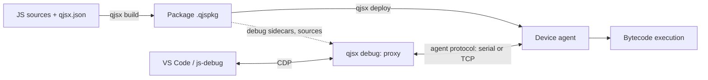

# qjsx: design and reference

This document describes the architecture of qjsx: a JavaScript runtime based on QuickJS, for the
development machine (Windows, macOS, Linux) and for devices (see below), together with a
debugger usable from VS Code.

It gathers the decisions taken (recorded in [`CLAUDE.md`](../CLAUDE.md)), the description
of the split engine ([quickjs-map.md](quickjs-map.md)), the measurements
([quickjs-split-perf.md](quickjs-split-perf.md)), the generator
([tools/quickjs-split](../tools/quickjs-split/README.md)) and the task list
([`TODO.md`](../TODO.md)). If this document and `CLAUDE.md` disagree, `CLAUDE.md`
prevails.

**Device.** In this document, a *device* is a target board that runs the programs
(precompiled bytecode, debug and deployment agent, no compiler). Today:

- the **ESP32** (ESP32-S3, YD board with a WROOM-1 module, PSRAM);
- the **RP2350** (Olimex PICO2-XXL, RP2350B, 8 MB of PSRAM).

This list will grow: what is said of a device holds for any new target
(one more port in `ports/`, one implementation of `board.h`). A chip is named only
for what is specific to it (ESP-IDF, `esp_partition_mmap`, RP2350 boot ROM…).

## How to read this document

Each section carries an explicit status:

| Status | Meaning |
|---|---|
| **done** | the code exists in the repository and has been tested or measured |
| **being implemented** | the design is settled and the code is being written; at the time of writing, no corresponding file is in the repository yet |
| **designed, not implemented** | the decision is taken, no code exists |
| **to verify** | a point that the sources explicitly mark as still to be confirmed |

The decisions marked as taken in `CLAUDE.md` are not reopened without the author of the
project.

## Contents

1. [Overview](#1-overview)
2. [The QuickJS engine](#2-the-quickjs-engine)
3. [The debugger](#3-the-debugger)
4. [Formats and protocol](#4-formats-and-protocol)
5. [The runtime](#5-the-runtime)
6. [The host tool `qjsx`](#6-the-host-tool-qjsx)
7. [Open points and points to verify](#7-open-points-and-points-to-verify)
8. [Appendices](#8-appendices)

---

## 1. Overview

> **Status: designed, not implemented** for the whole chain. Only the engine (section 2)
> exists today, as the untouched original and as the split version.

### 1.1 Goals

- Run modern JavaScript (promises, `async`/`await`, classes, modules) with QuickJS,
  on the development machine and on the devices.
- Debug from VS Code the code that runs on a device: breakpoints, stepping,
  variable inspection, expression evaluation, pause on exceptions.
- Deploy the compiled code to the device through the same channel as debugging.
- Write native modules (C++) visible from JavaScript easily.

"Development machine only" debugging is not a goal: the architecture aims at a remote
target.

### 1.2 Targets

| Target | Role |
|---|---|
| Development machine (Windows, macOS, Linux) | runs the host tool `qjsx` (compilation, package, deployment, debug proxy); can also run scripts |
| Device (ESP32, RP2350…) | runs the precompiled bytecode, the device agent (debug and deployment); no compiler, no `eval` |

### 1.3 Components

| Component | Where it runs | Role |
|---|---|---|
| QuickJS engine | host and device | interpreter; the compiler exists only on the host |
| Host tool `qjsx` | host | a single executable: host QuickJS + C modules (event loop, sockets, serial port, SHA-256, compile API); its commands are written in JS, precompiled and embedded |
| Firmware + device agent | device | runs the scripts; the agent ("device agent") contains the debug stub and receives the deployments |
| Debug proxy | host, in `qjsx debug` | CDP adapter written in JS; translates CDP into agent messages; compiles the expressions to evaluate |
| VS Code + js-debug | host | debugger client, built into VS Code, speaks CDP |

### 1.4 The end-to-end flow

1. The developer writes JavaScript sources in a project described by `qjsx.json`.
2. `qjsx build` compiles the sources with the host compiler ("debug info" option), and
   produces a `.qjspkg` package: bytecode, debug sidecars, copy of the sources, manifest. It
   also writes the `.d.ts` typings of the native modules for VS Code.
3. `qjsx deploy` sends to the device, through the agent, a reduced package (same extension, the
   manifest says what it contains) which is written to flash.
4. The device runs the bytecode, with no compilation on the target.
5. `qjsx debug` starts the proxy: it opens a CDP server for VS Code (through js-debug) and talks
   to the device agent over a serial or TCP link. It finds the debug sidecars thanks to the
   build ids that the agent reports to it.



### 1.5 Links between the host and the device

Three links are planned: serial (UART, COM/USB), WiFi and wired network (TCP). The debug
protocol is independent of the transport: the same framing applies everywhere (section 4.3).

---

## 2. The QuickJS engine

### 2.1 Version and choices

> **Status: done.**

- Engine: QuickJS by Fabrice Bellard, version **2026-06-04** (`engine/qjs-bellard/VERSION`). It is
  not quickjs-ng.
- mquickjs was evaluated and rejected: it is an ES5 subset (no `Promise`/`async`, no
  classes, no modules…).
- `engine/qjs-bellard/` contains the upstream engine, unmodified. The local patches of 2021 were
  dropped.

`quickjs.c` is 61,197 lines long: 1,562 functions, 142 types, 97 data tables. The map of the
modules of this file (line ranges, dependencies) is in [quickjs-map.md](quickjs-map.md),
and the list of every item in [quickjs-items.csv](quickjs-items.csv).

### 2.2 The split engine (`engine/qjsx/`)

> **Status: done.** Generated automatically; tested and measured (section 2.4).

`engine/qjsx/` contains the same engine split into **55 source files**. Each file
states at its top the lines of `quickjs.c` it comes from (for example `builtins/json.c`:
"Lines of quickjs.c: 23156-23360, 49092-50177").

#### Folders

| Folder | Role | Files |
|---|---|---|
| `core/` | always compiled | 18 files: atoms, bigint-arith, cfunc, closures, conversions, errors, gc, generators, interpreter, intrinsics, iteration, modules, objects, operators, print, properties, runtime, strings |
| `bytecode/` | loading and saving bytecode | opcodes, reader, writer |
| `builtins/` | standard objects, one file per object | 22 files: array, arraybuffer, atomics, base64, bigint, dataview, date, function, global, iterator, json, mapset, math, number, object, promise, proxy, regexp, string, symbol, typedarray, weakref |
| `compiler/` | the compiler, absent from a build without `eval` | 12 files: emitter, eval, finalize, funcdef, parser-class, parser-expr, parser-func, parser-module, parser-stmt, resolve-labels, resolve-vars, tokenizer |

The other files of the engine (`cutils`, `dtoa`, `libregexp`, `libunicode`, `list.h`,
`quickjs.h`, `quickjs-atom.h`, `quickjs-opcode.h`, `LICENSE`, `VERSION`) are copied as they are to
the root of `engine/qjsx/`.

The interpreter (`JS_CallInternal`, "computed goto" dispatch, `DIRECT_DISPATCH`) is in
`core/interpreter.c`. The frames (`JSStackFrame`) are chained from
`rt->current_stack_frame`.

#### Headers

- **`quickjs-internal.h`**, included by every file. Its parts, in order, are
  separated by marker comments:
  1. the prelude of `quickjs.c` (lines 1 to 1415: options, `JSRuntime`, `JSContext`, `JSObject`,
     `JSFunctionBytecode`, `JSStackFrame`…) without its prototypes;
  2. `/* ---- macros and types shared between files ---- */`;
  3. `/* ---- prototypes and shared data ---- */`: inclusion of `core/core.h`,
     `bytecode/bytecode.h`, `builtins/builtins.h`;
  4. `/* ---- inline functions shared between files ---- */`.
- **`core/core.h`, `bytecode/bytecode.h`, `builtins/builtins.h`**: prototypes of the functions and
  `extern` declarations of the tables shared between files.
- **`compiler/compiler.h`**: types (`JSFunctionDef`, `JSToken`, `JSParseState`, `BlockEnv`,
  `JSVarDef`…, `TOK_*` enumeration), macros and prototypes private to the compiler. Only the
  files of `compiler/` include it. Nothing outside `compiler/` calls the compiler
  directly, except `JS_NewContext` (in `core/runtime.c`) which calls `JS_AddIntrinsicEval`
  (in `compiler/eval.c`) through the public API.

#### Rules of the split

- Only the functions and tables used in several files lost `static`
  (688 functions, 48 tables); the others stay `static` in their file.
- The size of the shared tables is written in their `extern` declaration, so that `countof()`
  works elsewhere. If a table changes size without the header being updated, the compilation
  fails.
- A macro defined inside a function and used elsewhere (for example `JS_THROW_VAR_RO` in
  `JS_CallInternal`) is copied identically into a header.
- A few items are placed outside their original line range:

| Item | Destination | Reason |
|---|---|---|
| `free_function_bytecode`, `free_bytecode_atoms` | `core/gc.c` | free bytecode at run time, called by the GC |
| `JSOpCode`, `opcode_info` | `bytecode/opcodes.c` | used by the bytecode reader and writer (and later the debugger) |
| `JS_EvalFunction` and the eval dispatch | `core/interpreter.c` | run bytecode that is already compiled |
| `__JS_EvalInternal` | `compiler/eval.c` | single entry point to the compiler |
| `JS_ResolveModule` | `core/modules.c` | |
| `ident_realloc` | `core/strings.c` | |
| `get_line_col` | `core/errors.c` | |
| `js_get_prototype_from_ctor` | `core/objects.c` | |
| `add_export_entry` | `compiler/parser-module.c` | see change 2 below |

#### The generator

The split is produced by `tools/quickjs-split/split.js` (Node), driven by
`tools/quickjs-split/split-config.js`, and started by `tools/quickjs-split/regen.sh`.

Steps of `split.js`:

1. cut `quickjs.c` into top-level units (functions, data, types, macros,
   prototypes), each one remembering the `#if/#elif/#else` context it is in;
2. apply the agreed patches (JSON parser state, module exports);
3. assign each unit to an output file (line ranges + exceptions by name);
4. compute what is shared between files: the shared functions and data lose
   `static` and get a declaration in a header; the shared types, macros and inline functions
   go into a header;
5. write the files and print a report (number of files, shared functions and data,
   compiler functions used outside `compiler/`, unassigned units).

`split-config.js` contains:

- `version` (`2026-06-04`) and `preludeEnd` (1416: the lines before it become
  `quickjs-internal.h`);
- `fileRanges`: a list of `[first line, file]`, each range running up to the next
  entry;
- `overrides`: the items placed outside their range (table above);
- `patches`: the two patches described in 2.3.

`regen.sh` empties the content of `engine/qjsx/{core,bytecode,builtins,compiler}`, runs
`split.js` on `engine/qjs-bellard/quickjs.c`, then copies the other files of the engine.

**Rules of use:**

- `engine/qjsx/` is **generated**: any manual change is lost at the next
  regeneration. The author of the project must be asked before changing it by hand or
  regenerating it.
- The line ranges of `split-config.js` refer to the `quickjs.c` of version
  2026-06-04. For another version, they must be checked again.

### 2.3 Changes from the original

> **Status: done.** These are the only two changes made by the generator. The
> changes made by hand for the debugger (since 2026-11-10) are described in
> [engine-changes.md](engine-changes.md); their exact diff is in
> [engine-changes.patch](engine-changes.patch).

1. **JSON.parse has its own state.** In the original, `JS_ParseJSON3` and the JSON tokenizer
   reuse the state of the JavaScript parser (`JSParseState`, `js_parse_init`, `free_token`,
   `js_parse_error`, `js_parse_error_pos`). The patch adds to `builtins/json.c` a state
   of its own (`JSONParseState`, `JSONToken`, `JSON_TOK_*`, `json_parse_init`, `json_free_token`,
   `json_parse_error`, `json_parse_error_pos`) and renames the uses in the JSON ranges. JSON
   therefore no longer depends on the compiler.
2. **Module exports are separated from the parser.**
   - `add_export_entry2` (`core/modules.c`) no longer receives a `JSParseState` and throws an
     ordinary `SyntaxError` ("duplicate exported name");
   - `add_export_entry` (`compiler/parser-module.c`) reports the duplicate with its position in the
     source, then calls `add_export_entry2`;
   - the call in `JS_AddModuleExport` is adapted to the new signature.

The error messages and positions of `JSON.parse` and the duplicate export error are
identical in both versions (section 2.4).

### 2.4 Validation and performance of the split

> **Status: done** (measurements of 2026-11-10, details in
> [quickjs-split-perf.md](quickjs-split-perf.md)).

Conditions: Windows, gcc 13.1.0 mingw64, `-O2 -fwrapv`, no LTO, 20 threads; both
`qjs.exe` are built with the same `qjs.c`, `quickjs-libc.c` and `repl.c` by Bellard.

- **Tests**: Bellard's tests pass with both versions (`test_closure`,
  `test_language`, `test_builtin` with `--std`, `test_loop`, `test_bigint`,
  `test_cyclic_import`, `test_worker`).
- **Compilation**: 47.4 s for the original whatever the number of threads; 7.4 s for the
  split version on 20 threads. A change to `json.c` recompiles in 1.6 s (against
  42.7 s), a change to `quickjs-internal.h` in 6.7 s.
- **Size**: machine code 1,000 KB against 1,112 KB; `qjs.exe` without symbols 1,143 KB against
  1,256 KB.
- **Speed** (`tests/microbench.js`): −3.8% on the total, with per-test differences from −48.4%
  (`array_read`) to +27.5% (`prop_clone`). The explanation put forward (gcc no longer inlines
  across files the `static` functions called once) is an **unverified hypothesis**.

The tests need an extracted release of QuickJS 2026-06-04
(https://bellard.org/quickjs/quickjs-2026-06-04.tar.xz) for `qjs.c`, `qjsc.c`,
`quickjs-libc.c`, `repl.js` and `tests/`. The procedure is in
[tools/quickjs-split/README.md](../tools/quickjs-split/README.md).

### 2.5 Removing the compiler on the device

> **Status: engine without compiler done and validated on the PC on 2026-11-11** (change H of
> [engine-changes.md](engine-changes.md): `qjsx-engine-target`, `qjsx-target`, fixture
> `nocompiler`), then built for the ESP32-S3. The firmware no longer embeds any JS: the
> library modules written in JS (`stdlib/path`) travel as bytecode in the program's
> package (`.qjslib` libraries, section 4.5).

Decision: **no `eval` on the device, debug builds included.** The `compiler/` folder is not
compiled for the device. The JS code arrives on the target already compiled by the development
machine. Everything the debugger evaluates (`Runtime.evaluate`, `evaluateOnCallFrame`,
`callFunctionOn`) is compiled on the host and sent as bytecode.

What the split already allows:

- the compiler (about 13,300 lines, 22% of `quickjs.c`) is isolated in `compiler/` with
  its private header;
- it is already behind an indirection: `ctx->eval_internal`, filled only by
  `JS_AddIntrinsicEval` with `__JS_EvalInternal`. If the pointer is NULL, `JS_EvalInternal` throws
  a `TypeError` "eval is not supported"; this is the path of `JS_Eval`, `JS_EvalThis`,
  `JS_EvalObject`, of the global eval, of the `Function` constructor and of the direct eval;
- `JS_NewContext` calls `JS_AddIntrinsicEval`; a build without compiler must start from
  `JS_NewContextRaw` and add only the intrinsics it wants;
- the couplings identified in [quickjs-map.md](quickjs-map.md) (JSON, `free_function_bytecode`,
  `opcode_info`, `js_parse_error` in the exports, mixed roles of the `eval-api`, compiler
  types) are handled by the split (sections 2.2 and 2.3).

No build for a device without `compiler/` has been made yet.

### 2.6 Compiler changes

> **Status: done on 2026-11-10, with two deviations.** Up-to-date description, files touched and
> tests in [engine-changes.md](engine-changes.md). The text below is the original
> design. Deviations:
> - the positions go through the operand of `OP_line_num` (two bits for the kind), not through a
>   new opcode;
> - the scopes are **source** ranges, not pc ranges;
> - no build id in the bytecode and no per-script table in the reader: a script is
>   identified by the build id of the package and the module name, which is now always present.

- **Statement start positions.** Today, a `pc2line` entry is recorded only
  when `resolve_labels` emits instructions (`add_pc2line_info`). A temporary opcode
  `OP_stmt_pos <offset>` will be emitted:
  - at the start of each statement;
  - at each `catch` clause;
  - at the entry of the function body;
  - at each `return` and at the implicit return;
  - at each loop condition.

  `resolve_labels` attaches it unconditionally to the next emitted instruction. Each
  position carries a kind: statement, return or expression.
- **Variable scopes.** Scope entry and exit markers (without code) are
  passed down to `resolve_labels`, to get the final pcs and therefore the visibility range of
  each variable. Internal variables are flagged; slots in the temporal dead zone
  (TDZ) are reported as such.
- **Function number.** Each `JSFunctionBytecode` gets a 16-bit number (creation
  order), serialized: the version number of the bytecode format changes.
- **Build id.** The top-level function carries a build id, computed by the
  packer on the serialized bytecode with this field set to zero.
- **Function table at read time.** The bytecode reader builds, per script, a
  record (build id + number → function table, entry cleared when the function is
  freed) used by the stub.
- **`debugger;`** compiles to a new opcode `OP_debugger` (no effect without a debugger
  attached). Today, the keyword is ignored by the parser ("currently no debugger").
- **Tail calls always disabled**, in debug as in production: same bytecode in
  both cases, complete call stacks.
- **Collection of the debug sidecar** in `js_create_function`, before the information is
  stripped; the host compiler returns `{ bytecode, debug }` to the host JS, which writes the JSON,
  the manifest and the zip (CRC32 computed in JS).

### 2.7 Interpreter changes

> **Status: done on 2026-11-10, except `sf->call_sp`** (prediction of uncaught
> exceptions, not done). Public API in `engine/qjsx/quickjs-debug.h`, details in
> [engine-changes.md](engine-changes.md), section F. The stub that uses it is not written
> yet.

- **Two dispatch tables** (option C): a normal table and a debug table. The debug
  table checks a per-function bitmap of the stop positions. When "computed goto" is
  not available, a per-opcode test is the fallback. Details in 3.2.
- **`sf->call_sp`**: a new field of `JSStackFrame`, saved before each call, for
  the prediction of uncaught exceptions (3.4). The existing field `cur_sp` does not fit:
  it already has a meaning for generators.
- **`OP_debugger`** to execute (see 2.6).

Existing entry points useful to the debugger (lines of the original `quickjs.c`, see
[quickjs-map.md](quickjs-map.md)): `JS_CallInternal` (hooks), `JSStackFrame`, `find_line_num`
(`pc2line` decoding), `build_backtrace`, `compute_pc2line_info`, `js_poll_interrupts` and
`JS_SetInterruptHandler`.

### 2.8 Build

> **Status: done for the test build of the split; project build to be updated.**

- Toolchain: Windows, gcc 13.1 mingw64, premake5 5.0.0, node 26. The makefiles are
  generated with `premake5 gmake --cc=gcc --shell=posix`.
- The project's `premake5.lua` / `qjs.make` still build `engine/qjs-bellard` and are not up to
  date for 2026-06-04: `dtoa.c` must be added (regenerate `qjs.make`) and
  `CONFIG_VERSION` defined (`-DCONFIG_VERSION="2026-06-04"`).
- The test build (original and split) is in `tools/quickjs-split/test/`.

---

## 3. The debugger

> **Status of the whole section: designed, not implemented.**

### 3.1 Architecture

- **Client**: VS Code, through its built-in debugger js-debug. The protocol on the VS Code
  side is therefore **CDP** (Chrome DevTools Protocol), not DAP.
- **C stub on the target**: minimal, it exposes primitives (frames, variable
  slots, properties, loading and calling bytecode). It is part of the
  device agent, which also handles deployment.
- **Proxy on the host**: the CDP adapter is written in JavaScript and runs in the host
  QuickJS (the `qjsx` executable, not Node). This host QuickJS embeds the compiler: it compiles the
  evaluated expressions and produces the bytecode and the debug sidecars of the scripts.
- **C modules the host needs**: `quickjs-libc` has no sockets and its Windows event
  loop only waits on stdin, timers and workers. The host therefore needs
  C modules for an event loop, TCP sockets and the serial port (section 5).
- **Split debug info**: since the code arrives precompiled,
  the debug info lives on the host, next to the proxy, in a sidecar indexed by the
  build id stored in the bytecode, and not in the target's bytecode.

Division of roles:

| Role | Stub (device) | Proxy (host) |
|---|---|---|
| Stopping on a breakpoint, stepping | detects the stops (dispatch tables, bitmap) | translates lines/columns into positions, computes the bitmaps |
| Variable names, scopes | does not know them | reads them in the debug sidecar |
| Expression evaluation | runs the bytecode it receives | compiles the wrapped expression |
| Conditions, logpoints, counters | evaluates on the spot | compiles |
| Persistent breakpoints | | keeps them and re-applies them |

### 3.2 Breakpoints

**Decision: two dispatch tables (option C).**

- The interpreter has a normal dispatch table and a debug table. The debug
  table checks, for the current function, a **bitmap of the stop positions**.
- Without "computed goto", a per-opcode test is the fallback.
- Opcode patching (replacing an instruction with a stop instruction) was **rejected**:
  the bytecode may be in ROM, and patching complicates stepping.
- The possible stop positions are the statement start positions produced by the
  compiler (2.6).
- The proxy sends the stop positions with the `SetStopPoints` message. It keeps the list of
  breakpoints and re-applies them at each `ScriptLoaded` and after a device restart.

Note: one bullet of `CLAUDE.md` still presents breakpoint detection as "under
discussion", while another gives it as decided (option C). See section 7.

### 3.3 Stepping

All the rules are expressed as "next statement start":

| Command | Stop at the next statement start… |
|---|---|
| over (main step) | in the same frame or in a calling frame |
| into (enter) | anywhere; native functions are stepped over, JS callbacks called from C are entered |
| out (leave) | in a calling frame |

- **Frame comparison**: by address in the C stack. The frames of generators and of
  `async` functions are compared by their state object; so a step "over" an `await`
  resumes in the same `async` function.
- **Additional stops**: at the start of a `catch` clause, and at function end (at each
  `return` and at the implicit return) to show the return value.

### 3.4 Pause on exceptions

Two modes, set by `SetPauseOnExceptions`:

- **"all"**: pause at the `throw`, before the stack is unwound.
- **"uncaught"**: the prediction is made at the `throw`, by scanning the frames
  for `catch` offsets. The following do not count as handlers:
  - offset 0 (iterator close);
  - a handler that starts with `gosub; throw` (rethrow of a `finally`).

  This prediction needs the new `sf->call_sp` (2.7).
- **Async boundaries**: an exception that crosses the boundary of an `async` function
  counts as caught. Unhandled promise rejections are reported (console, stack captured
  at the `throw`) through the "promise rejection tracker".
- The agent also emits an `UncaughtException` event.

### 3.5 Expression evaluation

- The proxy wraps the expression in a function whose parameters are the variables
  visible at the stop position (known from the debug sidecar), compiles it on the host, then the
  stub runs it (`LoadFunction` then `Call`).
- This covers `Runtime.evaluate`, `Debugger.evaluateOnCallFrame` and `Runtime.callFunctionOn`.
- The js-debug helper functions are loaded only once (`LoadFunction`).
- Accessors (getters) are never run implicitly during a `GetProperties`.
- Changing a variable goes through `SetSlot`.

### 3.6 Conditional breakpoints, logpoints, hit counts

Conditions, logpoints and hit counts are compiled by the proxy and
**evaluated on the device itself**, with no round trip to the host at each hit.

### 3.7 Source / bytecode / sidecar consistency

- Each script has a build id: the hash of its bytecode with the id field set to
  zero. The stub reports to the proxy the build id of the loaded scripts (the sources do not say
  through which field of which message).
- The proxy indexes the `.qjspkg` packages it finds to find the sidecar that matches a
  build id.
- The proxy checks the consistency between the source, the bytecode and the sidecar (the manifest
  contains the hash of the source).
- The scripts are announced to VS Code with `file:///` URLs pointing to the local sources.

### 3.8 Waiting for the debugger at startup (`--wait-debugger`)

- The agent holds `main` until the proxy gives the go-ahead, so that the startup code
  can be debugged (opening the serial port often resets ESP32 boards).
- The setting is remembered by the agent for the next startup.
- It has a timeout.
- It is never used on production devices.

---

## 4. Formats and protocol

### 4.1 The `.qjspkg` package

> **Status: done** (`qjsx build`, `host/js/build.js` and `zip.js`; reading
> `common/runtime/package.*`). Current content:
> - `manifest.json`: `format` (1), `name`, `buildId`, `created`, `compiler`
>   (`"qjsx 0.1.0 / QuickJS 2026-06-04"`), `main`, `scripts[]` with, for each one, `path`,
>   `module`, `buildId`, `sourceHash`, and the names of its `bytecode`, `debug`, `source` entries;
>   a module that comes from a library also carries `library` (section 4.5);
> - `libraries[]` (name and version of the libraries used) and `natives[]` (native modules
>   imported, which the firmware must provide);
> - `bytecode`: the bytecode version number of the package (see "Package compiled for
>   another engine" below);
> - `bytecode/<path>.qbc`, `debug/<path>.json`, `src/<path>`;
> - ids: build id of a script = first 32 hexadecimal digits of the SHA-256 of its
>   bytecode; `sourceHash` = SHA-256 of the source; build id of the package = SHA-256 of the
>   ids of the scripts and of the main module; file `<name>-<12 digits>.qjspkg`;
> - zip with stored entries, fixed dates (1980-01-01): same content, same archive.
>
> Temporary deviation: the bytecode is compiled with `JS_STRIP_SOURCE` (without the source text, but
> with positions, file name and variable names). Full stripping (`JS_STRIP_DEBUG`)
> breaks `import.meta` and dynamic `import()`: QuickJS finds the current module by the file
> name of the debug info (`JS_GetScriptOrModuleName`, Bellard's "XXX" comment).
> The fix (a reference to the script in each function) is part of the engine changes
> for the debugger. The build id is not yet written in the bytecode
> itself (same step).

- **One zip per build**, extension `.qjspkg`. The same extension is used for the full package and
  for the reduced package sent to the device; the manifest says what it contains.
- **Entries stored without compression**: no dependency on a compression library, and
  the device can execute the bytecode in place from flash, with `JS_READ_OBJ_ROM_DATA`
  (on the ESP32 through `esp_partition_mmap`). **This last point is to verify.**
- The zip (with its CRC32) is written by the host JS.

Content:

| Entry | Content |
|---|---|
| `manifest.json` | format version, build id, compiler id, list of the scripts (path, script build id, source hash) |
| `bytecode/` | the bytecode, that is, what goes to the device |
| `debug/` | one JSON debug sidecar per script |
| `src/` | exact copy of the compiled sources |

The exact names of the manifest fields and the hash algorithm of the source are not fixed
in the sources.

**Package compiled for another engine** (done on 2026-11-11). An engine only reads the
bytecode of its own version (QuickJS's `BC_VERSION`, `0x45` today, given by
`JS_GetBytecodeVersion()`). `qjsx build` writes this number in the manifest (`bytecode`), and
it is checked in two places:

1. **When sending.** `qjsx deploy` puts it in `UPLOAD_BEGIN`. The agent compares it to its own and
   refuses at once if it differs: nothing is written, the installed package stays in place, and
   the tool prints the device's message ("the package holds bytecode version 70, this device
   reads version 69: rebuild the package, or flash a firmware that matches qjsx").
2. **When starting.** The loader (`startPackage`, `common/runtime/program.cpp`) reads the
   number again in the manifest before loading any module. This check does not depend on
   what the host says, and covers `qjsx run package.qjspkg` on the PC.

A package without a `bytecode` field (built by an older `qjsx`) is refused in the same
way. The number is only worth something if `BC_VERSION` increases at each engine change that
touches the bytecode: this is a rule of `engine-changes.md` (section K).

**`eval` and `Function` warnings** (done on 2026-11-11). On a device, `eval(...)`
and the `Function` constructor throw "eval is not supported"; on the PC they work.
`qjsx build` and `qjsx mklib` therefore warn, without failing:

```
src/main.js:46:29: warning: eval() needs the compiler, which a device does not have: it throws there
```

The detection is done by the compiler (change K) and it is syntactic: the direct
call `eval(...)`, the call `Function(...)` and `new Function`. An indirect use
(`(0, eval)(x)`, `globalThis.eval`, an alias) is not seen; the run-time error remains the
safety net. A module taken as it is from a library is not recompiled: its warnings
were given by `qjsx mklib`.

### 4.2 The debug sidecar

> **Status: done** (format 2, 2026-11-10). Details in
> [engine-changes.md](engine-changes.md), section E.

One JSON sidecar per script, in `debug/`, collected by the compiler before the information is
stripped: `format`, `path`, `buildId`, `sourceHash`, and `functions`. The index of a
function in `functions` is its function number. Each function carries:

- its name, its source range and the size of its bytecode;
- `positions`: triplets `pc, source offset, kind`, sorted by pc. The kind is 0 for
  an expression (the positions of the original pc2line), 1 for a statement start and 2 for
  a return;
- `arguments`, `locals` (with their scope), `closures`: names and flags (lexical, const,
  captured, global). The index of a variable is its slot in the frame;
- `scopes`: parent and **source range** of each scope. Deviation from the original
  design, which planned pc ranges: the proxy goes from the pc of the stop to a source
  position, then to the scopes that contain it. Internal variables are recognized by their
  name (`<ret>`, `this`, …). A variable in the TDZ reads with the tag `JS_TAG_UNINITIALIZED`.

The positions are **byte offsets in the source**. The proxy derives from them the lines and
the UTF-16 columns that CDP expects.

The link with the bytecode goes through the build id of the script (4.1, 3.7). Variable names
never travel to or from the device: they are read in the sidecar.

### 4.3 The device agent protocol

> **Status: done for deployment** (the debug part will come with the debugger). Two
> implementations that must stay equivalent: JS on the host side (`host/js/cbor.js`,
> `frames.js`, `protocol.js`, `device.js`, `deploy.js`) and C++ on the device side (`common/agent/`:
> `cbor`, `frames`, `protocol.h`, `agent` — portable code, for the device and for the desktop agent
> `qjsx agent`). Tested end to end between the two (`tests/run-tests.sh`).
>
> Points fixed at implementation time:
> - **frame**: `0x00 | COBS(0xE5 | version 1 | CRC-16/CCITT-FALSE of the message, 2 bytes
>   big-endian | message) | 0x00`; on a serial link, a segment that does not decode as a
>   valid frame is console text;
> - **message**: CBOR array `[type, id, content]`; `id` > 0 for a request and its response,
>   0 for an event; content = integer-keyed map (or `null`);
> - **types**: `RESPONSE` 1, `ERROR` 2 (`{MESSAGE}`), `HELLO` 10 (`{PROTOCOL, TOKEN?}` →
>   `{PROTOCOL, AGENT, ENGINE, MAX_MESSAGE}`), `INFO` 11 (→ `{RUNNING, BUILD_ID, PACKAGE_SIZE}`),
>   `UPLOAD_BEGIN` 20 (`{SIZE, SHA256, BUILD_ID, BYTECODE}`, refused if the bytecode number
>   is not that of the device's engine), `UPLOAD_CHUNK` 21 (`{OFFSET, DATA}`, 2,048
>   bytes, in order), `UPLOAD_END` 22 (checks size and SHA-256, installs), `RUN` 23,
>   `STOP` 24, `RESET` 25; events `LOG` 30 (`{STREAM, TEXT}`), `EXITED` 31 (`{CODE}`),
>   `STARTED` 32 (`{BUILD_ID}`). Key values: `common/agent/protocol.h`;
> - **session**: any request other than `HELLO` is refused before `HELLO`; during the
>   session, the program's console (`console.*`, uncaught exceptions) goes out as `LOG`;
> - **retransmission**: the host resends a request without a response after 3 s (3 tries) with the same
>   id; the agent then resends the remembered response without executing again;
> - **token**: if the agent is started with a token, `HELLO` must provide it.
>
> **Debug part: done on the device side on 2026-11-10** (stub, `common/agent/debugger.*`). The
> messages and the encoding of values are described at the top of `host/js/protocol.js`.
> - **requests**: `DEBUG_ATTACH` 40 to `RELEASE` 54. They include pause, resume, the steps,
>   the stops per function, the exceptions mode, the list of modules, the stack, reading and
>   writing the slots, the properties and internal slots, loading a
>   function compiled on the host, calling, and releasing handles;
> - **events**: `PAUSED` 60, `RESUMED` 61, `SCRIPT_LOADED` 62. After `SCRIPT_LOADED`,
>   the device waits for `RESUME`: the host first sets the stops of the module;
> - **values**: primitives in direct CBOR, objects behind grouped handles (group
>   `PAUSE` released on resume, `CONSOLE`, `PERSISTENT`). Objects are described without
>   running JS;
> - **maximum size of a message**: 64 KB (functions compiled by the proxy). The C++ CBOR
>   now reads and writes floats and `undefined`;
> - **threads**: requests arrive on the transport thread and run on the
>   JS thread:
>   - while paused, in the pause loop;
>   - when idle, through a message of the event loop;
>   - while JS is running, from the interrupt handler, and only the
>     requests that run no JS (`PAUSE`, `SET_STOPS`…);
> - **tested** by `tests/debugger.test.js` through the desktop agent (52 checks:
>   breakpoints, step into / over / out, pausing an infinite loop, variables and closures
>   modified, calling functions compiled on the host, exceptions, `debugger;`);
> - **not done yet**: the "uncaught" prediction (the `UNCAUGHT` mode does not
>   pause), `[[Entries]]` of Map/Set, `--wait-debugger`, conditional breakpoints.

The protocol between the stub and the proxy is called "device agent": it serves debug **and**
deployment.

#### Framing

On every link (serial and TCP), a frame has the form:

`0x00 | COBS(magic | version | CRC-16 | message) | 0x00`

- COBS guarantees that there is no `0x00` byte inside the frame; `0x00` delimits the frames.
- A frame whose CRC is wrong is ignored.
- On a serial link, bytes that do not decode as a valid frame are console text.
  During a session, the stub wraps the console, `printf` and the ESP-IDF logs into
  `Log` messages.

The exact value and size of the magic marker, and the CRC-16 variant, are not
specified in the sources.

#### Encoding

A hand-written subset of **CBOR**: integers, floats, strings, bytes, arrays and
integer-keyed maps.

#### Objects, handles and groups

- Objects stay on the target, behind **handles**, grouped like
  CDP object groups:
  - `pause`: released on resume;
  - `console`;
  - `persistent`.
- Primitive values travel inline.
- Names never travel: they come from the debug sidecar.
- `Release` releases handles.

#### Robustness

- Requests are numbered: a duplicate gets the same response again, without being
  executed again.
- The maximum size of a message is negotiated in `Hello`.
- Big payloads are chunked (`Upload Begin` / `Chunk` / `End`).

#### Messages

| Category | Messages |
|---|---|
| Opening | `Hello` (maximum size, token over TCP) |
| Execution control | `Pause`, `Resume`, `Step`, `SetStopPoints`, `SetPauseOnExceptions` |
| Scripts | `ListScripts` |
| Inspection | `GetStack`, `GetFrameSlots`, `GetProperties` (without running getters), `GetInternals` |
| Modification | `SetSlot` |
| Code execution | `LoadFunction`, `Call` |
| Handles | `Release` |
| Events (agent → proxy) | `Paused`, `Resumed`, `ScriptLoaded`, `Log`, `UncaughtException` |
| Deployment | write a `.qjspkg` to flash (through `Upload Begin`/`Chunk`/`End`), list files, restart |

The names of the deployment messages other than the upload, and the details of the fields of each
message, are not fixed in the sources yet.

#### Security over TCP

Over TCP, the stub is **disabled by default**, and a **token** is required in `Hello`.

### 4.4 Position kinds

> **Status: designed, not implemented.**

Each position recorded by the compiler carries a kind:

| Kind | Origin |
|---|---|
| statement | statement start, `catch` clause, entry of the function body, loop condition |
| return | each `return` and the implicit return (lets the return value be shown) |
| expression | planned kind; its precise use is not detailed in the sources |

### 4.5 The `.qjslib` libraries

> **Status: done on 2026-11-11** (`qjsx mklib`, `host/js/library.js`, `compile.js`,
> `build.js`; engine change J). Tested by `run-tests.sh` (fixtures `testlib`,
> `uselib`, `dynamicimport`, `nolibrary`) and `tests/tools.test.js`. Not done: checking
> the native modules against the firmware, the `.d.ts`.

**The problem.** A device has no compiler: a module written in JS and embedded as
source in the firmware (this was the case of `path`) cannot load there. And a generic
firmware must not grow with JS that most programs do not use.

**The answer.** The firmware contains no JS, only native modules. Reusable JS
modules live in libraries, `.qjslib` files. `qjsx build` copies into
the program's package the library modules it imports; the device finds them there
like any other module, knowing nothing about libraries.

**Names.** Every module of a library is called `<library>/<module>`, and is imported
under that name, on the model of `node:path`:

```js
import { join } from "stdlib/path";
import { read } from "sensors/bme280";
```

- The standard library is called `stdlib` (`stdlib.qjslib`).
- Native modules keep their short names (`fs`, `crypto`…).
- Two libraries cannot have the same name, so their modules never
  collide.
- Inside a library, a module imports its neighbours by their full name or relatively:
  `"./filter"` from `sensors/bme280` means `sensors/filter`.

**The `.qjslib` file.** A zip with stored entries, laid out like a `.qjspkg`:

| Entry | Content |
|---|---|
| `manifest.json` | `format` (1), `kind` (`"library"`), `name`, `version`, `created`, `compiler`, `bytecode`, `natives[]`, `modules[]` |
| `bytecode/<module>.qbc` | bytecode of the module: a cache, used only by a build whose compiler is the one that produced it |
| `debug/<module>.json` | its debug sidecar (same condition) |
| `src/<module>.js` | its source: what a build made with another compiler recompiles, and what the debugger shows |

Each item of `modules[]` gives `name` (`"sensors/bme280"`), `buildId`, `sourceHash`, the
names of its three entries and `imports` (the names of the modules it imports).

**Making a library: `qjsx mklib [directory] [--output <file>]`.** The command serves
`stdlib` as well as a user's libraries. The folder contains a library
`qjsx.json` (section 6.4): `name`, `version` and `modules`, which maps each
module name to its source file. It compiles each module under its full name, checks
that an import to the library itself does name one of its modules, notes the native
modules imported, and writes `<output>/<name>.qjslib`.

**The standard library.** Its sources are in `lib/stdlib/` (today `path`). The
build of `qjsx` makes `stdlib.qjslib` next to the executable, with the tool it has just
linked; this file is what is shipped, not the sources. The tool finds it in the folder of
its executable (`process.argv[0]` is the full path of the executable, as in Node).

The same sources are also embedded in the host executable, under the same names
(`stdlib/path`): the tool needs them for its own commands, `mklib` among them, before
`stdlib.qjslib` exists, and `qjsx run script.js` uses them for a script started without a build.

**What `qjsx build` does.**

1. It compiles the modules of the program (the files of `sources`).
2. It reads the libraries: `stdlib.qjslib`, then those of `libraries` in `qjsx.json`.
3. It follows the imports of each module. A name that is not a module of the program is:
   - a module of a known library: it is added to the package, whole, and its own
     imports are followed in turn;
   - a name without `/`: a native module, recorded in `natives` of the manifest;
   - otherwise an error, which names the importing module (relative import not found,
     library not declared, module missing from the library).
4. It writes into the package the bytecode, the debug sidecar and the source of each module, those
   of the libraries under `bytecode/<library>/<module>.qbc`. A library module
   that nobody imports is not copied; there is no finer sorting (function by
   function).

The debugger sees library modules like the others: their sidecar and their source
are in the package.

**Library made by another compiler.** The build compares the compiler
id and the bytecode number of the library (`compiler`, `bytecode` of its
manifest) to its own. If they differ, the library is not refused, since it contains
its sources: its modules are recompiled, and the build says so ("library 'testlib' (...) was
made by another compiler (...): its modules were compiled again from their sources").

**`import()` is forbidden** in a program built by `qjsx build`, and in a
library: the name of a module loaded by `import()` is known only at run time, so the
build could not take it along. The compiler refuses it as a syntax error, with
its position (engine change J). The JS of the tool itself is not concerned.

**Limits.**

- `qjsx run script.js` (without a build) only knows the embedded copy of `stdlib`: a script
  that imports another library must be built, then started with
  `qjsx run package.qjspkg`.
- A typo in the name of a native module (`"cryto"`) is only seen when the
  program is loaded: the build does not know the list of the native modules of a firmware. It is planned
  that the firmware gives it in `Hello` and that `qjsx deploy` compares it to `natives`.
- If only `lib/stdlib/qjsx.json` changes, `make` does not remake `stdlib.qjslib` (it remakes it
  when the executable is relinked, so as soon as a source of `stdlib` changes).

---

## 5. The runtime

### 5.1 Event loop

> **Status: done for the host** (`common/runtime/loop.h`, `loop.cpp`, `platform_host.cpp` for
> Windows and POSIX) and tested (`tests/runtime.test.js`). Device version (FreeRTOS queue) not
> implemented. On the host, an uncaught exception stops the loop with code 1
> (`setExitOnUncaught`), like Node; the device will print it and continue.

Same model on every platform (host and device):

- **a single JS thread**;
- **event producers** (drivers, I/O threads, ISRs on the device) post messages
  into **a single bounded queue**: FreeRTOS queue on the device, mutex + condition/event on
  the host;
- the loop drains the promise jobs, waits for the next message or timer, then handles it on
  the JS thread;
- messages carry a **source id + a generation**, never a raw pointer
  to an object;
- the event loop of `quickjs-libc` is not used;
- the transport of the debug stub is one more producer; during a pause, a mini-loop
  only handles the debugger's messages.

An uncaught JS exception in a callback on the device is printed, then execution
continues; restarting remains an option.

### 5.2 Async styles

> **Status: designed, not implemented.**

- **Callbacks** for spontaneous events: `uart.onData(fn)`.
- **Promises** for operations started by the script:
  `await uart.readLine({ timeout })`.
- A module may offer both.
- Async iteration (`for await`) may come later, built on promises.

### 5.3 C++ ↔ JS binding library

> **Status: done** in `common/jsbind/` (headers only) and tested by `tests/jsbind.test.js`
> with the native module `tests/native/test_module.cpp` (42 checks, no leak in a Debug
> build). It replaces the `uart`/`console` code of `legacy/devices/` (which had bugs,
> `console.cpp` did not compile). It answers the task "make it easier to write C objects
> visible in JS" of `TODO.md`. Not done: the generation of the `.d.ts`.
>
> Deviations from the design:
> - in a `void` function, C++ forbids `return <value>`: one writes
>   `return (void)js::fail(...);` (or `js::fail(...); return;`);
> - a module is declared by a function body: `JS_MODULE(fs, m) { JS_FUNCTION(m, readFileSync); JS_ADD_CLASS(m, Stats); }`,
>   the globals by `JS_GLOBALS(name, g) { ... }`; `JS_FUNCTION_AS(m, cppFunction, "jsName")`
>   when the C++ name clashes (for example `log` of `<math.h>`);
> - additional types: `js::Optional<T>`, `js::Args` (remaining arguments), `js::Created<T>` /
>   `js::create<T>()` to create from C++ an object of a bound class;
> - a pointer to a bound class (`Device *`) is accepted as an argument and returned as it is
>   (same JS object);
> - error names include the owner: `UART.open: argument 1, field 'speed': ...`,
>   `fs.readFileSync: ...`.

#### Constraints

C++17, header-only, **no `std::` at all**, no C++ exceptions, no RTTI.

#### Errors: "first error wins"

- Each call has an error slot; the first error recorded wins.
- `return js::fail(...)` is convertible to any return type.
- Variants: `js::fail<js::RangeError>()`, `js::failSystem()`.
- JS exceptions thrown in callbacks are captured automatically.
- It is the boundary between C++ and JS that throws the JS exception.
- System errors carry a Node-like `code` (`"ENOENT"`).

#### Constraints carried by types

- `js::Range<int, a, b>`: bounded integer.
- `JS_ENUM(Name, a, b)`: enumeration, passed as a string from JS.
- `JS_STRUCT(Options, fields...)`: options object, with C++ default values; unknown
  fields are rejected.

#### Own types

`js::Str`, `js::Bytes`, `js::Buffer`, `js::Function`, `js::Value`.

#### Classes and modules

- `JS_CLASS(Name)` inside the class, and a `JS_EXPORT(member)` marker before each exposed method or
  field. The mechanism relies on `__COUNTER__` and overloaded static registrars;
  slots 0 to 63 are scanned at compile time.
- The JS constructor corresponds to an optional `init(...)` method; the C++ constructor has
  no arguments.
- Fields become properties, read-only if they are `const`.
- `JS_MODULE(name, classes...)` declares a module.

#### Lifetime and GC

- The destructor is only a **safety net**: it is called by the finalizer, and no
  JS code is allowed in it. Explicit closing goes through `close()`.
- `js::Value` members register automatically for GC marking (registered
  while the object is being constructed).
- `js::keepAlive(bool)` keeps an object alive as long as it has pending I/O (like Node).

#### Typings

`.d.ts` typings for VS Code can be generated from the declarations; `qjsx build`
writes them (section 6).

### 5.4 Standard library

> **Status: partly done for the host** (`common/runtime/modules/`), tested by
> `tests/runtime.test.js` (46 checks):
> - globals: `console` (`log`, `info`, `debug`, `warn`, `error`), `setTimeout`, `setInterval`,
>   `clearTimeout`, `clearInterval`, `TextEncoder` / `TextDecoder` (UTF-8 only), `process`
>   (`argv`, `env`, `platform`, `exit`, `cwd`), global as in Node; on a device (agent),
>   `argv` is `["qjsx", main module]`, `env` comes from the `env` section of qjsx.json (through
>   the manifest), `cwd()` is the data folder of the board (`board::dataDirectory()`,
>   `<storage>/data` for the desktop agent) and `fs` resolves relative paths against it;
>   `process.exit` ends the program, never the process (the agent survives);
> - `fs`: `readFileSync`, `writeFileSync`, `existsSync`, `statSync`, `readdirSync`,
>   `mkdirSync` (`recursive`), `rmSync` (`recursive`, `force`), `renameSync`, `unlinkSync`;
>   UTF-8 paths (wide APIs on Windows);
> - `stdlib/path`: written in JS, in the standard library (`lib/stdlib`, section 4.5);
>   semantics of Node's `path.posix`, plus drive letters and `\` as input on
>   Windows; results always with `/` (Node on Windows produces `\`);
> - `crypto`: `sha256(string or bytes)` → `Uint8Array`.
>
> - `net`: `connect({host, port})` → promise of a connection, `listen({host, port},
>   onConnection)` → server (`port()`, `close()`); connection: `onData`, `onClose`,
>   `write(text or bytes)`, `close()`, `remoteAddress()`, `remotePort()`. One read
>   thread per connection; `listen` listens on 127.0.0.1 by default (tested, `tests/net.test.js`);
> - `serial` (host): `list()`, `open(port, {baudRate})` → `onData`, `onClose`, `write`,
>   `close`, 8N1. List tested; opening and exchanges **not tested for lack of hardware**;
> - `process.stdout.write` / `process.stderr.write`.
>
> On the device, without a compiler, a module written in JS such as `stdlib/path` arrives as bytecode
> in the program's package (section 4.5).
>
> Infrastructure: the I/O threads post into a reference-counted "mailbox"
> (`rt::Mailbox`), which outlives the loop: a thread that posts after a runtime was
> destroyed has its message ignored. The loop is destroyed after `JS_FreeRuntime`
> (`Loop::shutdown()` frees its JS part before), because the finalizers remove their sources.

It replaces `quickjs-libc`, is written with the binding library, and is shared with
the device where it makes sense.

**Globals:**

- `console`;
- `setTimeout`, `setInterval`, `clearTimeout`;
- `TextEncoder`, `TextDecoder`;
- `Uint8Array` for bytes (no Node-style `Buffer`).

**Modules:**

| Module | Platform | Description |
|---|---|---|
| `fs` | host, and device where relevant | files, synchronous |
| `stdlib/path` | all (standard library, in JS) | paths |
| `process` | host | |
| `net` | | TCP, asynchronous |
| `serial` | host | serial port; on the device, the equivalent is `uart` |
| `crypto` | | `sha256` |
| `compiler` | host | compile API |

The sources do not specify the platform of `net` and `crypto` beyond the rule
"shared with the device where it makes sense".

**Naming rule:**

- when a function behaves exactly like Node's, it has Node's name
  (`fs.readFileSync`, `path.join`, `process.argv`…);
- otherwise, short names of the project's own, following the async rules of 5.2 (callbacks
  for events, promises for operations).

### 5.5 Device ports

> **Status: ESP32-S3 done on 2026-11-11** (ESP-IDF v6.1, 700 KB firmware, with no
> JS at all), flashed and tried on the YD board: agent over UART0, deployment and execution in place,
> debugger 52/52, program using `.qjslib` libraries.
> RP2350: designed, not implemented.

One firmware per board, generic: everything the chip can do, flashed once; the
programs then arrive as packages. Each port provides three things around the common code,
identical on every board (`agent::runDevice()`):

| Part | Role | ESP32 |
|---|---|---|
| `ports/cmake/qjsx.cmake` | common sources (engine without compiler, runtime, agent), engine options | shared with the RP2350 |
| `platform.h` | clock, fatal stop, tasks, locks, signal, periodic pause of the JS thread | `ports/freertos/` (locks, signal, `sleepMs`, `yieldIfDue`) + `platform_esp32.cpp` (`esp_timer`, `esp_system_abort`, pinned tasks) |
| `board.h` | identity, JS heap, JS stack, package storage, links, console | `board_esp32.cpp` |
| entry point | creates the JS task, which calls `agent::runDevice()` | `main.cpp` (48 KB task on core 1) |

**One description per board.** `ports/esp32` serves every ESP32 board; what changes from one
board to another is in `boards/<board>/`: `sdkconfig.board` (chip, flash size, table from
`partitions/`, PSRAM mode) and `board_config.h` (name, later links and pins). The
board is chosen at build time (`QJSX_BOARD`), each one in its `build-<board>` folder. The partition
tables go by flash size (4, 8, 16 MB), not by board.

**Long computation and watchdog** (decided, coded and verified on the YD board on 2026-11-11:
during the endless loop of `tests/fixtures/debuggee`, no "task_wdt" message in 17 s
of listening to the console, against one every 5 s before).

- *The problem.* On an RTOS, the JS task has a higher priority than the idle task.
  A program that computes without yielding to the event loop therefore starves the idle task of
  its core. Under ESP-IDF, the task watchdog reports it ("task_wdt ... IDLE1"
  every 5 s, without a restart), and the idle task no longer does its housekeeping (freeing
  deleted tasks).
- *The answer.* `platform::yieldIfDue()`, called by the interrupt handler of the runtime
  (`Runner::interrupt`, `common/agent/runner.cpp`), so regularly as long as JS
  is running. Every 100 ms (`YIELD_PERIOD_MS`, `ports/freertos/platform_freertos.cpp`),
  it blocks the JS task until the next tick (`vTaskDelay(1)`); the rest of the time it
  returns at once. Cost: 1% of the computing time at most with a 1 ms tick
  (`CONFIG_FREERTOS_HZ=1000`). On the PC, the function is empty.
- *What the watchdog still detects.* Its criterion becomes: "the JS thread has not
  gone through the engine's interrupt point for 5 s".
  - A script that loops (`while (true) {}`) goes through this point: the watchdog says
    nothing. This is intended: one cannot decide whether a long computation is intended or stuck, and the
    device stays controllable from the PC through this same point (debugger pause, stop,
    redeployment).
  - Native code that spins (busy wait in a driver, loop in a C module)
    no longer goes through it: the message appears, and neither pause nor stop is possible. This is
    a defect of the firmware, not of the script.
  - A deadlock (JS thread asleep on a lock) does not starve the idle task: it is not seen.
- *Rejected options.* No longer watching the idle task of core 1
  (`CONFIG_ESP_TASK_WDT_CHECK_IDLE_TASK_CPU1=n`): the detection of native code that
  spins is lost. JS task at priority 0: it would be preempted by every other task.
- *Not handled.* A standalone device that recovers by itself from a stuck script: this would be a
  time budget chosen by the author of the program ("the event loop must get control
  back every N seconds"), suspended during a debugger pause. To be discussed.

**ESP32-S3** (YD board, WROOM-1 N16R8: 16 MB of flash, 8 MB of octal PSRAM):

- **Memory**: the JS heap is in PSRAM (`heap_caps_malloc`), the JS stack in internal RAM;
  `board::jsStackSize()` gives QuickJS a limit below the stack of the task (an overflow
  becomes a `RangeError`).
- **Partitions** (16 MB): two 3 MB firmware slots reserved for OTA (still to be
  decided), packages 2 MB, data 7.9 MB for a future `fs`. On 4 MB: no OTA.
- **Packages**: two slots, each one half of the partition. An upload goes into the one that is
  not installed; its header (size, sequence, build id) is written last. An interrupted upload
  therefore leaves the installed package intact, and the running program, mapped from its slot by
  `esp_partition_mmap`, is never erased under it.
- **Links**: the board starts all those it can handle; the host chooses its own, and
  the link that receives the `Hello` carries the session. Today UART0 (COM port, CH343): the
  UART driver also serves the console (`uart_vfs`), one write per call, so a frame is
  never cut by text. To come: native USB, TCP over WiFi.
- **Console**: during a session, the program's output goes out as `Log` messages on the link
  of the session; otherwise it goes to the ESP-IDF console (UART0, 921600 baud).
- **Engine**: two changes for newlib (`engine-changes.md`, I); compile options
  for GCC 15 on 32 bits (`int32_t` is a `long`).
- **Libraries**: a program that imports `stdlib/path` and a test library
  (`tests/fixtures/uselib`) gives on the board the same output as on the PC (2026-11-11);
  the modules come from its package (section 4.5).
- **Limits**: no `fs` yet (`cwd()` is `"/"`), no `net`.

---

## 6. The host tool `qjsx`

> **Status: in progress.** Done (`host/`):
> - `qjsx run <file.js | package.qjspkg> [arguments]`: a script is run as an ES
>   module; a package is run from its bytecode, as the device will do (package reader
>   `common/runtime/package.*`, without copying, shared with the device). Module loader: native,
>   bytecode of the package, embedded JS, files;
> - `qjsx build [directory]`: compiles the project (`qjsx.json`) into a `.qjspkg` (see 4.1), with
>   the library modules it imports (4.5);
> - `qjsx mklib [directory] [--output <file>]`: compiles a library project into a `.qjslib`
>   (4.5);
> - `qjsx deploy [package] --target T [--token X] [--no-run] [--monitor [--until-exit]]`,
>   `qjsx monitor`, `qjsx device info|run|stop|reset`, `qjsx targets`; the status messages
>   go to stderr, stdout only carries the program's output;
> - `qjsx agent [--host] [--port 5555] [--storage build/agent] [--token]`: the
>   device agent on the desktop (`host/agent_command.cpp`), which stands in for a board to
>   develop and test; same agent code as the firmware; installed program started at
>   startup; stopping a program even when it is stuck in a loop (interrupt handler);
>   an uncaught exception is printed and the program continues, as on the device;
> - `qjsx help`, `qjsx --version`.
>
> The commands other than `run` and `--version` are written in JS (`host/js/`), embedded
> in the executable as modules `qjsx:<name>` by a premake rule
> (`tools/embed-js.lua`). Native module `compiler` (host): `compile(source, name, { module,
> strip: "none" | "source" | "all", debug, dynamicImport })` → `{ bytecode, debug, imports,
> warnings }`, plus `quickjsVersion`, `qjsxVersion` and `bytecodeVersion`.
> Tests: `tests/run-tests.sh [Release|Debug]` (binding, runtime, tool modules, package
> run exactly like the sources, zip readable by an external tool, reproducible build,
> syntax error with its location). Build: `premake5 gmake --cc=gcc --shell=posix` then
> `make -C build config=release`; executables in `bin/Release/` (`qjsx`, and `qjsx-tests`
> which adds the test module). The other commands are not implemented yet. The old
> program (`legacy/main.cpp`, `legacy/devices/`) is no longer built but stays on the disk.

### 6.1 Composition

A single executable:

- host QuickJS, with the compiler;
- C modules: event loop, sockets, serial port, SHA-256, compile API;
- commands written in JS, precompiled and embedded.

### 6.2 Commands

| Command | Role |
|---|---|
| `build` | compiles the project, produces the `.qjspkg` and the `.d.ts` of the native modules |
| `mklib` | compiles a library project, produces the `.qjslib` (section 4.5) |
| `deploy` | sends the package to the device through the agent |
| `debug` | starts the proxy: CDP server for VS Code |
| `monitor` | |
| `targets` | |
| `device ls` / `device reset` / `device info` | operations on the device; from their names and the deployment messages: list files, restart, information |
| `trace` | |
| `run` | |

Only the names of `monitor`, `targets`, `trace` and `run` appear in the sources; their
behaviour is not described.

### 6.3 Targets

A target names the link to a device:

| Example | Link |
|---|---|
| `serial:COM3` | Windows serial port |
| `serial:/dev/ttyUSB0@921600` | Unix serial port, with baud rate |
| `tcp:esp.local:5555` | TCP (WiFi or wired) |

### 6.4 Project file `qjsx.json`

At the root of the project (done, `host/js/project.js`). Keys, all optional; an unknown
key or one of the wrong type is an error:

| Key | Default | Role |
|---|---|---|
| `name` | name of the folder | name of the package (letters, digits, `.`, `_`, `-`) |
| `main` | `"src/main.js"` | module run at startup |
| `sources` | `["src/**/*.js"]` | modules compiled into the package (globs `*`, `?`, `**/`) |
| `exclude` | `[]` | patterns removed from `sources` |
| `output` | `"build/packages"` | folder of the packages |
| `keep` | `10` | number of packages kept for the project |
| `target` | — | default device (not used yet) |
| `env` | — | `process.env` of the program on a device (strings only) |
| `libraries` | `[]` | paths of the `.qjslib` files the program may import, in addition to `stdlib` |

A library project (`qjsx mklib`, section 4.5) replaces `main` and `sources` with:

| Key | Role |
|---|---|
| `name` | name of the library: its modules are imported under `<name>/<module>` |
| `version` | version of the library, mandatory |
| `modules` | object "module name → source file"; a name may contain `/` (`"drivers/bme280"`) |
| `output` | folder where `<name>.qjslib` is written |

### 6.5 VS Code integration

- "attach" configuration. The js-debug target type to use (node or chrome) is
  **to verify**.
- The scripts are announced with `file:///` URLs to the local sources.
- `qjsx build` writes the `.d.ts` of the native modules.
- The proxy keeps the breakpoints and re-applies them on `ScriptLoaded` and after a device
  restart.
- `--wait-debugger`: see 3.8.

---

## 7. Open points and points to verify

### 7.1 To verify (flagged as such in the sources)

- Execution of the bytecode in place from flash (`esp_partition_mmap` +
  `JS_READ_OBJ_ROM_DATA`) with a `.qjspkg` stored without compression.
- js-debug target type for the "attach" configuration: node or chrome.
- The explanation of the microbench differences (inlining of `static` functions by gcc) is an
  unverified hypothesis.

### 7.2 Open tasks (`TODO.md`)

| Task | State |
|---|---|
| Analyze the possible optimizations of the engine (later), starting from the microbench differences (−48% to +27%) | open |
| Send JS sources (files, folders) to the target | decided: the agent sends a `.qjspkg` to flash; not implemented |
| Make it easier to write C objects visible in JS | answer: binding library (5.3), in progress |
| Decide what to remove from `quickjs-libc` | decided: replaced by the project's modules (5.4); not implemented |

### 7.3 Points the sources do not specify

- Value and size of the magic marker, CRC-16 variant, details of the fields of each agent
  message, names of the deployment messages.
- Hash algorithm of the build id and of the source hash (SHA-256 is available on the host side,
  but its use for these ids is not written down).
- Names of the keys of `qjsx.json` and of the fields of `manifest.json`.
- Behaviour of the `monitor`, `targets`, `trace` and `run` commands.
- Use of the "expression" position kind.
- Writing back the variables modified by an evaluated expression (the wrapper function
  receives the variables as parameters; only `SetSlot` is described for changing a variable).
### 7.4 Inconsistencies between sources

The inconsistencies noticed when this document was written have been fixed in the sources:
- breakpoint detection by two dispatch tables is indeed the decision taken;
- the device's bytecode is stripped of positions, sources and variable names, identical in
  debug and in production: all the debug info is in the host-side sidecar;
- no build for a device contains the compiler, even in debug ([quickjs-map.md](quickjs-map.md)
  has been updated).

---

## 8. Appendices

### 8.1 Related documents and tools

| Document | Content |
|---|---|
| [`CLAUDE.md`](../CLAUDE.md) | reference list of the decisions taken, repository layout, build |
| [`TODO.md`](../TODO.md) | tasks of the author of the project |
| [quickjs-map.md](quickjs-map.md) | map of `quickjs.c` (modules, dependencies, compiler couplings, debugger entry points) and description of the split version |
| [quickjs-items.csv](quickjs-items.csv) | every item of `quickjs.c`: module, kind, name, lines |
| [quickjs-split-perf.md](quickjs-split-perf.md) | original against split: tests, sizes, compile times, microbench |
| [tools/quickjs-split/README.md](../tools/quickjs-split/README.md) | generator of the split, regeneration, tests |
| [`tools/quickjs-split/split-config.js`](../tools/quickjs-split/split-config.js) | line ranges, exceptions, patches |
| [`tools/quickjs-split/split.js`](../tools/quickjs-split/split.js) | the generator |
| [`tools/quickjs-split/regen.sh`](../tools/quickjs-split/regen.sh) | regeneration of `engine/qjsx/` |

### 8.2 Repository layout

| Path | Content |
|---|---|
| `engine/qjs-bellard/` | upstream QuickJS 2026-06-04, unmodified |
| `engine/qjsx/` | the same engine split into 55 files, generated |
| `tools/quickjs-split/` | generator, configuration, test build (`test/premake5.lua`), tests and microbench (`test/run.sh`, `test/bench-table.js`) |
| `doc/` | documentation |
| `legacy/main.cpp`, `legacy/devices/` | existing host program (uart and console modules), meant to be replaced |
| `premake5.lua`, `qjs.make` | project build (to be updated, see 2.8) |

### 8.3 Glossary

| Term | Meaning |
|---|---|
| Device agent | software embedded on the device that contains the debug stub and handles deployment |
| Debug sidecar | one JSON file per script holding the debug info, kept on the host |
| Build id | id of a script: hash of its bytecode, id field set to zero |
| CDP | Chrome DevTools Protocol, spoken by js-debug |
| COBS | Consistent Overhead Byte Stuffing: an encoding that removes the `0x00` bytes from a frame |
| Proxy | CDP adapter on the host, between VS Code and the agent |
| Stub | minimal part of the debugger on the target, which exposes primitives |
| TDZ | temporal dead zone of a `let`/`const` variable before its initialization |
